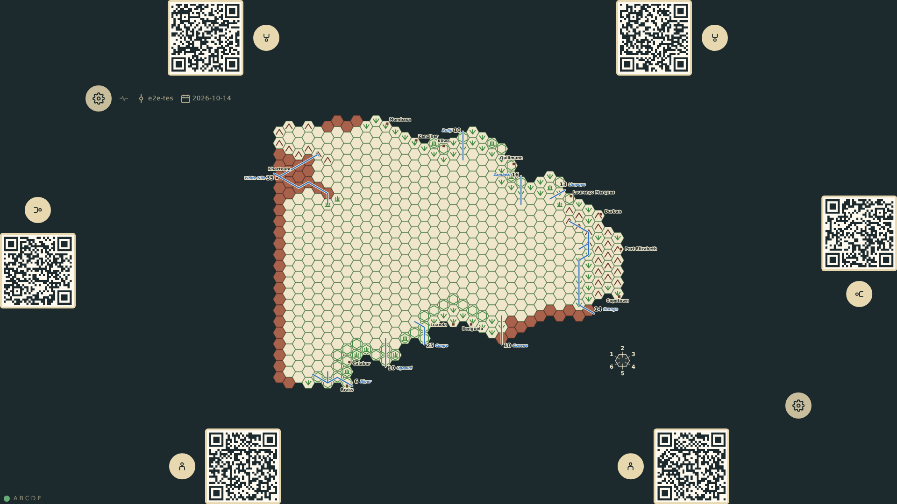
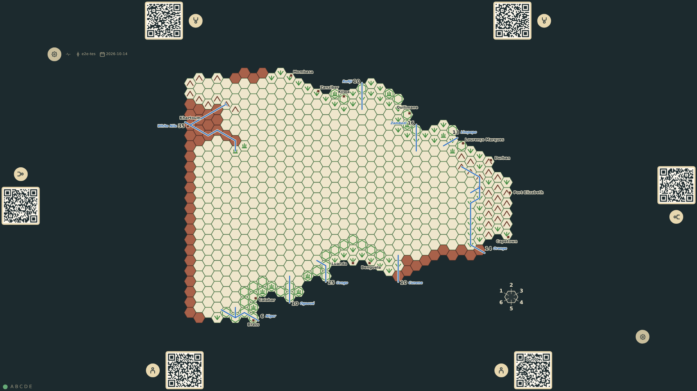
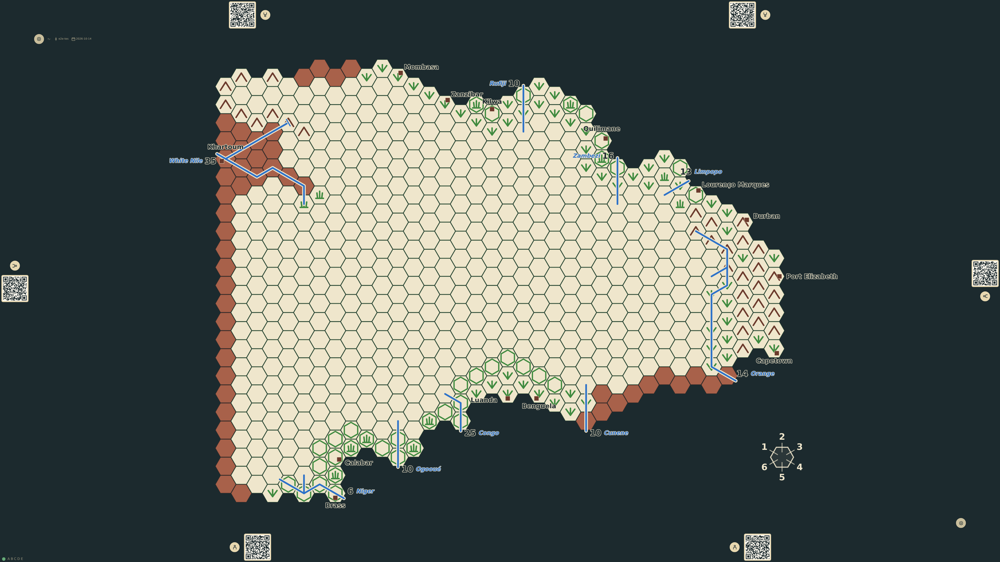
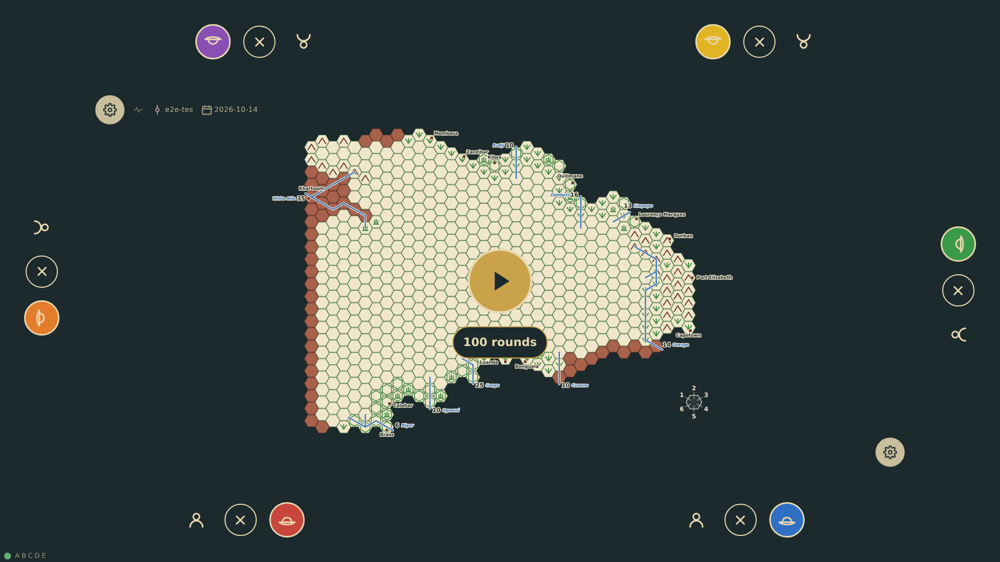
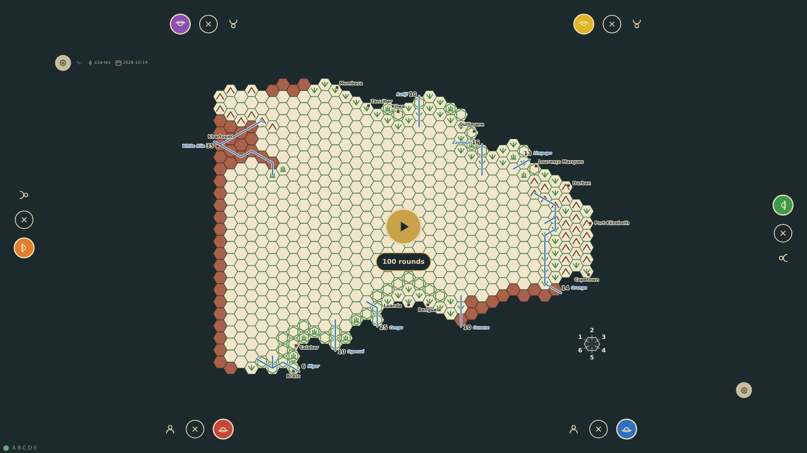
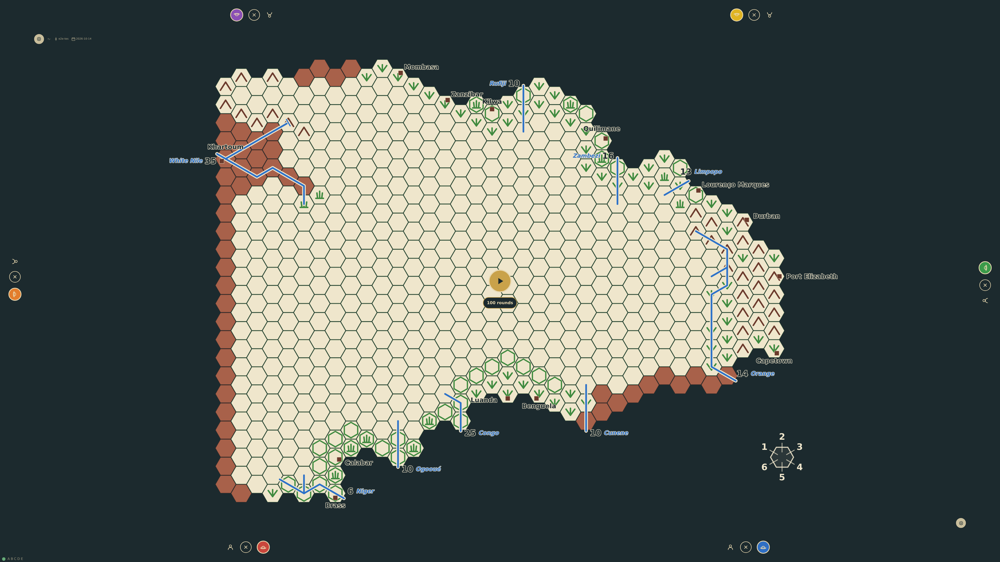
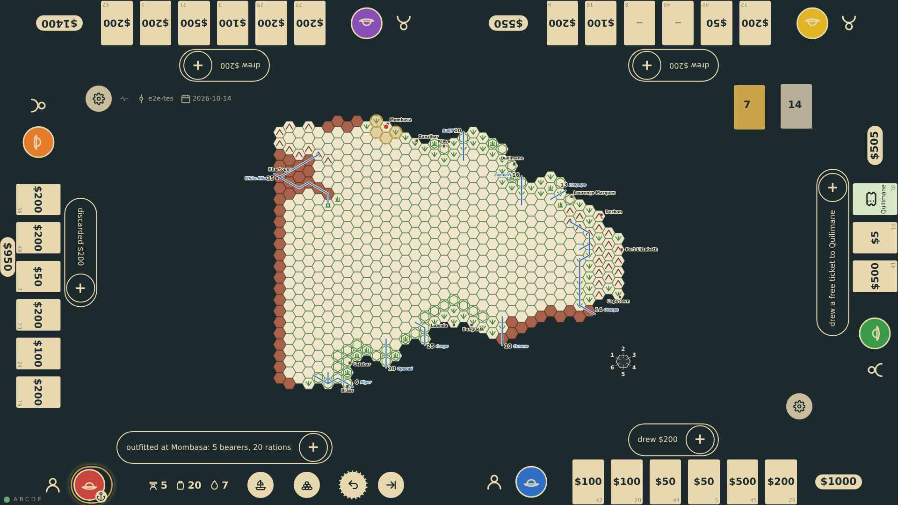
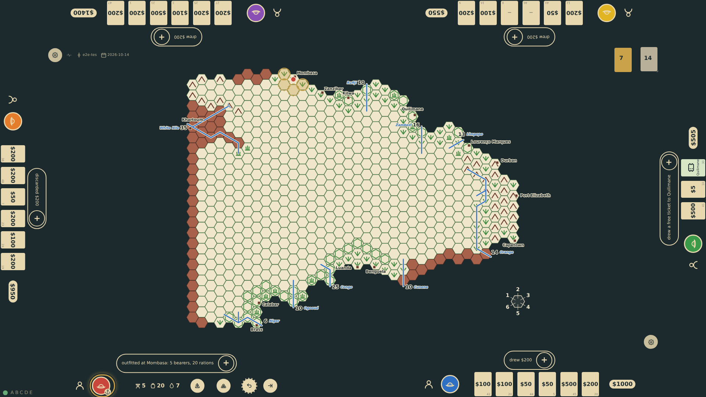
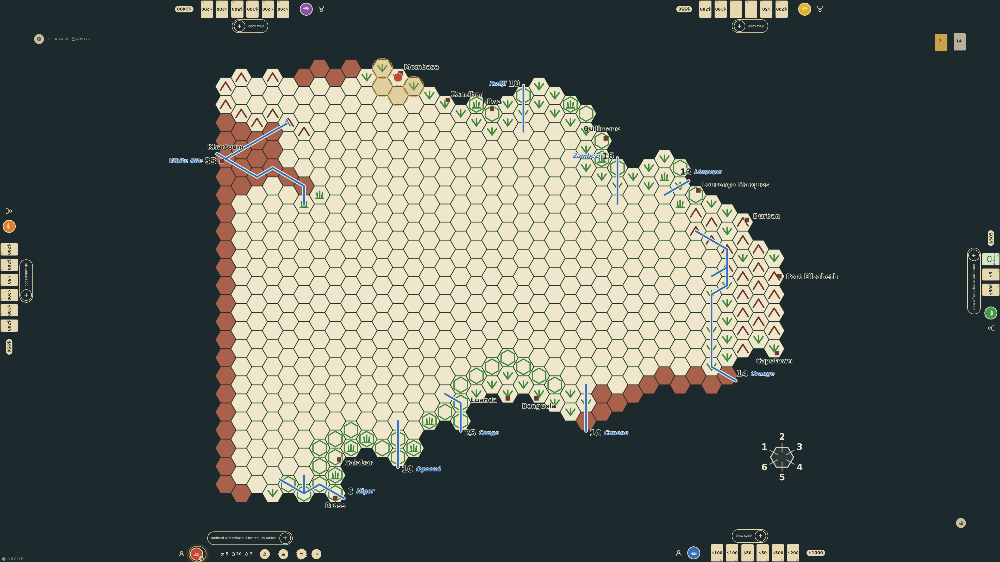

# Screen mockups

Pictures of the table's layout as the code draws it today, on three screen sizes, for talking about the layout without starting the game. They are taken from the E2E build by `tests/mockups/screen-mockups.spec.ts`; this file is written by the same run. **Do not edit either by hand.**

The table cannot know its physical size, so each picture is taken with the screen's diagonal configured (`?diag=`, [tabletop-ux.md](tabletop-ux.md)): a touch target is 12 mm and never under 44 px, and the rails, cards and panels follow from it. The same 1920 × 1080 pixels are therefore laid out differently at 17" and 27".

| Screen | Stands for |
|---|---|
| 17" | a 17" laptop or portable monitor, 1920 × 1080 |
| 27" | a 27" monitor laid flat, 1920 × 1080 |
| 55" | a 55" table, 3840 × 2160 |

## Regenerating

Regenerate the pictures **whenever the screen layout changes**: the board's place or size, the rails and what stands on them, the seats, the start control, the options gears, the status line, the compass, the dice tray's corner, the sizes that follow from the diagonal. A change that only moves a panel that opens during play (a prompt, a chart being filled in) does not show here and needs no new pictures.

```sh
nix develop --command bun run docs:mockups
```

That builds the E2E client, plays the opening of scenario 032 on each screen size and writes `docs/screen-mockups/*.png` and this file. The local relay must not be running on port 3001 (the run starts its own, as the scenarios do). Then look at every picture that changed (`git status docs/screen-mockups`), and commit them with the change that moved the layout. The run is not part of `bun run verify:change`: the scenarios' own baselines guard the layout, these pictures only show it.

To add a screen size or another screen, add a line to `SCREENS` or `SHOTS` in the spec and run it again.

## The start screen

The table as it opens: the board, a rail at each of the six seats with its player icon and the QR code that seats a phone, the gears for the options at two corners.

### The start screen at 17"



### The start screen at 27"



### The start screen at 55"



## Ready to start

Every seat taken and its explorer commissioned: the start control in the middle of the board with the length of the game beneath it.

### Ready to start at 17"



### Ready to start at 27"



### Ready to start at 55"



## The game screen

A game under way in round 3: bottom-1 has landed at Mombasa and outfitted, its chart at its rail and the hexes it may step into marked on the board; the other five explorers wait in Europe with their hands and funds at their rails.

### The game screen at 17"



### The game screen at 27"



### The game screen at 55"


