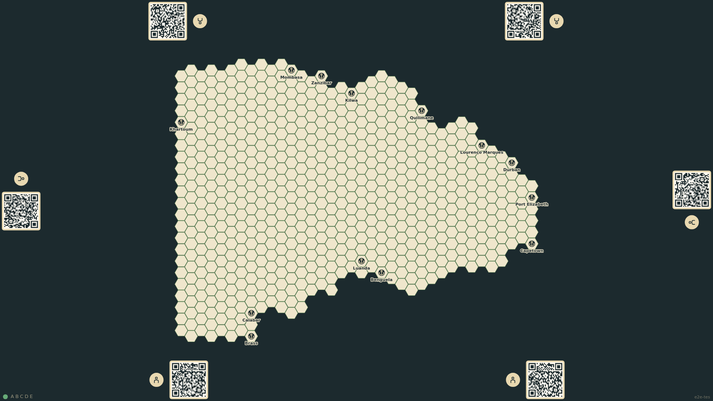
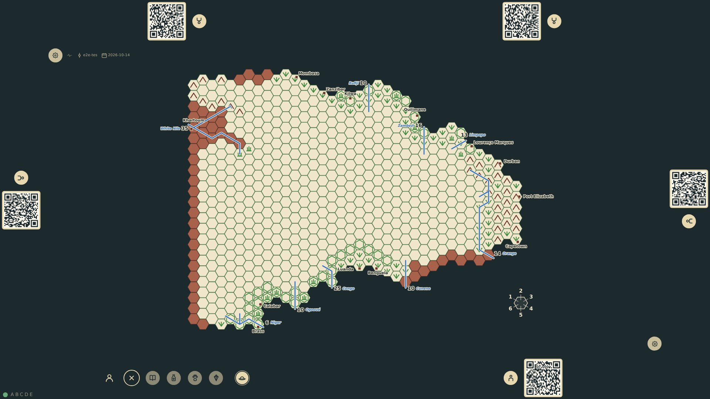

# App shell and seats

The table opens with six seats: two on each long edge, one on each short edge. A player at the bottom edge takes a seat; the rail shows them, faces them, and is still there after the table reloads. Before the game starts the player icon gives the seat up again, as does the cancel beside it (prompt 63).

_Generated by the test step helper from `001-app-shell-and-seats.spec.ts`. Do not edit by hand._

## 1. The table shows six empty seats around the board

**Player**

**Verifications:**

- [x] Six seat rails are visible: two on each long edge, one on each short edge
- [x] Every seat offers a join control and none is taken
- [x] The pinned room code is shown, and the status line beside the north-west gear reads the build's short git id and date, no capture server, and no update waiting
- [x] The game was created with the seed from the URL

## 2. The bottom seat is taken and its rail faces the player

**Player**

**Verifications:**

- [x] The bottom rail is marked taken and shows the player icon
- [x] The other five seats are still free
- [x] The bottom rail is upright (0°) and the top rail is turned around (180°)
- [x] The state records the occupant of bottom-1 and no diagnostics

## 3. A tap on the player icon gives the seat up, and a tap on the join control takes it again: beside the player icon stands a cancel that gives it up too

**Player**

**Verifications:**

- [x] The seat was given up and taken again: the stream reads taken, left, taken
- [x] The player icon is a control that gives the seat up, with a touch-sized cancel to its right

## 4. After a reload the same game and the taken seat are restored

**Player**

**Verifications:**

- [x] The same room code is shown and the one-shot URL parameters are gone
- [x] The bottom seat is still taken
- [x] The event stream was replayed, not recreated
