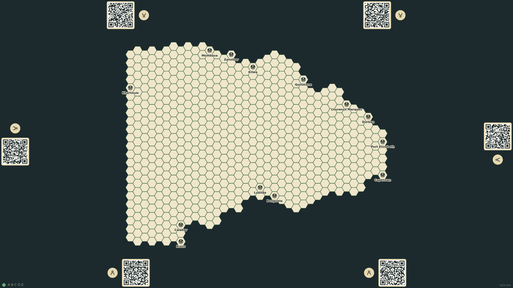
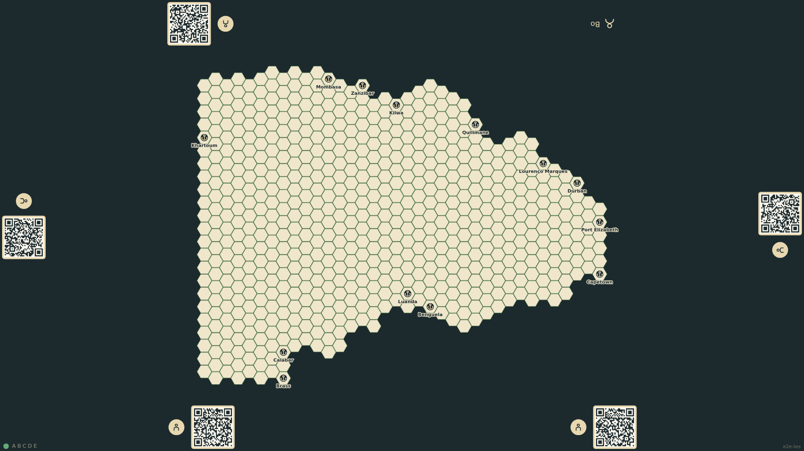
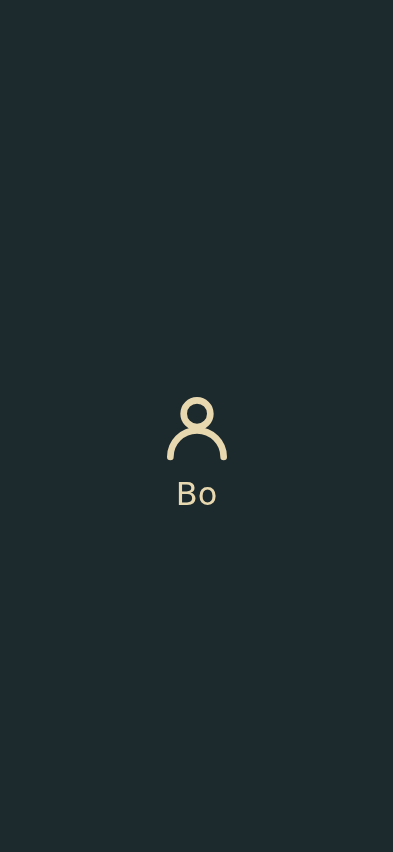

# Phone takes a seat

The table shows a QR code at each empty seat. A phone opens the top seat’s link, takes the seat through the relay, and shows that seat’s private view while the table shows only the public rail.

_Generated by the test step helper from `002-phone-takes-a-seat.spec.ts`. Do not edit by hand._

## 1. Every empty seat shows a QR code linking to its hand page

**Table**

**Verifications:**

- [x] Six QR links are shown
- [x] The top seat QR links to the hand page for session ABCDE and seat top-1

## 2. The phone takes the top seat automatically and shows its private view

**Phone**

**Verifications:**

- [x] The phone shows the private section for seat top-1 with the chosen name

## 3. The table shows the top seat taken, facing the top edge, with no private content

**Table**

**Verifications:**

- [x] The top rail is taken and its QR is gone
- [x] The occupant is the phone, not the table
- [x] The other five seats still offer QR codes

## 4. After a reload the phone is still seated without re-entering a name

**Phone**

**Verifications:**

- [x] The private view is shown again for the same name
