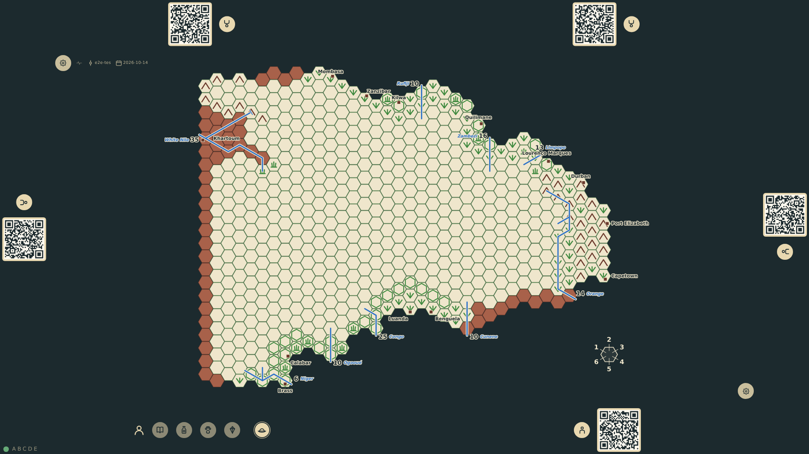

# Africa board and six seats

The table opens with the hex map of Africa in the centre, the thirteen ports of entry marked, and six seat rails around it. A player at the bottom edge takes a seat; the board is unchanged and everything survives a reload.

_Generated by the test step helper from `003-africa-board-and-six-seats.spec.ts`. Do not edit by hand._

## 1. The hex map of Africa fills the table between six empty seats

**Player**

**Verifications:**

- [x] The hex grid is drawn inside the board with every land hex of the manifest
- [x] 450 hexes are blank; the map is turned so north points to the left edge
- [x] The thirteen ports of entry are marked
- [x] Six seat rails with six join controls and no seat taken
- [x] The room code is shown

## 2. The first bottom seat is taken; every rail faces its own edge and the board is unchanged

**Player**

**Verifications:**

- [x] bottom-1 is taken and five join controls remain
- [x] Rails are rotated toward their edges: bottom 0°, left 90°, top 180°, right 270°
- [x] The two bottom rails sit side by side along the bottom edge
- [x] The board still shows every land hex and port

## 3. After a reload the same game, board and taken seat are restored

**Player**

**Verifications:**

- [x] The same room code is shown and the one-shot URL parameters are gone
- [x] bottom-1 is still taken and the grid is present
- [x] The event stream was replayed, not recreated
