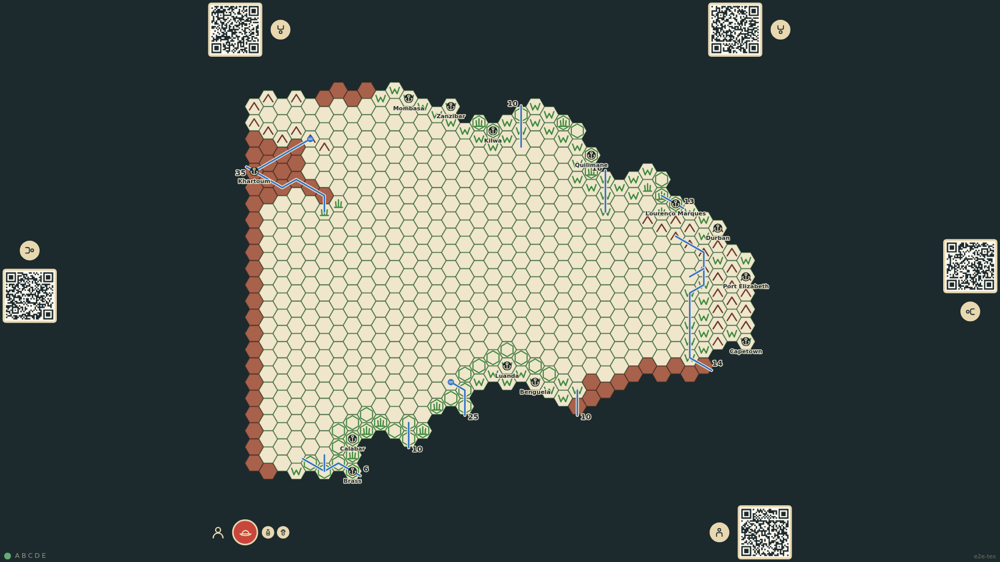
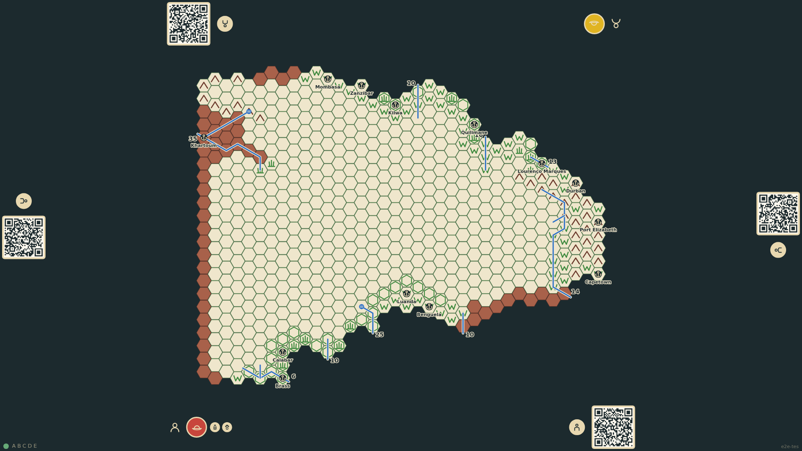

# Commission an explorer

After taking a seat, the rail offers the four specialties of the rules (evangelism, medicine, zoology, geology) and a confirm control. Confirming puts an explorer token in the seat colour on the rail, in Europe, with a badge per specialty. A second seat commissions an ordinary explorer with no specialties; its rail faces its own edge.

_Generated by the test step helper from `005-commission-an-explorer.spec.ts`. Do not edit by hand._

## 1. The taken bottom seat offers the specialty toggles and a confirm; no other rail does

**Player**

**Verifications:**

- [x] Four specialty toggles and a commission control are shown at bottom-1 only
- [x] The setup faces the bottom seat (0°) and no explorer exists yet

## 2. A doctor-zoologist explorer is commissioned: a token in the seat colour with two badges replaces the setup

**Player**

**Verifications:**

- [x] The explorer token is on the bottom rail with medicine and zoology badges, in Europe
- [x] The state holds one explorer with the specialties in canonical order and no diagnostics

## 3. The top seat commissions an ordinary explorer with no badges; its token faces the top edge

**Player**

**Verifications:**

- [x] An ordinary explorer token with no badges sits on the top rail, rotated 180°
- [x] Two explorers exist and the stream is game/created, two seats, two commissions
