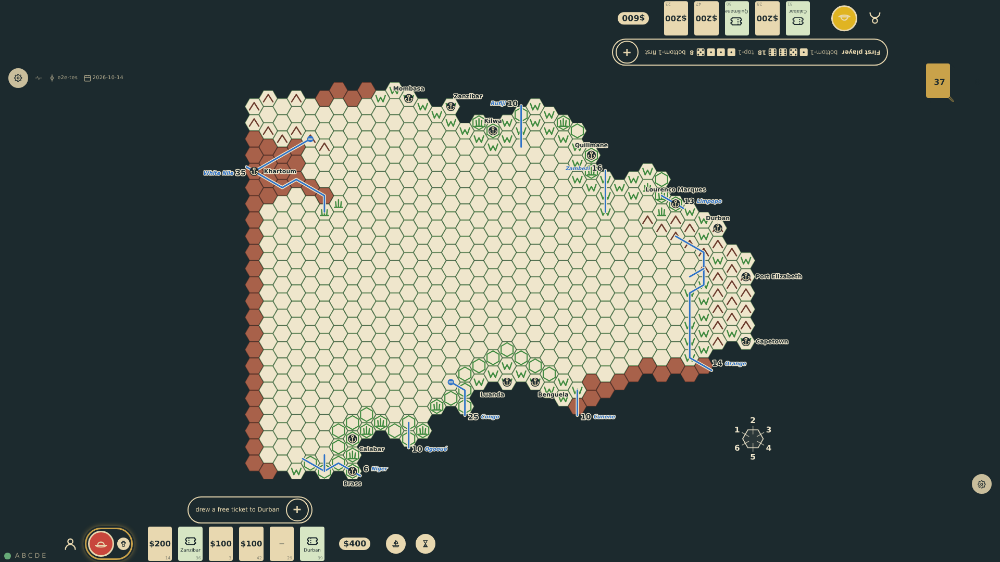

# First player and donations

With explorers commissioned, a start control appears on the board. Starting rolls four dice for each explorer in plain view, marks the high roller as first player, shuffles the deck from the game seed and deals five donation cards face up to each rail. The draw and discard piles sit on the board.

_Generated by the test step helper from `006-first-player-and-donations.spec.ts`. Do not edit by hand._

## 1. Two explorers are commissioned and the start control is offered on the board

**Player**

**Verifications:**

- [x] The start control is visible and no cards or piles exist yet

## 2. Both explorers rolled four dice and each roll stands in front of its own station: the four dice and the total, the winner's glowing as first player; the table stands still for a few seconds before play begins; under each roll the five cards dealt stand in full, the donation large and the disaster it would be in Africa beneath, with a control to take them

**Player**

**Verifications:**

- [x] Each station shows its own roll, the winner's marked and glowing, under a scrim; the turn is decided but the game is held at the roll
- [x] Each station shows the five cards dealt in full, one per card in the hand, waiting to be taken (prompt 44)

## 3. Play begins: the stations clear, and the roll is one line in every seat's log, each seat's four dice and total and who goes first: the seat that waits has it as its latest line, the high roller has already drawn and keeps it behind that line; each rail shows five face-up cards; the piles are on the board

**Player**

**Verifications:**

- [x] The same roll line is the first of each seat's log, both seats' dice and totals and the winner named, at the rail for the waiting seat and behind the draw for the first player
- [x] The turn marker sits at the seat whose final roll was higher
- [x] Each explorer was dealt five face-up donation cards; the first player has already drawn a sixth; the draw pile holds the other 37
- [x] Every card is one of the 48 and no card is in two places

## 4. After the pause the cards still wait at both edges, the first player's with the sixth card its turn drew; a tap on Take at each edge puts them away, a cards/seen event a seat, and the hands stay at the rails

**Player**

**Verifications:**

- [x] Both panels are gone, two cards/seen events were recorded, nothing waits, and the hands are five and six at the rails

## 5. After a reload the same roll-off, the same hands and the same first player are restored from the seed

**Player**

**Verifications:**

- [x] Hands, deck order, roll-off and turn are identical to before the reload
- [x] The stream replayed: game/created, two seats and commissions, game/started, game/begun, and the cards taken at each seat
