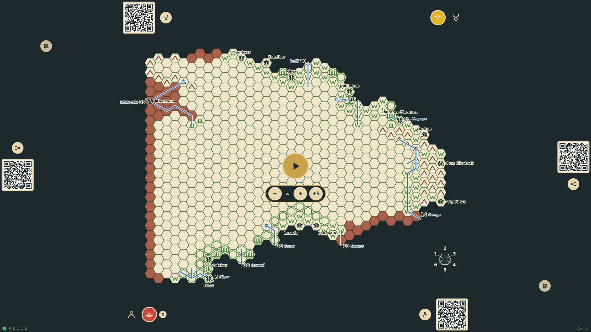
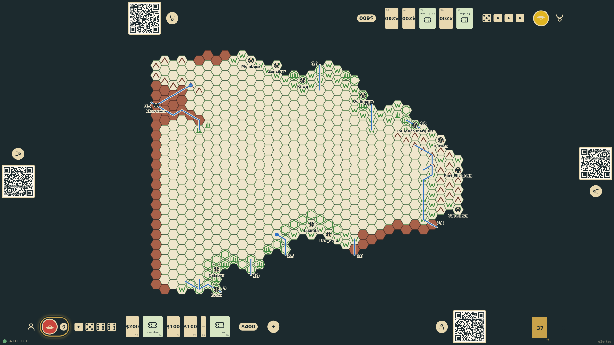

# First player and donations

With explorers commissioned, a start control appears on the board. Starting rolls four dice for each explorer in plain view, marks the high roller as first player, shuffles the deck from the game seed and deals five donation cards face up to each rail. The draw and discard piles sit on the board.

_Generated by the test step helper from `006-first-player-and-donations.spec.ts`. Do not edit by hand._

## 1. Two explorers are commissioned and the start control is offered on the board

**Player**

**Verifications:**

- [x] The start control is visible and no cards or piles exist yet

## 2. Both explorers rolled four dice; the high roller holds the turn marker; each rail shows five face-up cards; the piles are on the board

**Player**

**Verifications:**

- [x] Four dice are shown at each explorer's rail with their total
- [x] The turn marker sits at the seat whose final roll was higher
- [x] Each explorer was dealt five face-up donation cards; the first player has already drawn a sixth; the draw pile holds the other 37
- [x] Every card is one of the 48 and no card is in two places

## 3. After a reload the same roll-off, the same hands and the same first player are restored from the seed

**Player**

**Verifications:**

- [x] Hands, deck order, roll-off and turn are identical to before the reload
- [x] The stream replayed: game/created, two seats and commissions, game/started
