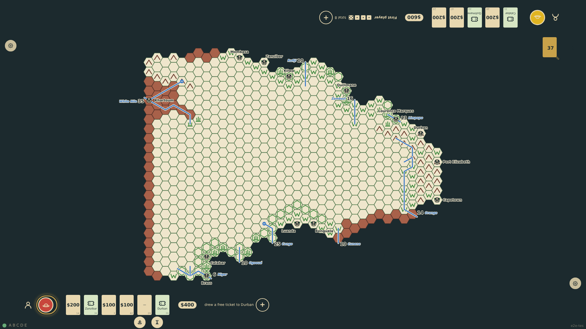
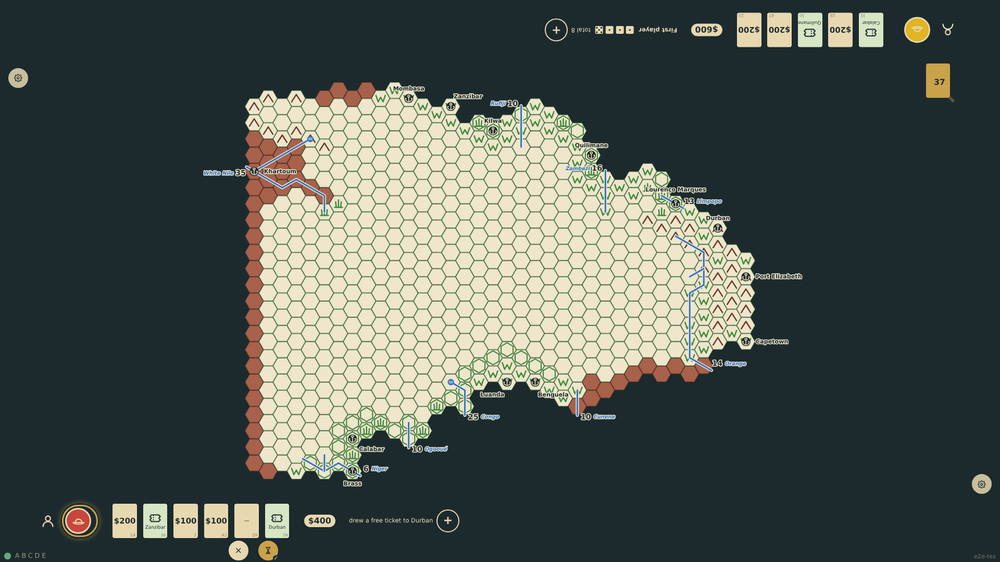
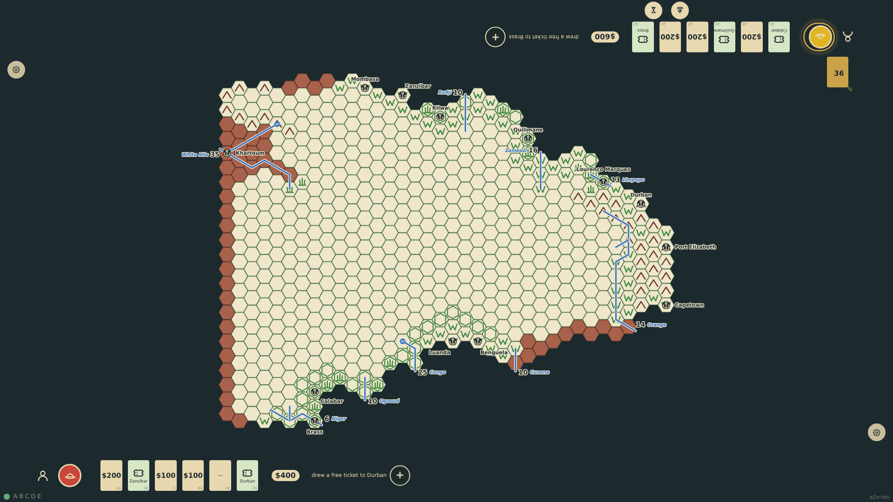
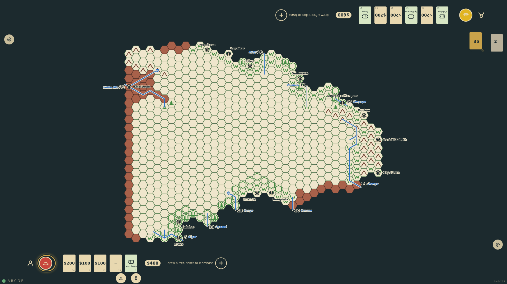
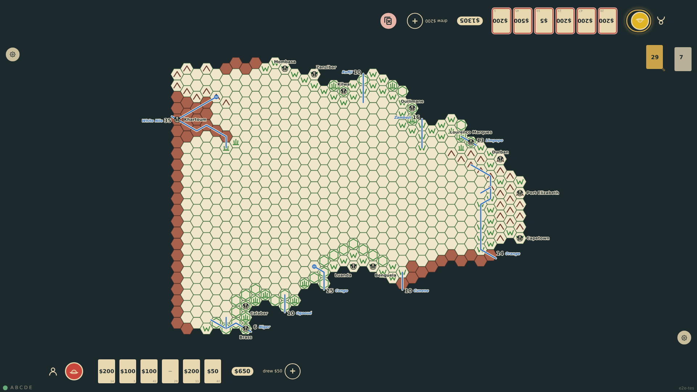
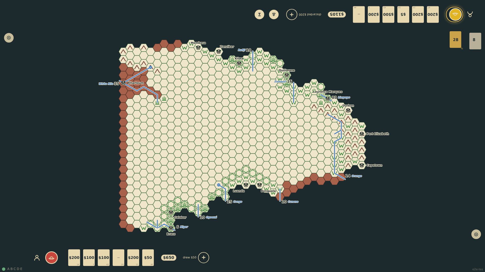

# A turn in Europe

Each turn an explorer stays in Europe: expired free tickets are discarded, a hand above five must be trimmed by tapping cards, then one card is drawn. The current seat alone shows the hourglass that ends the turn (to wait is the other choice besides sailing); a tap puts the check mark on the hourglass itself with the "✕" to its left, in the ship's place, and the turn passes clockwise once confirmed. Money raised is totalled at each rail.

_Generated by the test step helper from `007-a-turn-in-europe.spec.ts`. Do not edit by hand._

## 1. The first player has drawn a sixth card as the turn begins; only that seat shows the ship and the hourglass, and a money total; the roll for first player is the other seat's latest line

**Player**

**Verifications:**

- [x] The current seat holds six cards and the other five; the draw pile is 37
- [x] The hourglass is offered at the current seat only, and no discard is pending
- [x] The first player's latest line is the card drawn; the other seat's is its roll for first player, with four dice and no dice at the rail besides
- [x] Each rail totals the money in its hand

## 2. A tap on the hourglass: the check mark overlays the hourglass where it stands, and the ship's place to its left holds the "✕" that keeps the turn going

**Player**

**Verifications:**

- [x] The confirmation is on the hourglass and the cancel sits to its left, where the ship was

## 3. After confirming, the turn marker moved clockwise; the next explorer drew a card, which is now its latest line; the roll for first player stays in the log behind it

**Player**

**Verifications:**

- [x] The second seat is current and has drawn to six; the first keeps six
- [x] No roll for first player is at either rail now; the hourglass moved with the marker

## 4. Round two: the first player's unused free tickets from the deal were discarded before drawing

**Player**

**Verifications:**

- [x] It is round 2 at the first seat; the opening tickets are in the discard pile and not in the hand

## 5. A seat starts its turn with six cards: it must tap a card to discard before it can draw or end the turn

**Player**

**Verifications:**

- [x] The discard prompt is shown, the cards are tappable, and the end-turn control is withheld

## 6. The chosen card went to the discard pile, a card was drawn, and the turn may now end

**Player**

**Verifications:**

- [x] The hand is back to six with the chosen card gone and a new one drawn; the end-turn control is back
