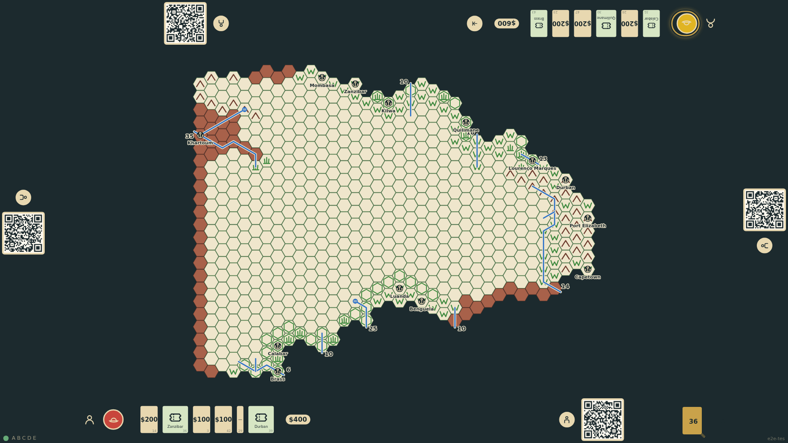
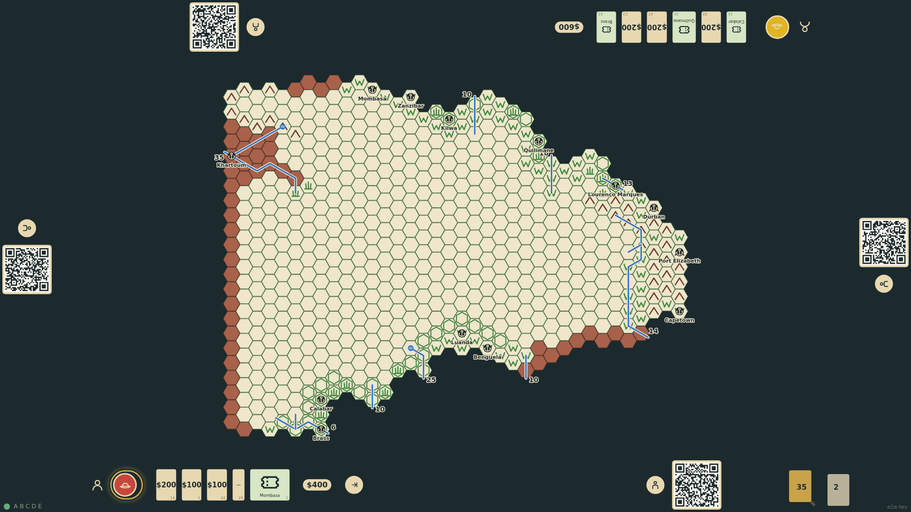
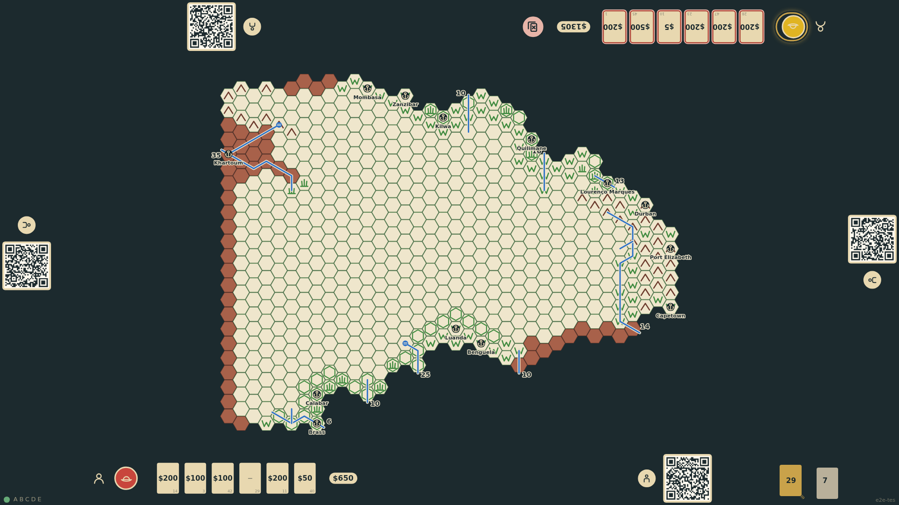
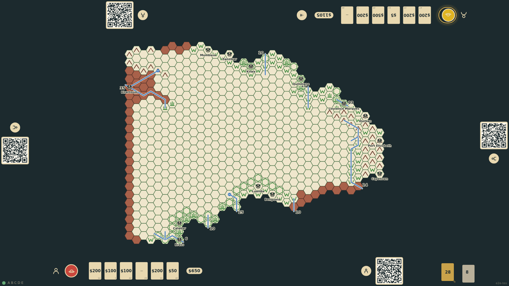

# A turn in Europe

Each turn an explorer stays in Europe: expired free tickets are discarded, a hand above five must be trimmed by tapping cards, then one card is drawn. The current seat alone shows an end-turn control that asks for confirmation at its edge, and the turn passes clockwise. Money raised is totalled at each rail.

_Generated by the test step helper from `007-a-turn-in-europe.spec.ts`. Do not edit by hand._

## 1. The first player has drawn a sixth card as the turn begins; only that seat shows an end-turn control and a money total

**Player**

**Verifications:**

- [x] The current seat holds six cards and the other five; the draw pile is 37
- [x] The end-turn control is offered at the current seat only, and no discard is pending
- [x] Each rail totals the money in its hand

## 2. After confirming, the turn marker moved clockwise; the next explorer drew a card; the roll-off dice are gone

**Player**

**Verifications:**

- [x] The second seat is current and has drawn to six; the first keeps six
- [x] The roll-off dice are no longer shown and the end-turn control moved with the marker

## 3. Round two: the first player's unused free tickets from the deal were discarded before drawing

**Player**

**Verifications:**

- [x] It is round 2 at the first seat; the opening tickets are in the discard pile and not in the hand

## 4. A seat starts its turn with six cards: it must tap a card to discard before it can draw or end the turn

**Player**

**Verifications:**

- [x] The discard prompt is shown, the cards are tappable, and the end-turn control is withheld

## 5. The chosen card went to the discard pile, a card was drawn, and the turn may now end

**Player**

**Verifications:**

- [x] The hand is back to six with the chosen card gone and a new one drawn; the end-turn control is back
