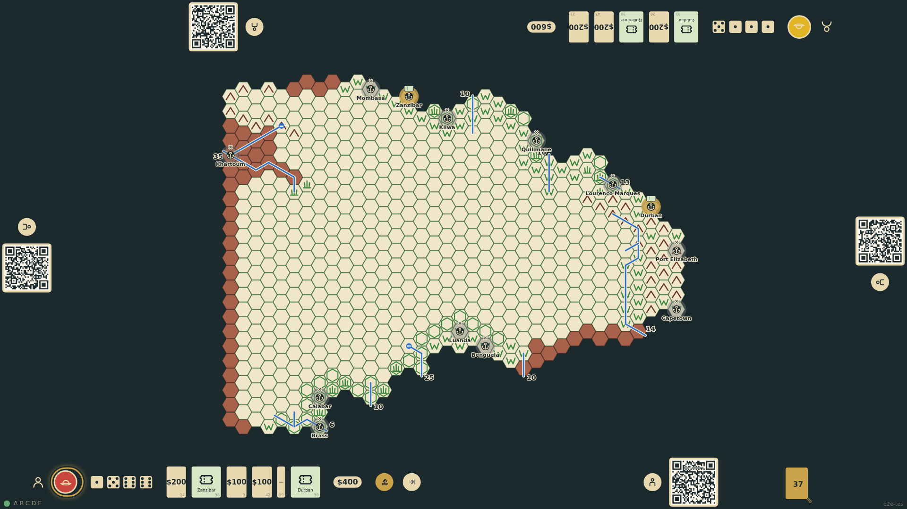
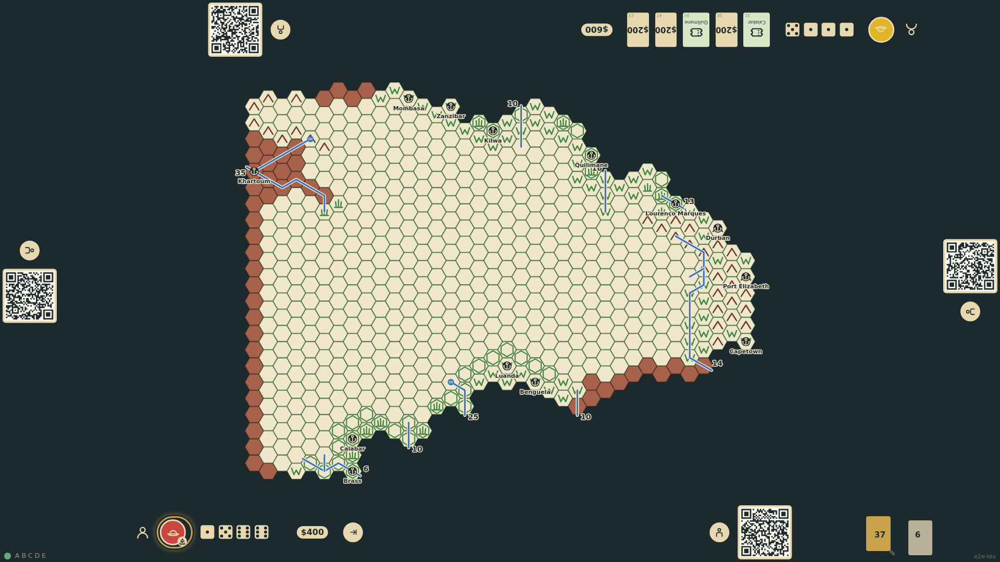
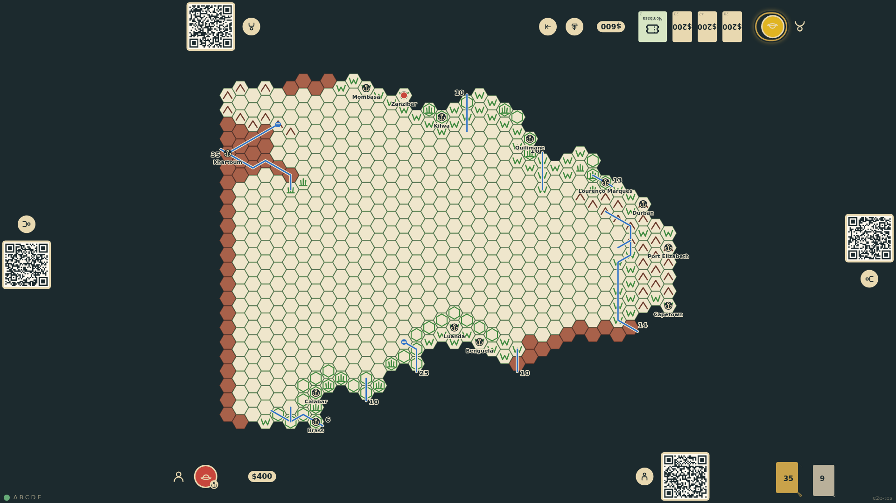

# Sail to Africa

In Europe the current seat offers a sail control. It turns the thirteen ports on the map into a chooser: a port the explorer holds a free ticket for shows the ticket, the others show the $500 fare, and ports the explorer cannot afford are greyed out. Choosing one turns the whole hand into the expedition budget (less the fare), puts the explorer at sea, and after one skipped turn the token lands on the port hex.

_Generated by the test step helper from `008-sail-to-africa.spec.ts`. Do not edit by hand._

## 1. The sail control opens the port chooser on the map: tickets, fares and unaffordable ports are marked

**Player**

**Verifications:**

- [x] All thirteen ports became choosable
- [x] A port the explorer holds a ticket for shows the ticket; Mombasa shows the $500 fare if affordable

## 2. Passage is booked with the ticket: the explorer is at sea, the hand became the budget, the chooser closed

**Player**

**Verifications:**

- [x] The rail token shows the explorer at sea and the budget equals the money raised (no fare with a ticket)
- [x] The chooser is closed, the sail control is gone, and the hand went to the discard pile

## 3. After the skipped turn at sea the explorer stands on the port hex and the turn has passed on

**Player**

**Verifications:**

- [x] The board shows the explorer token on the chosen port hex and the rail token says in port
- [x] The voyage turn was skipped: it is the second seat's turn again in round 2
