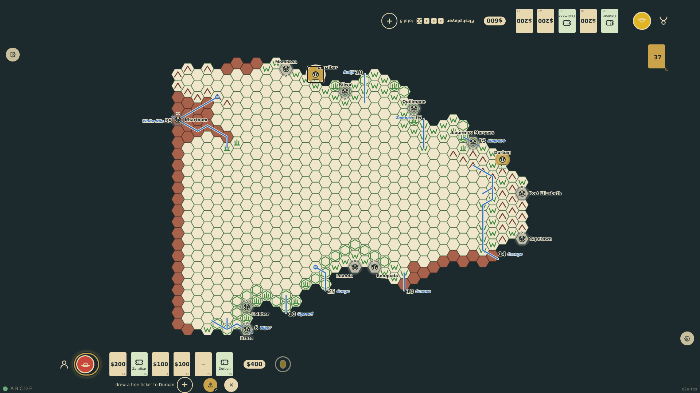
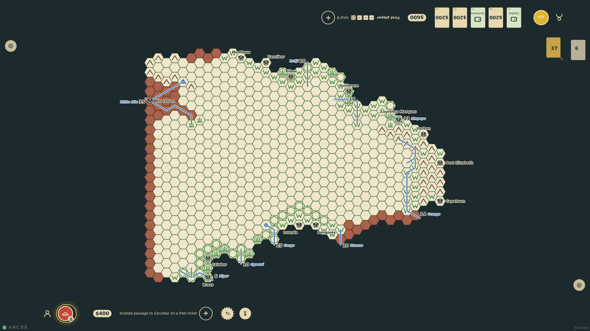
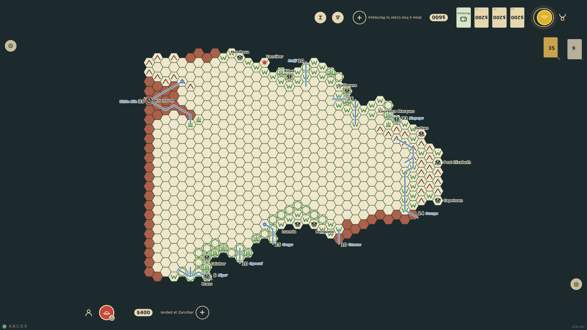

# Sail to Africa

In Europe the current seat offers a sail control. It turns the thirteen ports on the map into a chooser: a port the explorer holds a free ticket for shows the ticket, the others show the $500 fare, and ports the explorer cannot afford are greyed out. A tap on the ship puts the check mark on it with the "✕" to its right, in the hourglass's place; a tap on a port chooses it, and the check mark books: the whole hand becomes the expedition budget (less the fare), the explorer is at sea, and after one skipped turn the token lands on the port hex.

_Generated by the test step helper from `008-sail-to-africa.spec.ts`. Do not edit by hand._

## 1. The ship opens the port chooser on the map: tickets, fares and unaffordable ports are marked; the ship carries the check mark, not yet live, and the "✕" to its right would stay in Europe

**Player**

**Verifications:**

- [x] All thirteen ports became choosable
- [x] The check mark is on the ship but waits for a port; the "✕" is to its right, where the hourglass was
- [x] A port the explorer holds a ticket for shows the ticket; Mombasa shows the $500 fare if affordable

## 2. The ticket's port is tapped: it is marked on the map and the check mark on the ship is live; nothing is booked yet

**Player**

**Verifications:**

- [x] The chosen port is marked and the others are not; the confirmation is live; the explorer is still in Europe

## 3. The check mark books passage with the ticket: the explorer is at sea, the hand became the budget, the chooser closed

**Player**

**Verifications:**

- [x] The rail token shows the explorer at sea and the budget equals the money raised (no fare with a ticket)
- [x] The chooser is closed, the sail control is gone, and the hand went to the discard pile

## 4. After the skipped turn at sea the explorer stands on the port hex and the turn has passed on

**Player**

**Verifications:**

- [x] The board shows the explorer token on the chosen port hex and the rail token says in port
- [x] The voyage turn was skipped: it is the second seat's turn again in round 2
