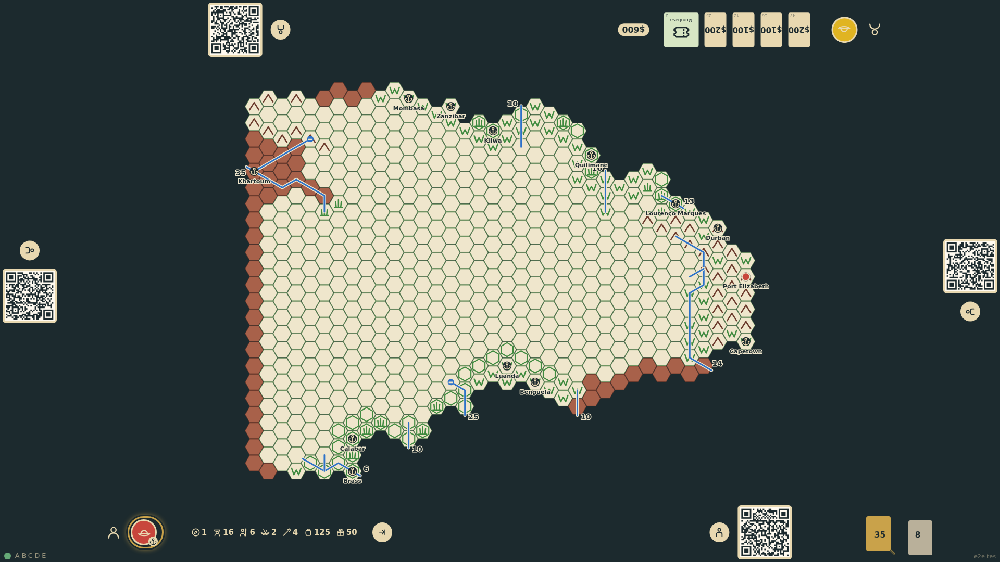

# Outfit the expedition

Landed at a port of entry, the current seat sees the Expedition Organization Chart as a panel at its edge: every item of the price list with −/+ controls, a ×1/×10 step, the running budget and a carrying summary. Horses are sold only at the Cape ports and camels only at Khartoum. Confirming forfeits the unspent money and the rail shows what the expedition has.

_Generated by the test step helper from `009-outfit-the-expedition.spec.ts`. Do not edit by hand._

## 1. At Port Elizabeth the outfitting panel faces the bottom seat: the price list, horses for sale, no camels, a $1100 budget

**Player**

**Verifications:**

- [x] The panel is at the bottom edge with all nine items; horses available, camels not
- [x] The budget shows $1100 and nothing is bought yet

## 2. The canoe-borne sample expedition is entered: $1000 spent, $100 left, 24 men with seats for 24 in two canoes

**Player**

**Verifications:**

- [x] Counts match the sample expedition and $100 of the budget is left
- [x] The carrying summary: 24 men, 179 load units, canoe seats for 24, not reduced to foot pace
- [x] An unaffordable purchase is refused by the control: a 21st askari would cost $50 more than is left

## 3. The expedition is set: the panel is gone, the unspent $100 is forfeited, and the rail lists what the expedition has

**Player**

**Verifications:**

- [x] The chart is recorded in the state and the budget is spent
- [x] The panel closed and the rail summary shows the counts
