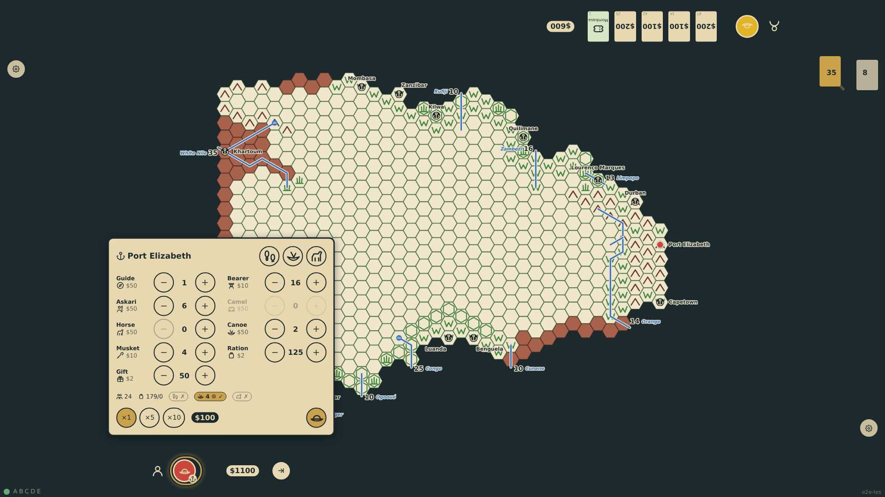
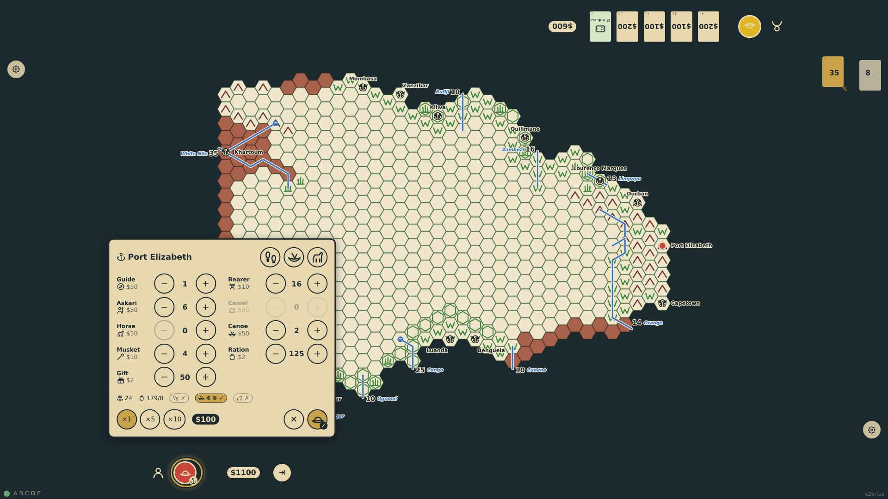
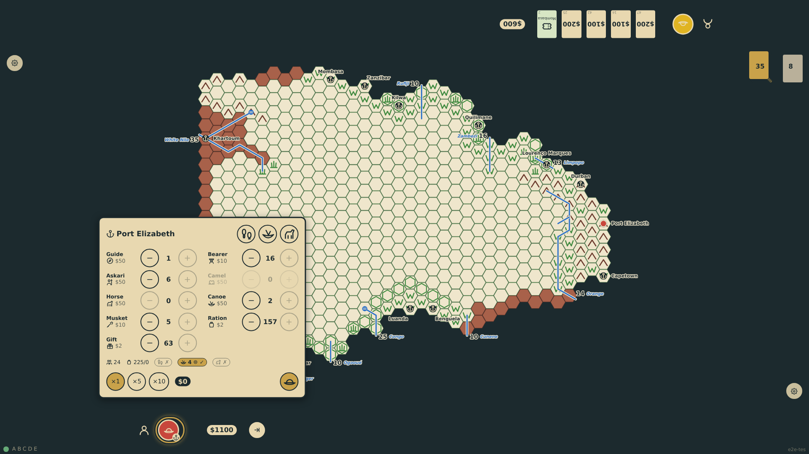

# Outfit the expedition

Landed at a port of entry, the current seat sees the Expedition Organization Chart as a panel at its edge, headed by the port: every item of the price list by name with −/+ controls, a ×1/×5/×10 step, the running budget, and a line that counts the people and says how the expedition could move (overland, by canoe at one to four hexes with a cataract mark when eight bearers can portage, mounted). Horses are sold only at the Cape ports and camels only at Khartoum. Three buttons spend the whole budget on the rules' sample expeditions. Done turns into a confirmation in place, which a tap anywhere else takes back; confirming forfeits the unspent money and the rail shows what the expedition has.

_Generated by the test step helper from `009-outfit-the-expedition.spec.ts`. Do not edit by hand._

## 1. At Port Elizabeth the outfitting panel faces the bottom seat: the port at its head with foot, canoe and horse outfits on offer, the price list by name, horses for sale and no camels, a $1100 budget, and an explorer alone who can only walk

**Player**

**Verifications:**

- [x] The panel is at the bottom edge, headed by the port, with all nine items named; horses available, camels not
- [x] Foot, canoe and horse outfits are offered (no camel outfit here) and the step is ×1 of ×1, ×5, ×10
- [x] The budget shows $1100 and nothing is bought yet: one person, who can walk but has no canoe and no mount

## 2. The canoe-borne sample expedition is entered with the ×1, ×5 and ×10 steps: $1000 spent, $100 left, 24 people who paddle four hexes a turn and can portage a cataract, but cannot walk (every bearer has a canoe on his shoulders) and cannot ride

**Player**

**Verifications:**

- [x] Counts match the sample expedition and $100 of the budget is left
- [x] The movement line: 24 people, 179 units to carry and nobody free to carry them overland; by canoe 4 hexes with a seat for everyone and eight bearers to portage; no mount
- [x] An unaffordable purchase is refused by the control: two more askaris take the last $100 and a third cannot be bought

## 3. Tapping done turns it into a confirmation in its place, a checkmark over the explorer, with a cancel to its left

**Player**

**Verifications:**

- [x] The confirmation stands where done was and the cancel is to its left
- [x] Nothing has been recorded yet

## 4. A tap on the port name took the confirmation back; the horse outfit then spends the whole $1100 like the rules' mounted sample: 13 horses for 8 people, who ride

**Player**

**Verifications:**

- [x] The mounted sample scaled to the budget: 13 horses, 4 askaris, a guide, 2 bearers, a musket, 24 gifts, 61 rations; nothing left
- [x] Eight people ride: the riders' horses carry five each and the two bearers lead the five spare horses with twenty each (140 for 86 units); they could also walk; no canoe

## 5. The canoe outfit spends the whole $1100 like the canoe-borne sample: two canoes seat 24, so the extra $100 goes on a musket, gifts and rations rather than a seventeenth bearer

**Player**

**Verifications:**

- [x] The canoe sample scaled to the budget: 2 canoes, 16 bearers, a guide, 6 askaris, 5 muskets, 63 gifts, 157 rations; nothing left
- [x] By canoe at four hexes with a cataract portage; not overland, not mounted

## 6. The expedition is set: the panel is gone, the budget is spent to the dollar, and the rail lists what the expedition has

**Player**

**Verifications:**

- [x] The chart is recorded in the state and the budget is spent
- [x] The panel closed and the rail summary shows the counts
