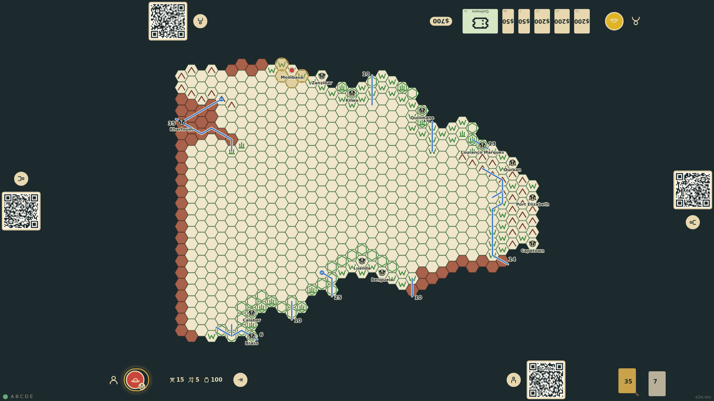
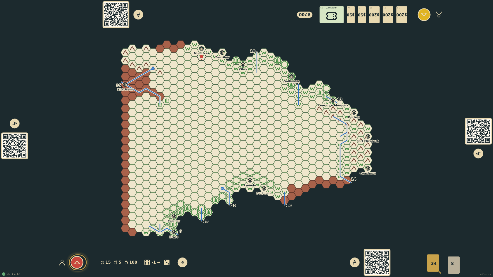
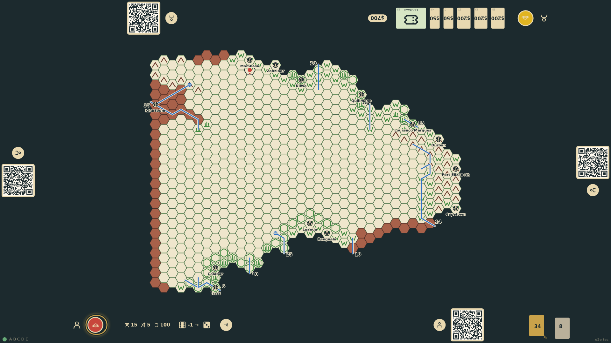

# First step into the unknown

Standing at a port, the expedition may step into one adjacent hex. Known hexes are plain targets; blank ones are dashed, because entering one risks becoming lost. The lost check is rolled as dice at the rail with the modifier for the terrain being left. A lost expedition stays put for the turn. On success the hex's terrain is generated from the neighbours or the random table, drawn on the board, and the seat's marker is placed on it.

_Generated by the test step helper from `010-first-step-into-the-unknown.spec.ts`. Do not edit by hand._

## 1. Outfitted at Mombasa, the expedition sees its four adjacent hexes as targets: two known veldt, two blank and dashed

**Player**

**Verifications:**

- [x] Four move targets: the two blank hexes to the west are marked unknown, the two veldt hexes are not
- [x] No roll has been made and no hex is mapped yet

## 2. The lost check is rolled at the rail with the veldt modifier: the expedition is lost and stays at Mombasa

**Player**

**Verifications:**

- [x] The lost-check dice show a total of zero or less and the lost badge appears
- [x] The token is still at Mombasa, nothing was mapped, and no further move is offered this turn

## 3. Next turn the expedition finds the way: the hex is generated as veldt like its neighbour, drawn, marked, and entered

**Player**

**Verifications:**

- [x] The lost check succeeded and a terrain roll followed
- [x] The hex shows veldt with the bottom seat's marker and the token stands on it

## 4. After a reload the generated hex, the marker, the token and the rolls are all restored from the stream

**Player**

**Verifications:**

- [x] Map, explorer and this turn's roll log are identical
