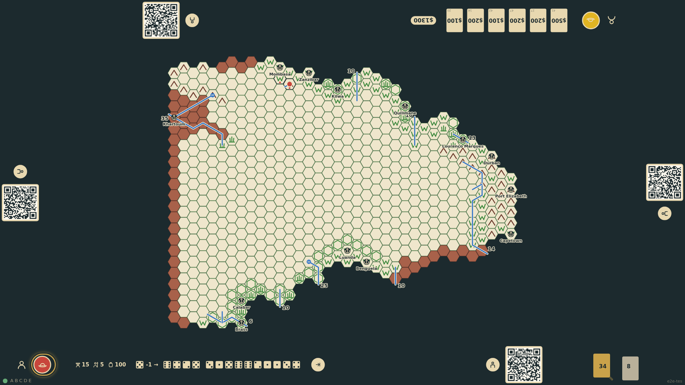
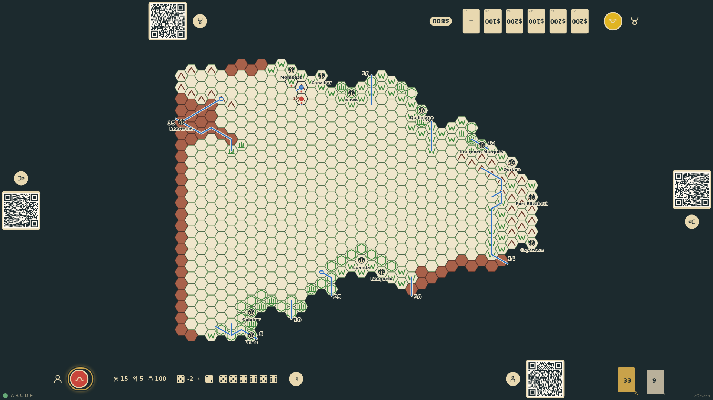
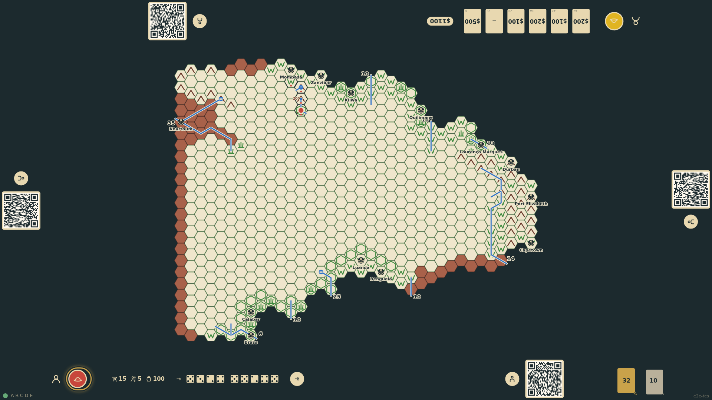

# Rivers, oases and cataracts

After the basic terrain, a mapped hex is checked for water: with no rivers around, an even roll and a direction into the unexplored make a river source (an oasis in desert); a river known to flow in continues out through a rolled exit; cataracts are rolled whenever a river is mapped, with a four-dice waterfall height recorded from 400 ft; mountains roll a peak height recorded over 15,000 ft.

_Generated by the test step helper from `011-rivers-and-oases.spec.ts`. Do not edit by hand._

## 1. c23r13 is mapped: a river rises there, flows north-west into the unexplored, and has a cataract

**Player**

**Verifications:**

- [x] The water roll reports a source flowing in direction 6 with a cataract, and the board draws it
- [x] The state records the course; the waterfall is under 400 ft so no height is shown

## 2. c22r13 is a mountain hex: three dice give a 20,000 ft peak, recorded in brown; another source rises here

**Player**

**Verifications:**

- [x] The peak height is recorded on the board and in the state

## 3. c21r13 lies where the river was flowing: it arrives from the east and a rolled exit carries it on south-west

**Player**

**Verifications:**

- [x] The course enters from direction 2 and leaves by direction 4; the lost check noted the river
- [x] Three hexes are mapped and marked, all replayable from the seed
