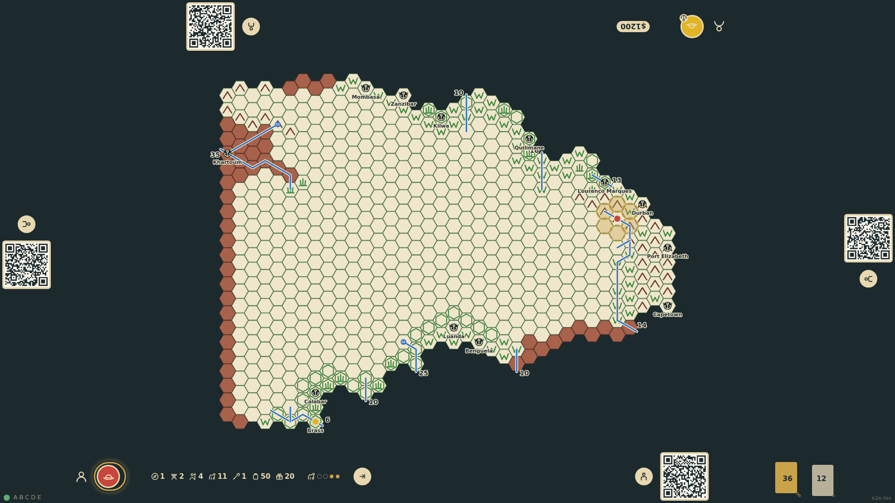
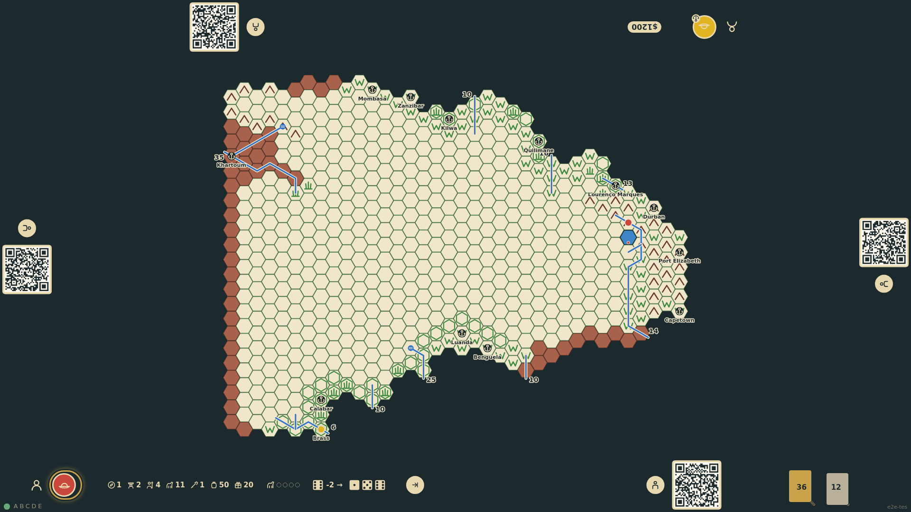
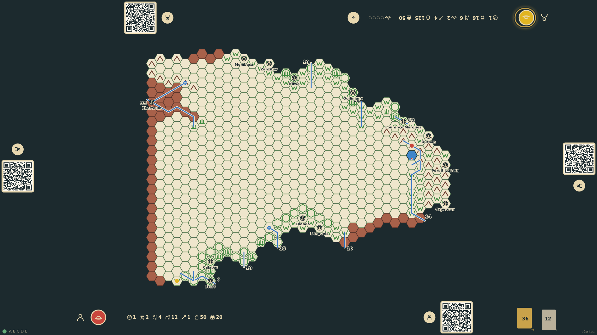

# Movement rates

The expedition's mode of travel is fixed by its first step each turn and sets a budget of movement points shown as pips at the rail: two on foot, four mounted, up to four by canoe with eight paddlers per canoe. A known hex costs one point; an unknown hex costs the mode's unknown rate (two mounted). A hex that turns out to be impassable for the mode is mapped and claimed, but the expedition turns back. Canoes must follow rivers, lakes, swamps or the coast. Walking two known hexes is proven by the unit tests.

_Generated by the test step helper from `012-movement-rates.spec.ts`. Do not edit by hand._

## 1. Riding from Durban, the expedition has crossed two known hexes: the rail shows two of four movement points left, and the blank hex ahead costs both

**Player**

**Verifications:**

- [x] The movement pips at the rail show mounted with 2 of 4 points left
- [x] Known neighbours cost one point, the blank hex to the north-west costs two
- [x] The state records the budget and no roll has been made for the known hexes

## 2. The blank hex is entered: the lost check succeeds, the terrain table gives a lake, which horses cannot enter, so the hex is mapped and claimed but the expedition turns back and its movement is over

**Player**

**Verifications:**

- [x] The rail shows the lost check, the terrain roll and the turning back, in that order
- [x] The lake is drawn with the bottom seat's marker; the token stays on c16r32 and no target is offered

## 3. The top seat's canoes, with eight paddlers each, go four known hexes in one turn: up the Niger and then along the coast, never onto dry land

**Player**

**Verifications:**

- [x] The top rail shows canoe movement with all four points spent
- [x] The token stands on c2r4 after four steps, with no roll (all hexes were pre-printed) and no further target
