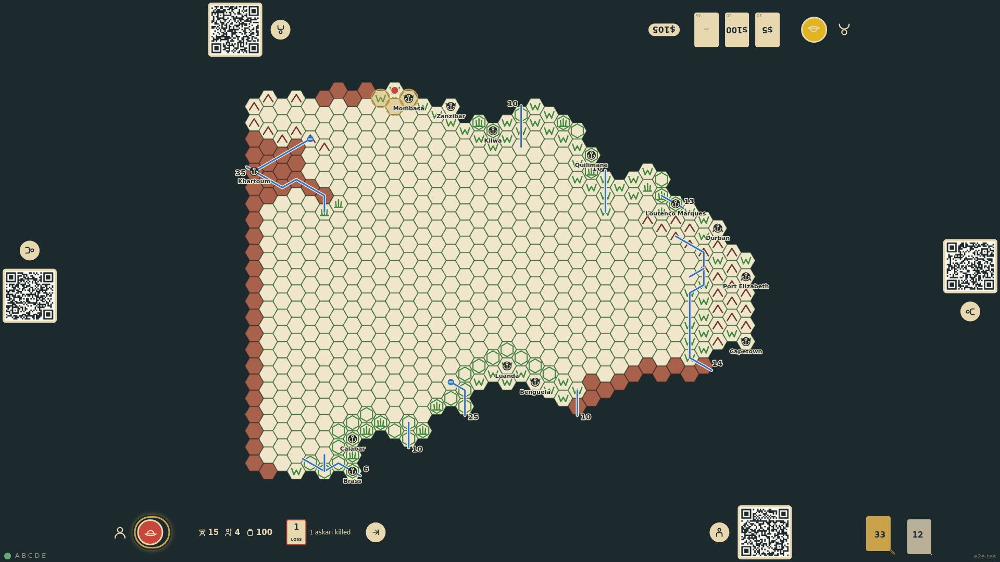
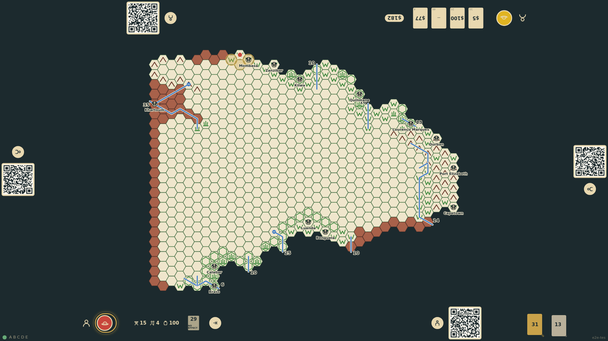
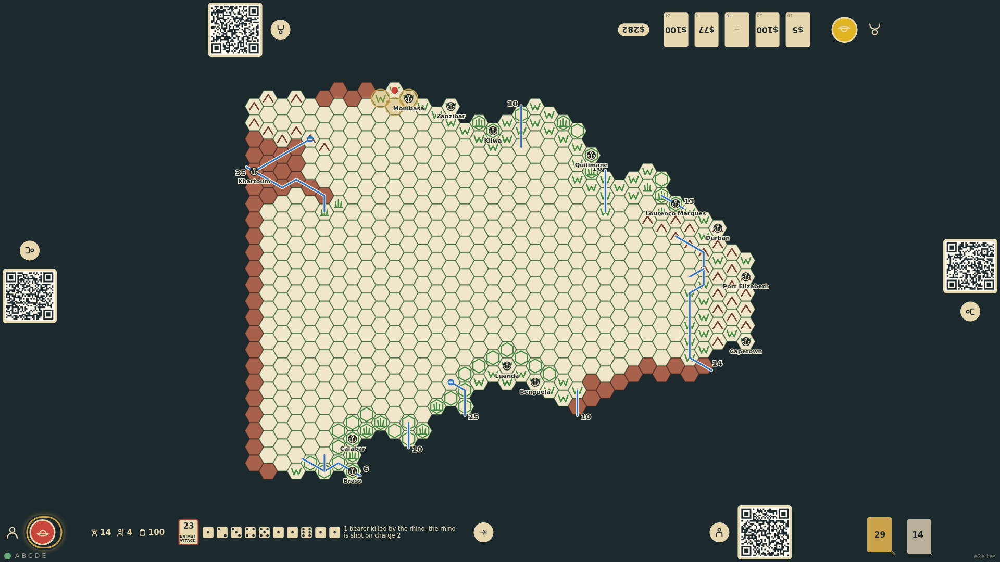

# Disaster cards

At the start of every turn in Africa outside a port of entry or Cape Colony the explorer draws a card and reads its disaster face. The card applies only when its terrain or context matches where the expedition is camped: then the losses are taken from the chart, shown as a note at the rail, and any rolls (askaris firing at animals, a doctor's treatment) are shown as dice. A card for another terrain has no effect. The card is discarded either way.

_Generated by the test step helper from `013-disaster-cards.spec.ts`. Do not edit by hand._

## 1. Camped on the veldt, the expedition draws card 1: an askari is killed by a buffalo. The card and the loss show at the rail and the chart drops to four askaris

**Player**

**Verifications:**

- [x] The rail shows card 1 as applying with the note "1 askari killed"
- [x] The chart shows 4 askaris; the card went to the discard pile and the expedition may still move

## 2. Next turn card 29 is drawn: cannibals in the jungle, which does not apply on the veldt. The card shows faded with "no effect" and nothing changes

**Player**

**Verifications:**

- [x] The rail shows card 29 as not applying and no note
- [x] The chart is unchanged and nobody is sick

## 3. Card 23: a rhino charges. The explorer and four askaris fire at each charge; the first volley misses and a bearer dies, the second has a six and the rhino falls

**Player**

**Verifications:**

- [x] Ten dice are shown: 1,2,3,4,5 then 1,1,6,1,1, and the note tells the story
- [x] The chart shows 14 bearers and 4 askaris, and all three cards are in the discard pile
