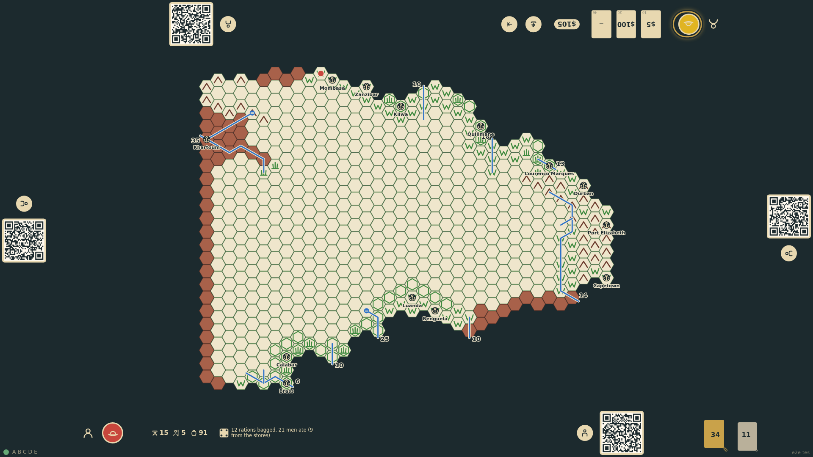
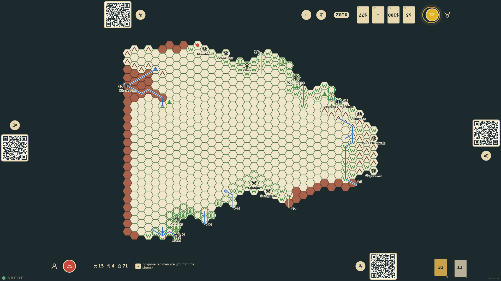

# Hunting and rations

When a turn in the field ends, one die is rolled for the hunt with the camp's terrain modifiers; the explorer and every askari bag 0, 1, 2 or 3 rations by the result. Each man then eats one ration, game first (surplus game does not keep), then the stores; horses in the desert eat four. When the stores run short, horses and camels are shot for ten rations each. The die and the meal stay at the explorer's rail while the other players take their turns, and the food count on the chart drops.

_Generated by the test step helper from `014-hunting-and-rations.spec.ts`. Do not edit by hand._

## 1. The turn ends on the veldt: the hunting die shows 4, six hunters bag twelve rations, twenty-one men eat, and the stores drop from 100 to 91 while the top seat plays

**Player**

**Verifications:**

- [x] The bottom rail shows the hunting die (4) and the meal note
- [x] The chart shows 91 food; the state records the meal on the explorer

## 2. Next turn the die shows 1: no game at all, so all twenty men (an askari fell to a buffalo that morning) eat from the stores, which drop to 71

**Player**

**Verifications:**

- [x] The rail shows a 1 and "no game"; the chart shows 71 food and 4 askaris
