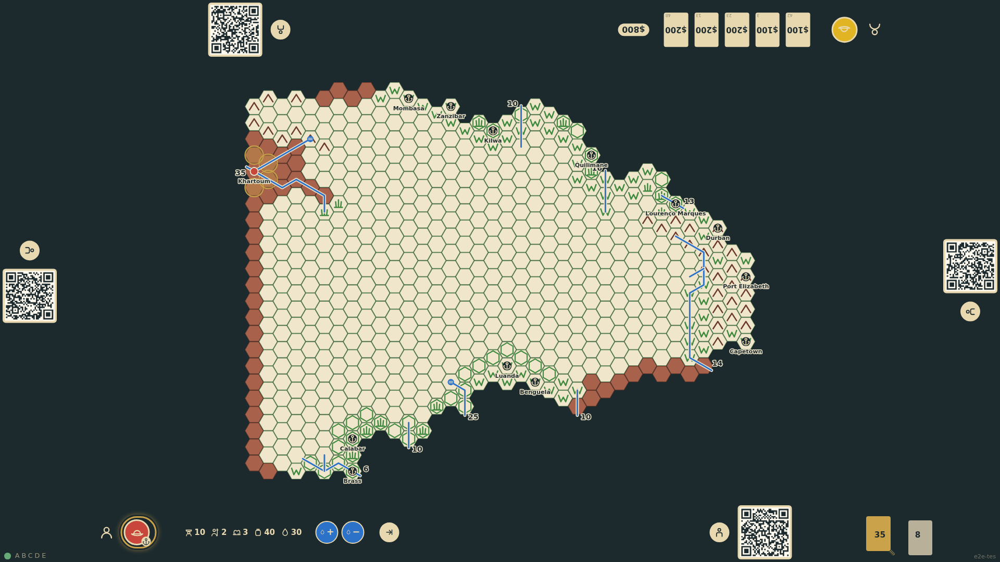
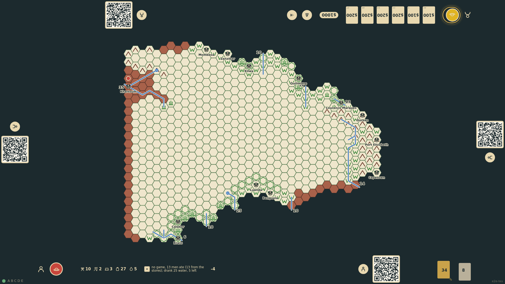
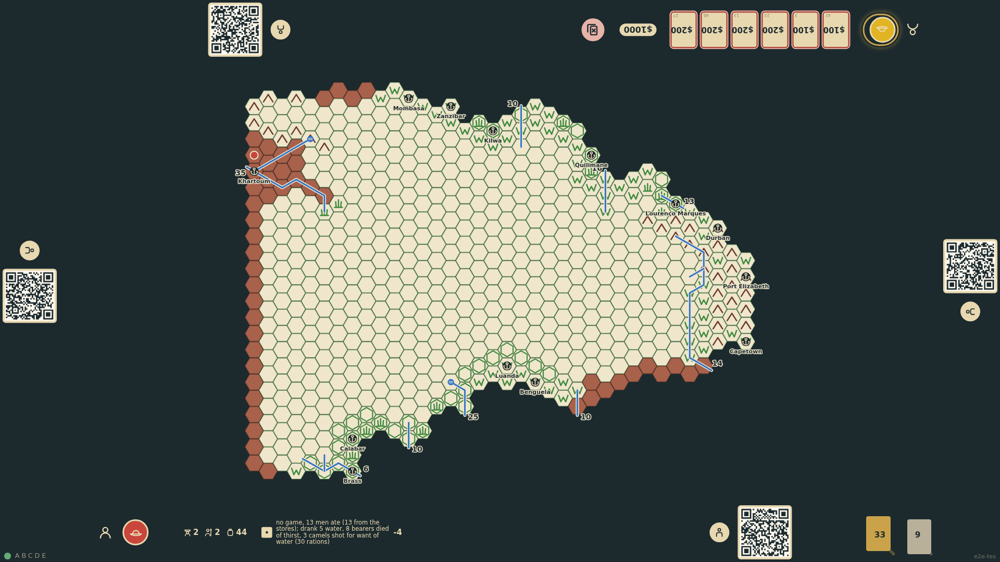

# Water in the desert

Water is free wherever there is water, so at the rail the explorer can take or pour out water rations ten at a time; each weighs four food rations. In a desert hex with neither river nor known oasis the evening costs one water ration per man and four per horse or camel. When the water runs short the guides, then bearers, then askaris go without and die; thirsty animals are shot for their meat.

_Generated by the test step helper from `015-water-in-the-desert.spec.ts`. Do not edit by hand._

## 1. At Khartoum, on the Nile, the caravan of thirteen men and three camels fills thirty water rations with three taps; the chart shows the water and the pour-out control appears

**Player**

**Verifications:**

- [x] The chart shows 30 water and the take and pour controls are at the rail

## 2. The caravan camps in the dry desert west of the Nile: no game, thirteen rations eaten, and twenty-five water drunk, five left

**Player**

**Verifications:**

- [x] The meal note reads the evening's food and water; the chart shows 27 food and 5 water

## 3. The second night only five rations remain: the explorer and the askaris drink, two bearers get the last of it, eight bearers die of thirst and the three camels are shot for their meat

**Player**

**Verifications:**

- [x] The meal note tells of the deaths; the chart shows 2 bearers, no camels, no water and 44 food
