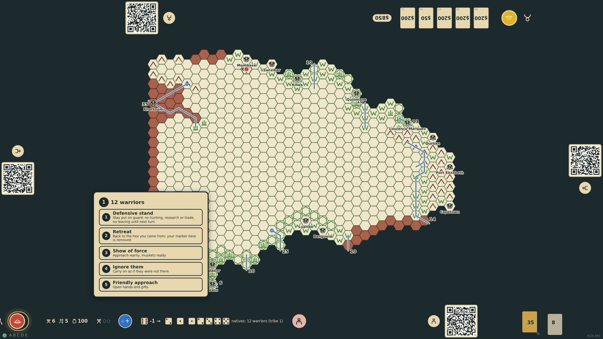
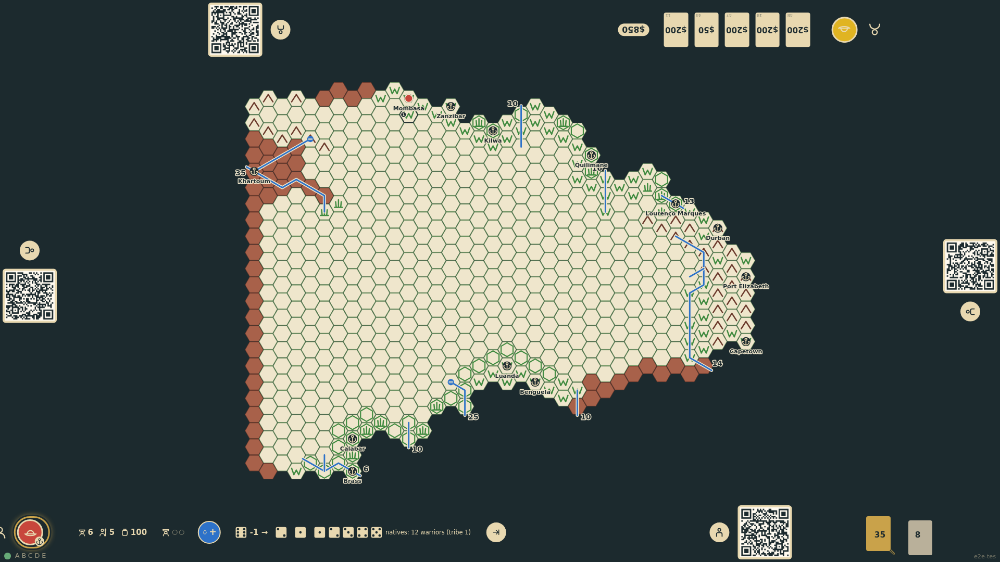
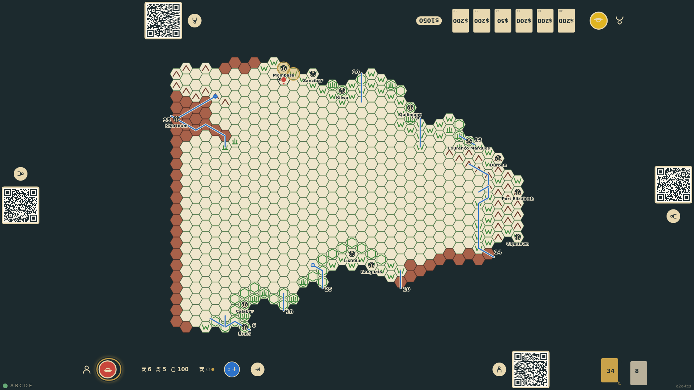

# Natives discovered and the explorer's policy

The first time an explorer enters an unpublished hex two dice are rolled for natives by the terrain (lake 2–3; veldt, swamp, jungle 2–4; mountain 5–6; 7 with a river or oasis). Found, the tribe's warriors are the product of three dice with the greatest capped at the distance to the nearest port, a numbered marker goes on the hex, and the turn pauses until the player chooses a policy on a panel at their edge: defensive stand, retreat, show of force, ignore, or friendly approach. Retreat returns to the previous hex and removes the marker. Re-entering a hex with a known tribe asks again without a roll.

_Generated by the test step helper from `016-natives-discovered-and-policy.spec.ts`. Do not edit by hand._

## 1. The expedition maps c24r12 as veldt and rolls 1 and 2 for natives: found. Three dice (3, 4, 5, the five capped at the one hex to Mombasa) make 12 warriors; tribe marker 1 goes on the hex and the policy panel opens at the bottom edge

**Player**

**Verifications:**

- [x] Tribe marker 1 is on c24r12 and the rail shows the five dice with the note
- [x] The policy panel lists the five policies and the turn cannot end until one is chosen

## 2. Policy 2, immediate retreat: the token is back at Mombasa, the bottom seat's marker is gone from the hex, the tribe marker stays, and the turn goes on

**Player**

**Verifications:**

- [x] The token stands at Mombasa and c24r12 keeps its terrain and tribe but no marker

## 3. Next turn the expedition walks back in: the tribe is known so no dice are rolled, the panel asks again, and policy 4 (ignore them) lets the turn continue with the marker restored

**Player**

**Verifications:**

- [x] No natives dice this turn; the marker is back; the end-turn control is offered
