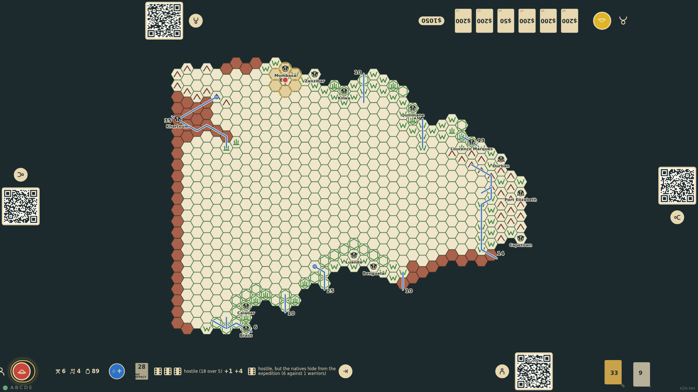

# Native reaction and combat

Once a policy is chosen the natives react: three dice against the distance to the nearest port plus the policy number (and the adjustments for an expedition without askaris, for local knowledge and for the tribe's attitude). A higher roll means hostility; then a die times the askaris, divided by the policy, decides whether they hide or attack. An attack rolls two dice for surprise; unsurprised, every askari and the explorer fire once, and a morale die may drive the natives off; otherwise the two sides strike in turn, casualties by division, until one side is finished. Every die and the story of the fight show at the rail.

_Generated by the test step helper from `017-native-reaction-and-combat.spec.ts`. Do not edit by hand._

## 1. A show of force. The reaction dice come up 6, 6, 6 against a target of 4: hostile, and strong enough to attack. Not surprised, the five askaris and the explorer fire and six warriors fall; the rest close in, kill an askari, and lose five more before they are driven off

**Player**

**Verifications:**

- [x] The rail shows the reaction as hostile with its dice and modifiers
- [x] The combat note tells the fight and its eight dice are shown; the chart shows 4 askaris and the tribe one warrior

## 2. Remaining in the hex next turn, the explorer ignores the tribe. Hostile again on 6, 6, 6, but the lone surviving warrior hides from four askaris

**Player**

**Verifications:**

- [x] The reaction is hostile and the natives hide; nothing changes on the chart
