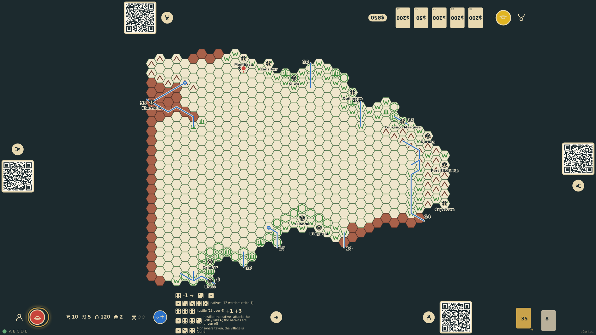
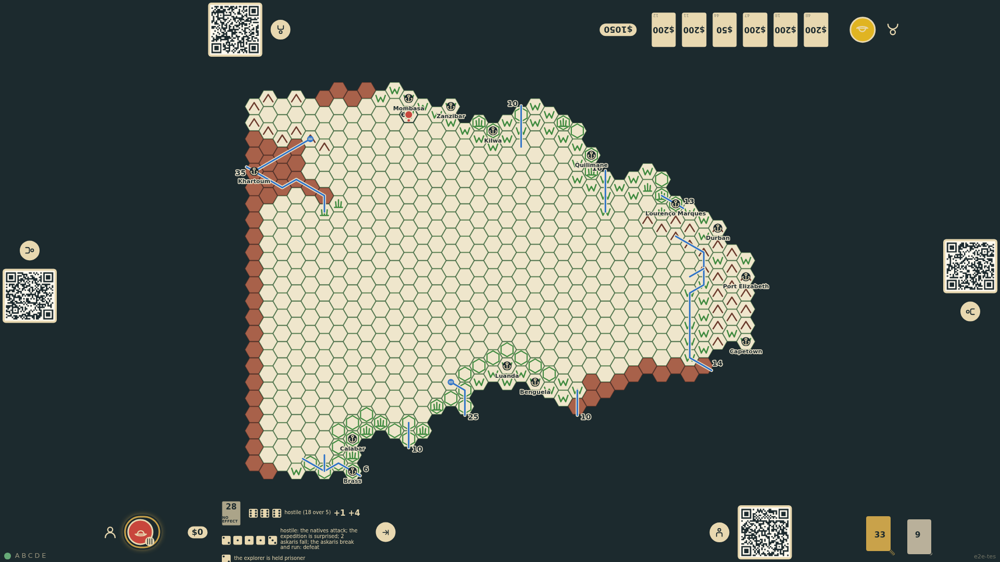
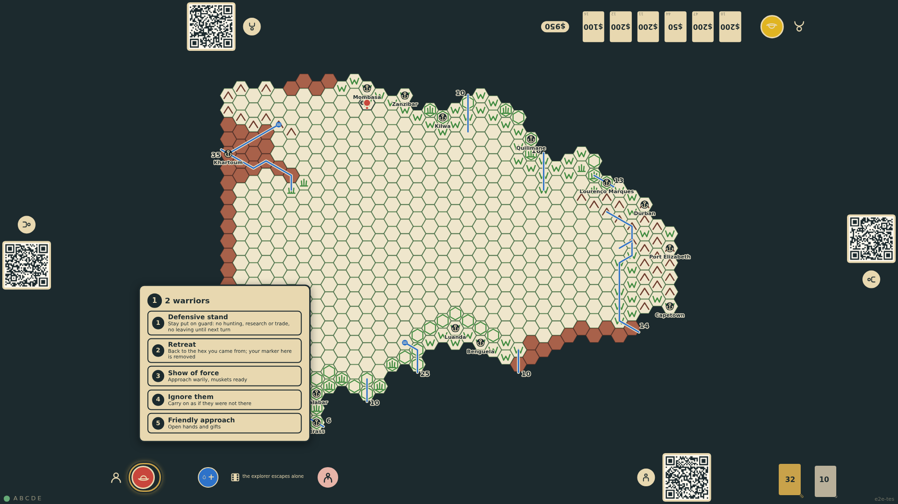

# Defeat, escape and victory

After a victory the askaris take prisoners (their number less a die, at most the warriors left); two dice against prisoners plus policy find the village, and the player chooses at the edge: release the prisoners, or keep them as bearers and loot a die per warrior met. After a defeat one die decides the explorer's fate: killed, held prisoner, or an escape alone with what the Escape Survival table allows. A captive rolls again every turn at minus three until killed or free.

_Generated by the test step helper from `018-defeat-escape-and-victory.spec.ts`. Do not edit by hand._

## 1. The show of force wins: six warriors fall to the volley and the rest are driven off. Four prisoners are taken and the village is found, so the panel at the edge asks whether to release them or keep them and loot

**Player**

**Verifications:**

- [x] The victory note reads four prisoners and the village found; the chart already counts the prisoners as bearers
- [x] The spoils panel offers release or keep and the turn cannot end yet

## 2. The prisoners are kept as bearers and the village looted: twelve dice, one per warrior met, yield twenty rations and two gifts

**Player**

**Verifications:**

- [x] The loot note and its twelve dice show; the chart has 120 food, 2 gifts and 10 bearers

## 3. Next turn the explorer ignores the two warriors left; they attack by surprise, two askaris fall and the rest break. The defeat die is a 2: the explorer is held prisoner and the expedition is lost

**Player**

**Verifications:**

- [x] The combat and defeat notes tell the rout and the capture; the token shows the captive mark

## 4. The captive's turn opens with the escape die: a 6 less three is a 3, so the explorer escapes alone, with nothing, and stands free in the hex again, where the tribe waits for a policy

**Player**

**Verifications:**

- [x] The captivity note reads the escape; the explorer is back on the hex with an empty chart
