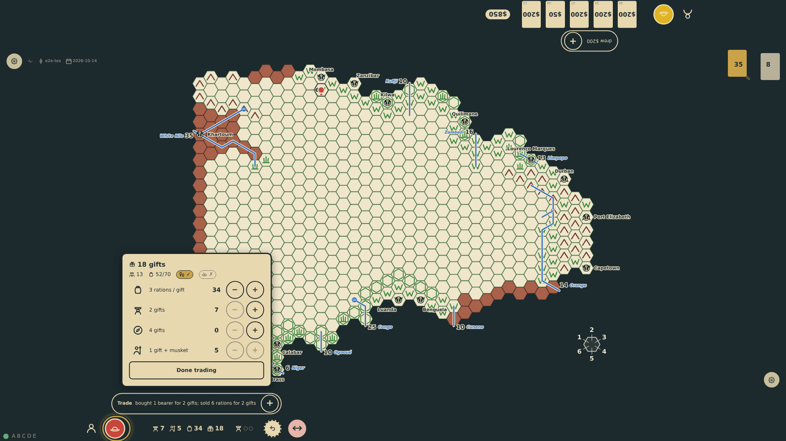
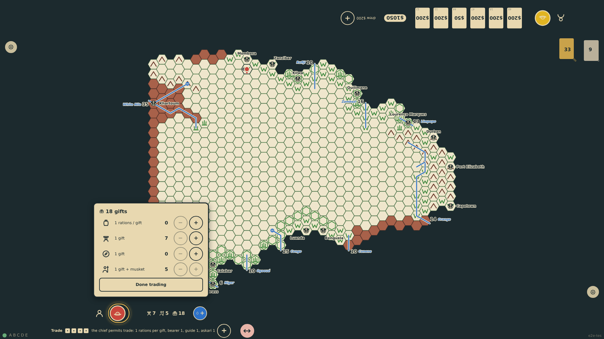

# Negotiation and trade

When the natives are not hostile to a show of force or a friendly approach, the explorer may negotiate: gifts are offered on a panel at the player's edge, and the gifts times the larger of two dice must reach the tribe's warriors or the chief is insulted (and considers an attack, or poison). Giving everything but the men always satisfies, the chief returning three dice of gifts. A satisfied chief permits trade: a die per item sets this turn's price in gifts, rations are bought and sold by the gift, and an askari also costs a musket.

_Generated by the test step helper from `019-negotiation-and-trade.spec.ts`. Do not edit by hand._

## 1. The reaction is calm, so the chief receives the explorer. Two gifts are offered; the dice show 3 and 6, and 6 × 2 reaches the twelve warriors: the chief is satisfied and permits trade. The trade panel shows this turn's prices and, as the outfitting screen does, how the expedition as it stands can move

**Player**

**Verifications:**

- [x] The rail tells the offer and the permission with the prices
- [x] The trade panel lists rations, bearers, guides and askaris at the rolled prices; 18 gifts remain

## 2. A bearer is hired for two gifts and six rations are sold for two gifts in two taps: the chart shows 7 bearers, 34 rations and 18 gifts, the three trades one line at the rail, and the panel's movement notes count the new bearer

**Player**

**Verifications:**

- [x] The chart and the panel agree on 7 bearers, 34 food and 18 gifts; the movement notes count one more person

## 3. Next turn the tribe remembers the explorer (+1 for the prior negotiation) and stays calm. The explorer gives everything but the men: the stores go, the chief returns 18 gifts, and trade opens again at fresh prices

**Player**

**Verifications:**

- [x] The reaction counts the local knowledge; the chart keeps the men, 18 gifts and nothing else
