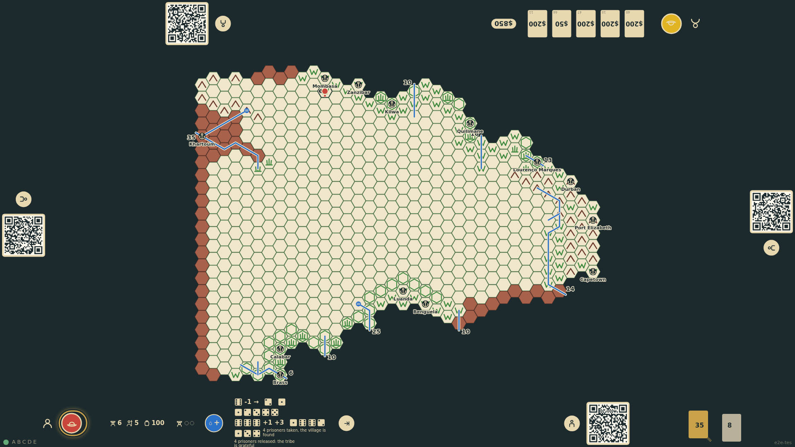
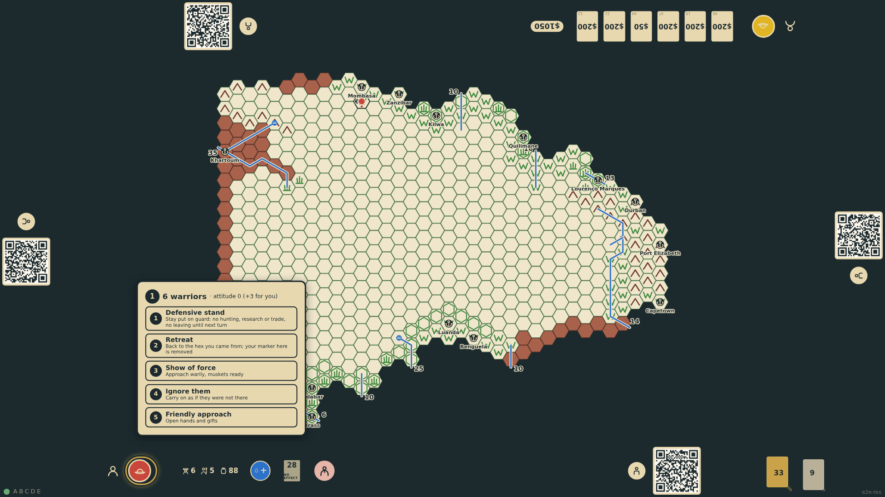
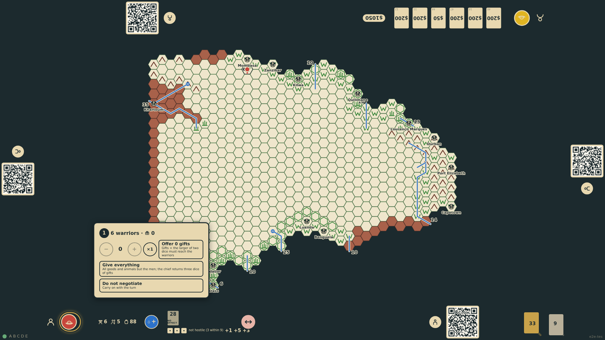

# Tribe attitude

Each tribe keeps an attitude towards all explorers (a defeat of an explorer lowers it, his death lowers it more) and a regard for individual explorers (releasing every prisoner raises it by three for the one who did). Both are shown on the policy panel when the tribe is faced again and are added to the reaction target, so a merciful explorer finds the tribe calmer on his next visit.

_Generated by the test step helper from `020-tribe-attitude.spec.ts`. Do not edit by hand._

## 1. After the victory the four prisoners are released: the village is left alone, the prisoners rejoin the tribe, and its regard for the bottom seat rises by three

**Player**

**Verifications:**

- [x] The rail notes the release; the chart is back to 6 bearers; the tribe records regard +3 for bottom-1 only

## 2. Next turn the policy panel shows the tribe's attitude with the +3 regard for this explorer

**Player**

**Verifications:**

- [x] The panel reads attitude 0 with +3 for you

## 3. A friendly approach: the reaction dice (1, 1, 1) are weighed against distance 1, policy 5 and regard 3; the tribe is calm and the chief receives the explorer

**Player**

**Verifications:**

- [x] The reaction modifiers at the rail include the regard and the negotiation opens
