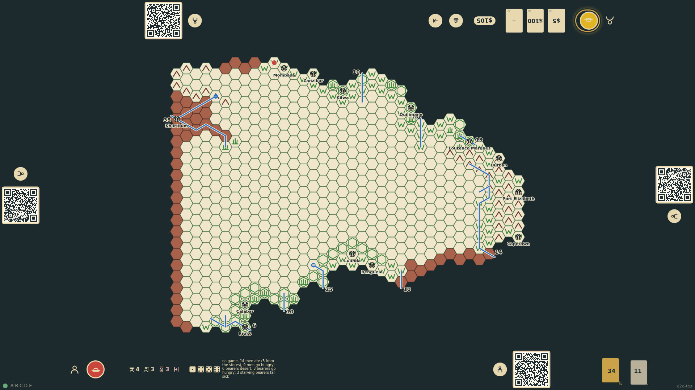
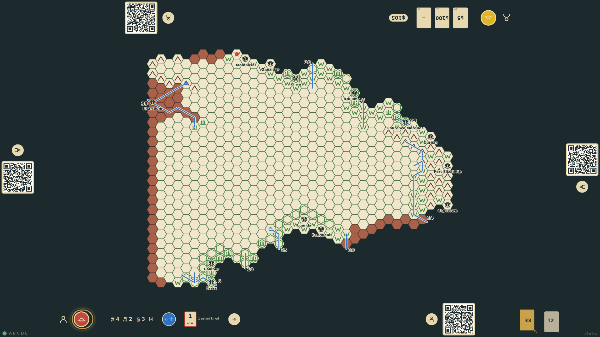
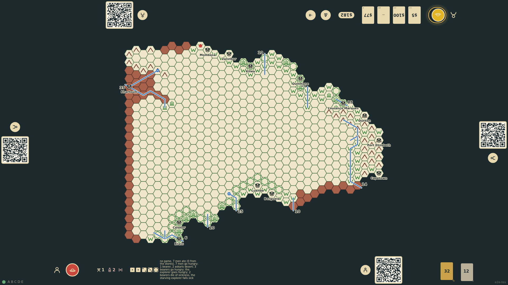

# Sickness, starvation and desertion

When the stores run out after the hunt, bearers go hungry first, then guides, askaris and the explorer. Hungry guides and askaris desert (the askaris with their muskets); hungry bearers desert unless an askari guards each. Every starving man rolls a die and falls sick on 4 to 6. Sick men cannot walk: they must be carried by an animal, two unladen bearers or a canoe, or the expedition halts. Each sick man rolls every evening, minus one with a healthy doctor and plus three if starving: 1 or less recovers, 5 or more dies.

_Generated by the test step helper from `021-sickness-starvation-desertion.spec.ts`. Do not edit by hand._

## 1. Fourteen men and five rations: nine go hungry. The three askaris can guard three bearers; the other six desert. The three guarded bearers roll 4, 5 and 6 and all fall sick

**Player**

**Verifications:**

- [x] The meal note tells the hunger, the desertion and the sickness; the chart shows 4 bearers with 3 sick

## 2. Next morning a buffalo kills an askari. Three sick bearers and one well one: nobody can carry the sick, so no move is offered and the rail shows the halt

**Player**

**Verifications:**

- [x] No move target is offered and the halt mark shows beside the sick count

## 3. With nothing to eat everyone goes hungry: the two askaris and the well bearer desert, the sick cannot. The three sick roll with +3 for starving: one lingers, two die; the starving explorer rolls a 4 and falls sick

**Player**

**Verifications:**

- [x] The note reads the desertions and deaths; one sick bearer and the sick explorer remain
