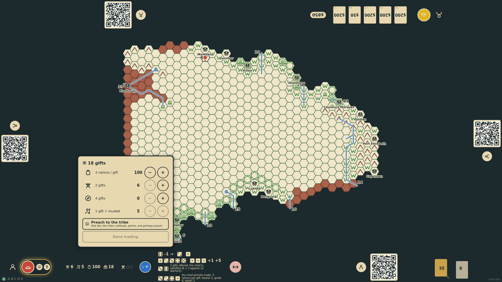
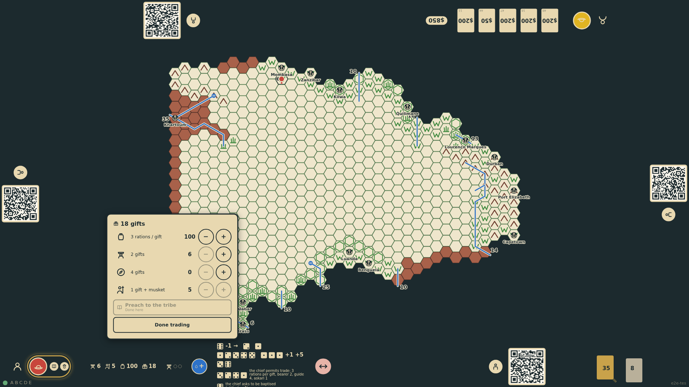
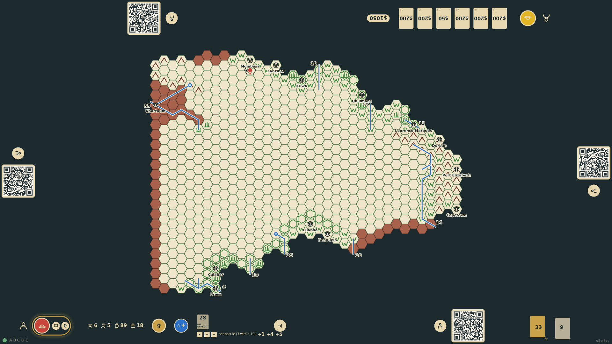
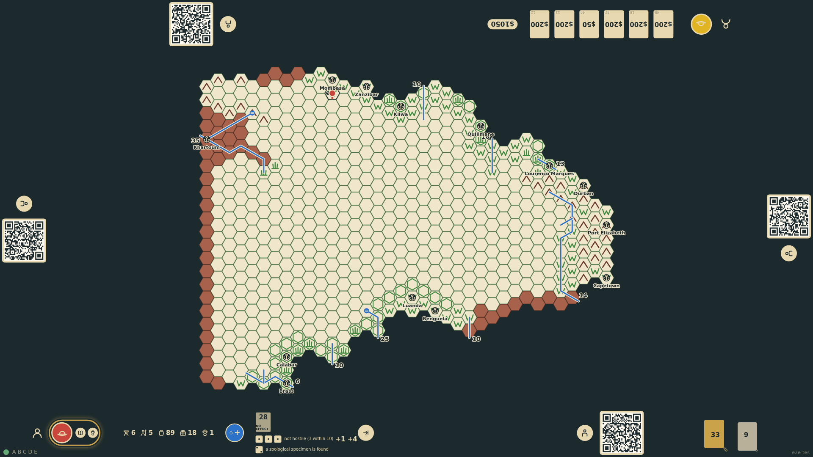

# Specialties in the field

A missionary must preach to each tribe once the chief permits it (after a satisfying negotiation), and a doctor must treat it: one die moves the tribe's attitude, earns points, and may bring the chief's poison. A zoologist or geologist must spend a turn in every unpublished hex entered, studying instead of moving: one die by the terrain finds a specimen, carried like a ration and scored in Europe. A turn is spent either moving or on a specialty, never both.

_Generated by the test step helper from `022-specialties-in-the-field.spec.ts`. Do not edit by hand._

## 1. The chief is satisfied with two gifts and permits trade. The trade panel also offers the missionary's sermon, and trading cannot end until he has preached

**Player**

**Verifications:**

- [x] The preach control is offered and the done control is held back

## 2. The sermon: a 6, the chief asks to be baptised. The tribe's attitude rises by five, the missionary banks five points, and trading may end

**Player**

**Verifications:**

- [x] The rail notes the sermon; the tribe's attitude is 5; the done control is released

## 3. Next turn the tribe is calmer for the sermon. The zoologist owes this unpublished hex a turn of study: no move is offered, only the study control at the rail

**Player**

**Verifications:**

- [x] No move targets; the zoology study control is at the rail

## 4. The study: a 2 on the veldt finds a zoological specimen. It joins the chart as a load, and the turn is spent

**Player**

**Verifications:**

- [x] The rail notes the find and shows one specimen; the study control is gone and the turn is spent
