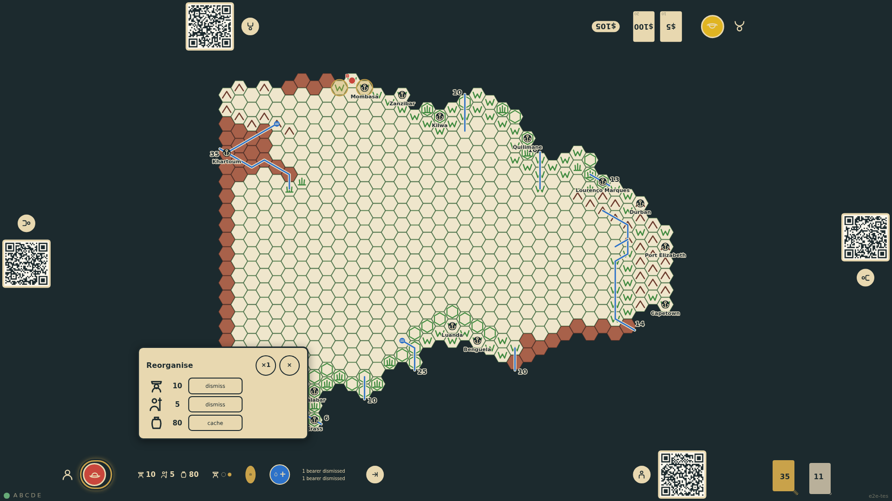
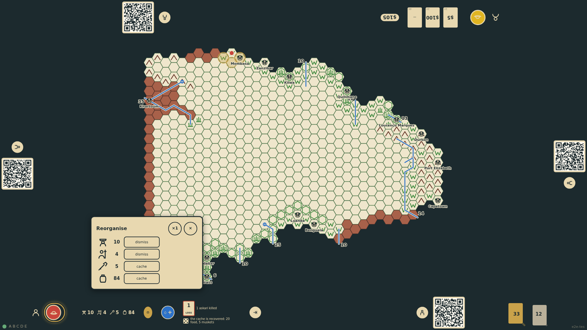

# Caches and reorganisation

On any turn the expedition can be reorganised from a panel at the player's edge: rations, gifts, muskets, canoes and water are cached on the hex under a cache marker in the seat colour; guides, bearers and askaris are dismissed and vanish; camels and horses are turned loose or eaten for ten rations each. Returning to a cache of one's own on a later turn, a die is rolled: on a 1 or 2 it has disappeared, otherwise its goods rejoin the chart. Other explorers' caches are only findable once the hex is published.

_Generated by the test step helper from `023-caches-and-reorganisation.spec.ts`. Do not edit by hand._

## 1. On the veldt north of Mombasa twenty rations and five muskets are cached under the bottom seat's marker, and five bearers are dismissed: the chart shows 80 rations, no muskets and 10 bearers

**Player**

**Verifications:**

- [x] A cache marker in the seat colour sits on c25r11; the chart has 80 food, 10 bearers and no muskets

## 2. Next turn the panel lists the cache; digging it up rolls a 5, so the twenty rations and five muskets rejoin the chart and the marker is lifted

**Player**

**Verifications:**

- [x] The cache die and note show at the rail; the marker is gone; the chart regains the goods
