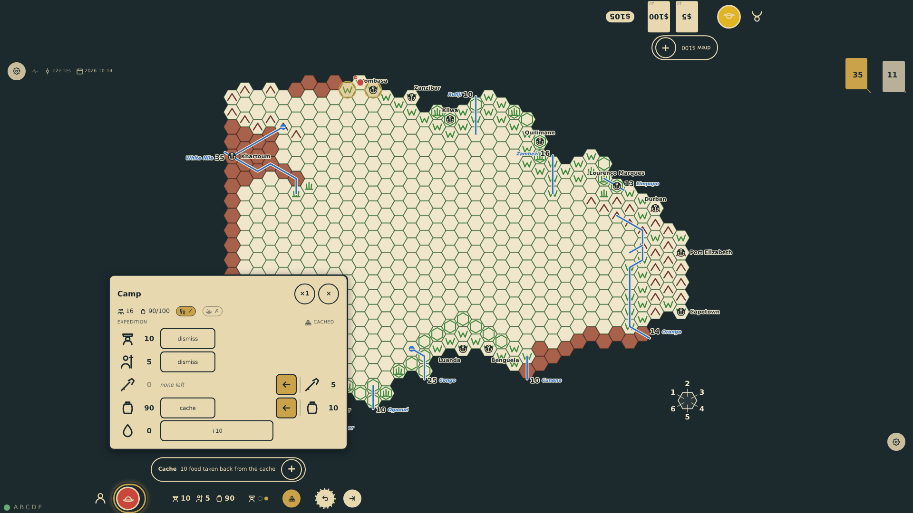
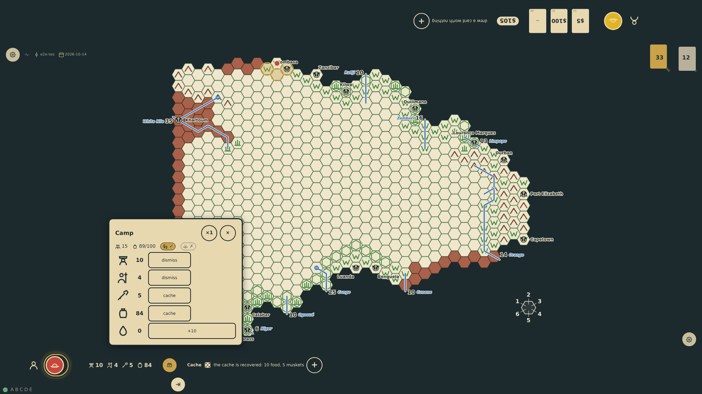

# Caches and reorganisation

On any turn the expedition can be reorganised from the camp panel at the player's edge: rations, gifts, muskets and canoes are cached on the hex under a cache marker in the seat colour; guides, bearers and askaris are dismissed and vanish; camels and horses are turned loose or eaten for ten rations each. The panel shows how the expedition as it stands can move, lists the caches on the hex with what each holds, and gives goods back out of a cache made this turn item by item. Returning to a cache of one's own on a later turn, a die is rolled: on a 1 or 2 it has disappeared, otherwise its goods rejoin the chart. Other explorers' caches are only findable once the hex is published.

_Generated by the test step helper from `023-caches-and-reorganisation.spec.ts`. Do not edit by hand._

## 1. On the veldt north of Mombasa twenty rations and five muskets are cached under the bottom seat's marker, and five bearers are dismissed: the chart shows 80 rations, no muskets and 10 bearers; the panel shows the cached goods in a column to the right of the expedition's, item by item, with the control that takes them back between the two columns, and how the lightened expedition can move

**Player**

**Verifications:**

- [x] The cached column holds 20 food and 5 muskets, each with its take-back control between the columns; the muskets' row stays though none are left; the movement notes count 15 people
- [x] A cache marker in the seat colour sits on c25r11; the chart has 80 food, 10 bearers and no muskets

## 2. Ten of the cached rations are taken back with the control between the columns: the chart has 90 rations and the cached column holds ten with the muskets

**Player**

**Verifications:**

- [x] The cached column holds 10 food and 5 muskets, the chart 90 food; the note reads the taking

## 3. Next turn the panel lists the cache with its ten rations and five muskets, to be dug up rather than taken from; digging it up rolls a 5, so the goods rejoin the chart and the marker is lifted

**Player**

**Verifications:**

- [x] The cache die and note show at the rail; the marker is gone; the chart regains the goods
