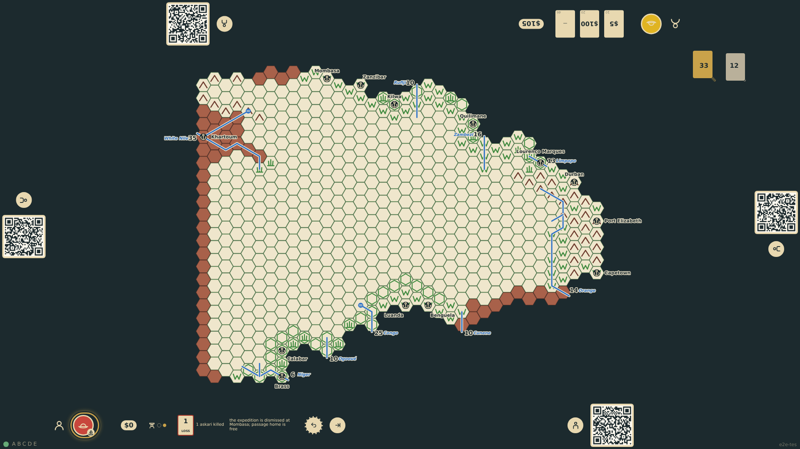
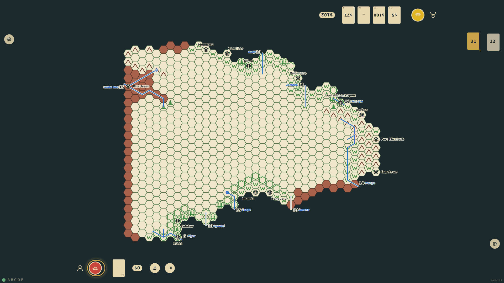

# Return to Europe

To publish, an explorer must get back to Europe. At any port of entry (landed there, or standing on its hex) the rail offers the voyage home: the men are dismissed with the supplies as their bonus, the chart is cleared, and the government pays the passage. The explorer is at sea for the rest of the round and back in Europe at the start of his next turn, when the Europe turn resumes with a card drawn. His markers, known hexes, specimens and good works stay with him for publishing (025).

_Generated by the test step helper from `024-return-to-europe.spec.ts`. Do not edit by hand._

## 1. Back on Mombasa's hex the explorer dismisses the expedition and sails: the token shows at sea, the chart is gone, and the rail notes the free passage

**Player**

**Verifications:**

- [x] The token is at sea and the chart summary is gone; the state records the homeward voyage

## 2. The next turn opens in Europe: a donation card is drawn, the sail control is back, and the hexes he walked stay known to him

**Player**

**Verifications:**

- [x] The explorer is in Europe with one card and the sail control; c25r11 (pre-printed veldt, so never marked) stays known to him
