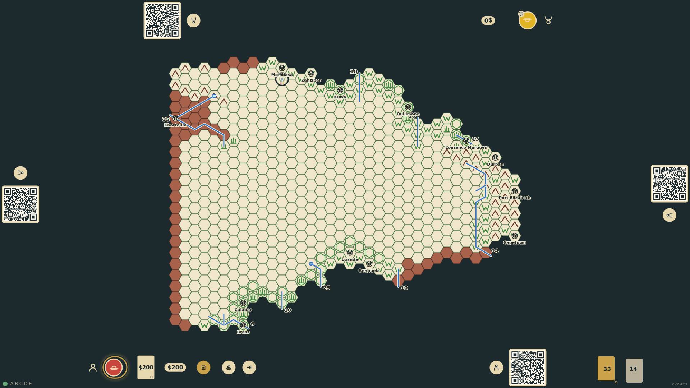
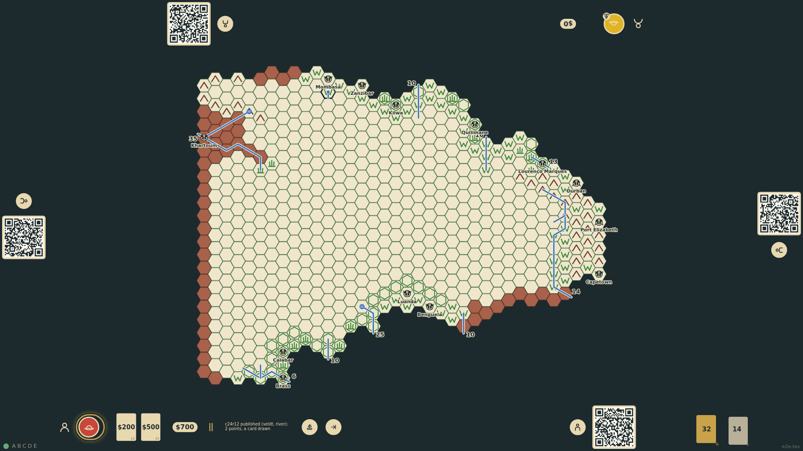
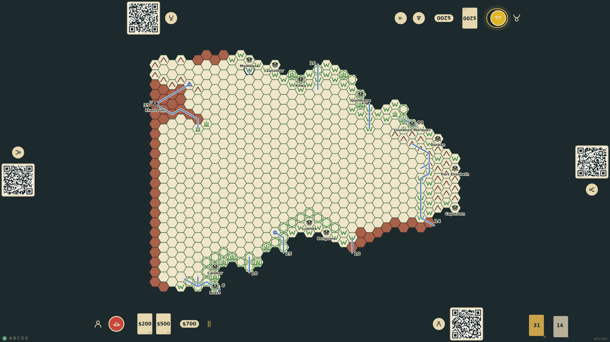

# Publishing and points

Discoveries score only when published in Europe. Any hex under the explorer's marker may be claimed, even one another explorer mapped first: whoever publishes first wins it, every marker on it comes off, the hex is known to the whole table, and the publisher draws one extra donation card per hex. Points are terrain and water (veldt 1, river 1, jungle 2 …) plus the hex's tribe, and they show at the rail as countable marks. Specimens and good works score on landing in Europe.

_Generated by the test step helper from `025-publishing-and-points.spec.ts`. Do not edit by hand._

## 1. Round 5, bottom-1 is home: c24r12 carries both markers and the rail offers to publish; a tap opens the claim on the map

**Player**

**Verifications:**

- [x] Both markers rest on c24r12; the publish control shows at the bottom rail and the hex is offered on the board

## 2. The hex is published: inked on the map with every marker gone, two points tallied at the rail (veldt and a river), a second card in the hand, and the note says what was counted

**Player**

**Verifications:**

- [x] The hex shows as published by bottom-1 with no markers; the tally reads 2; the hand grew by one card

## 3. top-1 lands in Europe with nothing to publish: the hex was stolen, the top rail shows no tally and no publish control

**Player**

**Verifications:**

- [x] top-1 is in Europe with one card drawn, no publish control and no score
