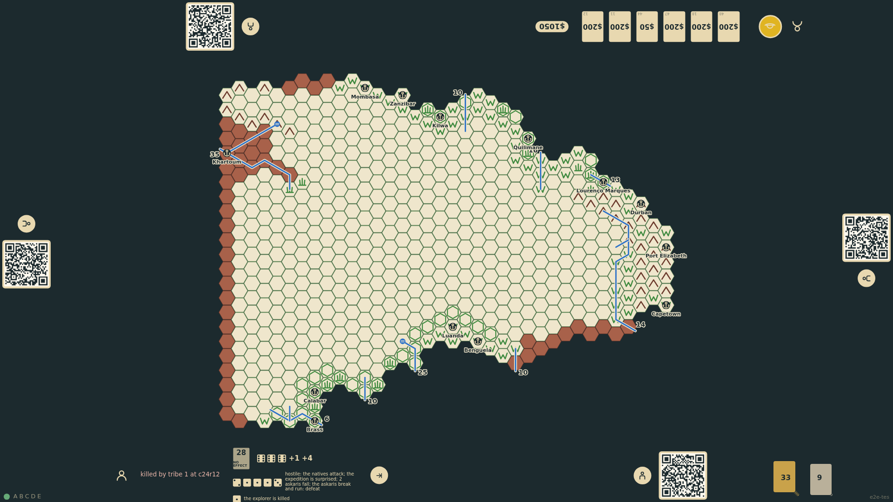
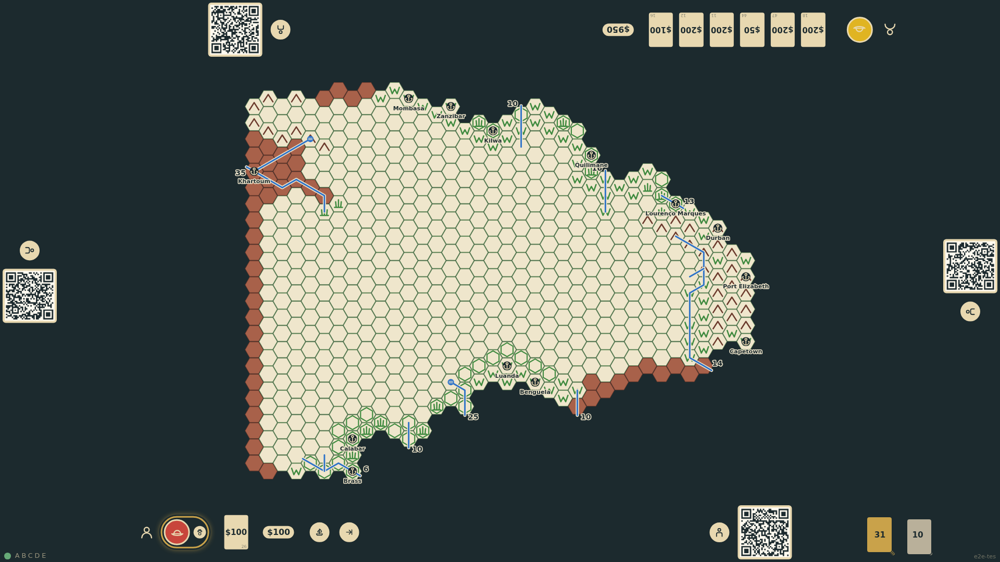
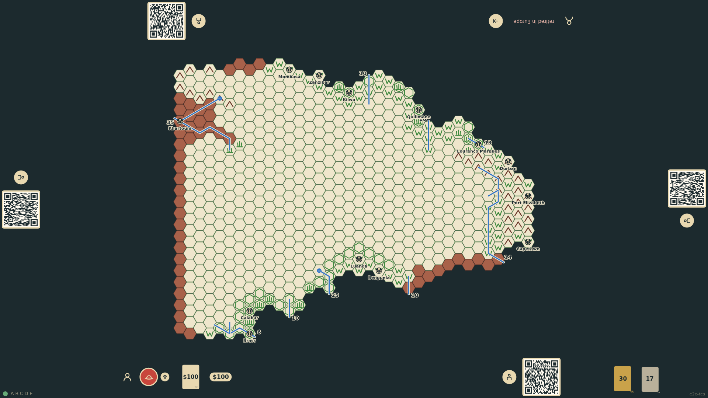

# Death and retirement

An explorer who dies, from a fight, a card, poison, sickness or thirst, leaves play: his markers come off, and every unpublished hex nobody else has visited is erased with its tribe and caches, so later explorers will find his discoveries were only rumours. The rail shows the obituary and the seat's turn ends as usual; from then on the seat may commission a new explorer, who starts in Europe with an empty hand. A player may also retire his explorer on his own turn by tapping him at the rail and confirming at the edge: the same erasure, but the points already scored stay with the seat.

_Generated by the test step helper from `026-death-and-retirement.spec.ts`. Do not edit by hand._

## 1. The defeat die is a 1: the explorer is killed. His token is gone, c24r12 is blank again with its tribe marker erased, and the rail shows the fight, the obituary and the end-turn control

**Player**

**Verifications:**

- [x] The defeat note reads killed; the obituary names the tribe and the hex; the turn can still be ended
- [x] The token, the hex, its tribe marker and his marker are gone from the board

## 2. On top-1's turn the bottom seat commissions a zoologist; round 5 opens his first Europe turn with one card drawn and the obituary gone

**Player**

**Verifications:**

- [x] The new explorer is in Europe on his turn with one card; the dead one stays on record

## 3. top-1 taps his explorer at the rail and confirms at the edge: he retires in Europe, his hand goes to the discard pile, and the rail shows the obituary with the end-turn control

**Player**

**Verifications:**

- [x] top-1 is retired: no token, the obituary reads retired in Europe, the hand is gone, the turn can be ended
