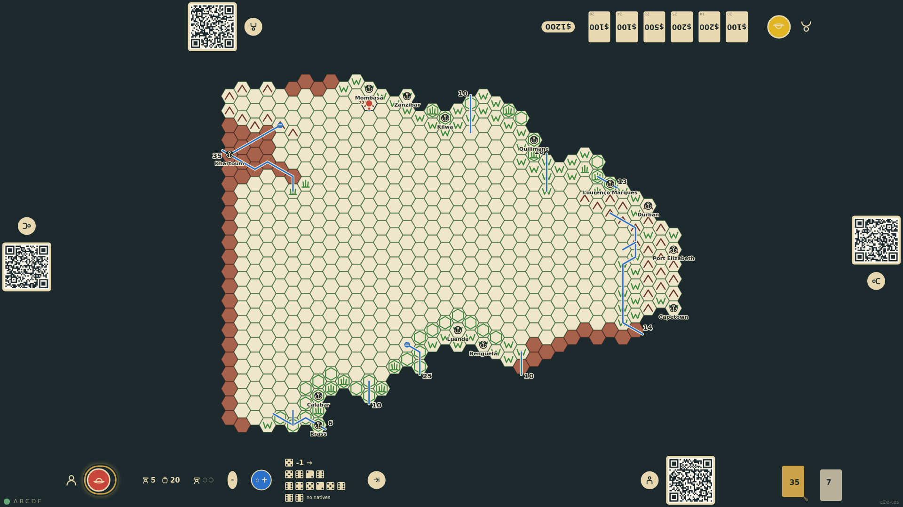
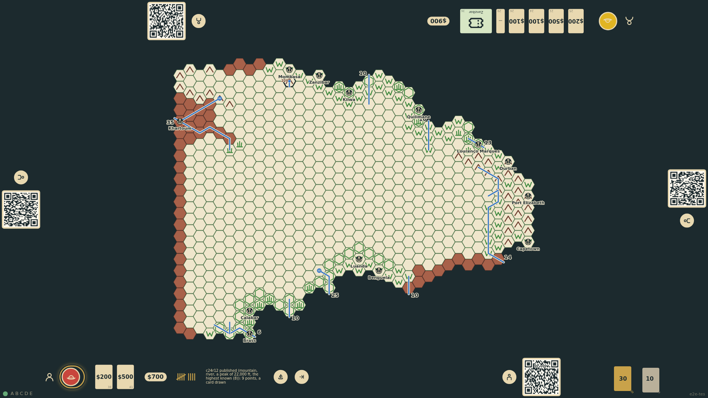

# Superlatives

Superlative discoveries score when their hex is published, ranked against what was published before: the highest mountain over 15,000 ft (8/4/2/1), the highest waterfall of 400 ft or more (4/2/1), the largest lake by connected hexes (4/2/1) and the source of the longest river measured from the sea, with the Nile's 25 hexes beyond the board, against the rivers known in 1820 (16/8/4/2/1). A new record takes first place and keeps its points when bettered later. A mountain hex itself scores nothing (RQ-14): the peak is the prize.

_Generated by the test step helper from `027-superlatives.spec.ts`. Do not edit by hand._

## 1. The first step from Mombasa maps a mountain hex with a river rising in it and a peak of 22,000 ft, recorded in brown on the hex

**Player**

**Verifications:**

- [x] The hex is mountain with a peak label of 220 (hundreds of feet) and a river source

## 2. Published from Europe the hex scores one for the river, nothing for the mountain, and eight for the highest peak known: nine points tallied at the rail, with the note naming the peak

**Player**

**Verifications:**

- [x] The note names the peak as the highest known for 8; the tally reads 9; the record is kept for later ranks
