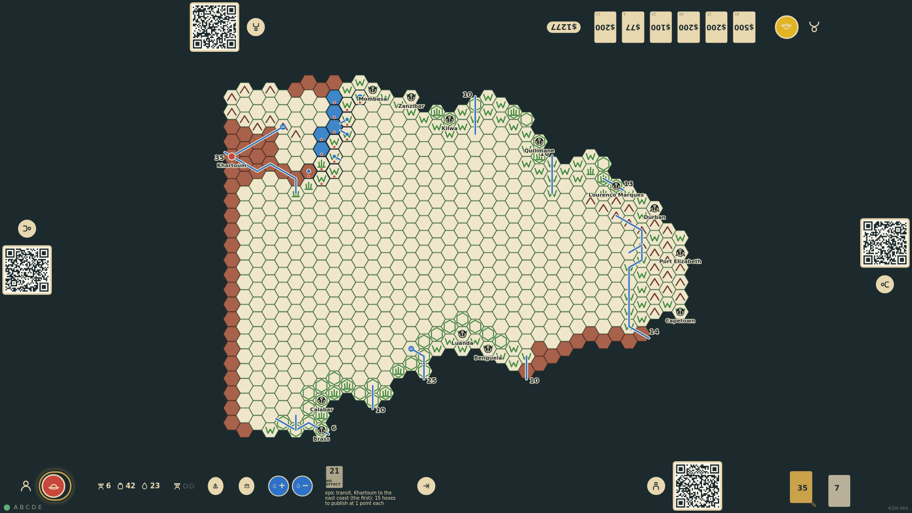
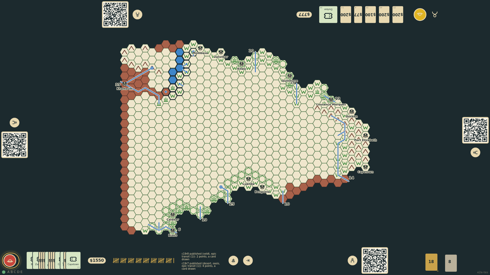

# Epic transits

The first explorer to cross the continent on one of four crossings (Khartoum to Cape Colony, to the east coast, to the west coast; or coast to coast) earns a bonus of one point for every hex of his route he then publishes; the second explorer on a different route earns half a point per hex, the third a third, the fourth a quarter. The pre-printed hexes at the north-east edge may not be used. The crossing is recognised the moment the expedition steps onto the far port, and the bonus is paid hex by hex at publication.

_Generated by the test step helper from `028-epic-transits.spec.ts`. Do not edit by hand._

## 1. The last step onto Khartoum completes the crossing from Mombasa: the rail announces the epic transit and how many hexes of the route wait to be published for a point each

**Player**

**Verifications:**

- [x] The token stands on Khartoum; the transit note names the crossing as the first; the route is recorded

## 2. Home in Europe the whole route is published hex by hex: each note counts the terrain and the epic transit bonus, and the tally at the rail shows the sum

**Player**

**Verifications:**

- [x] Every route hex is published with a transit bonus of one point; the tally equals the terrain points plus the bonus
