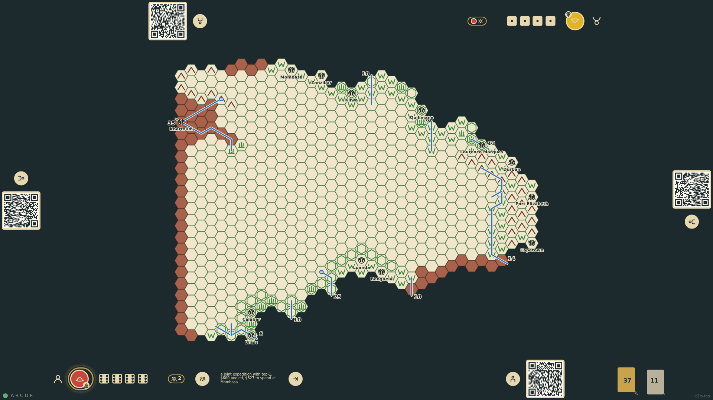
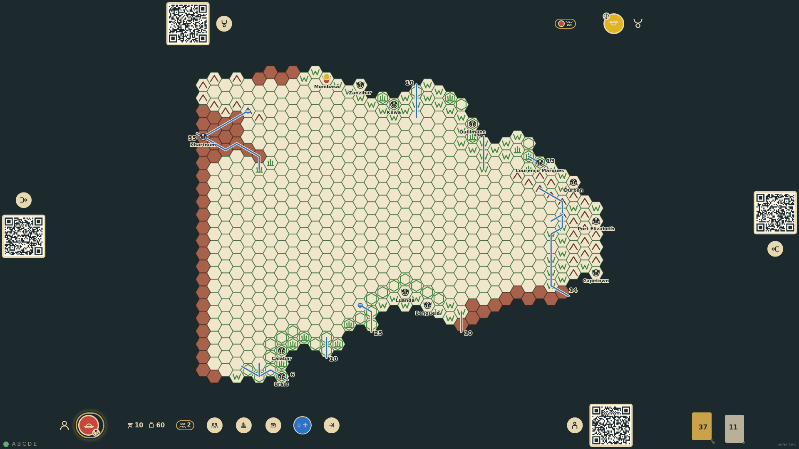
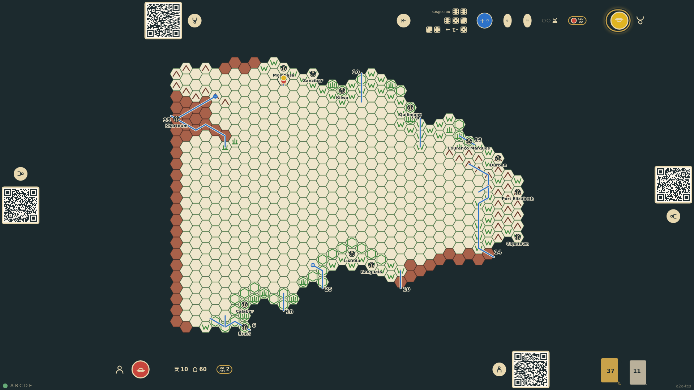
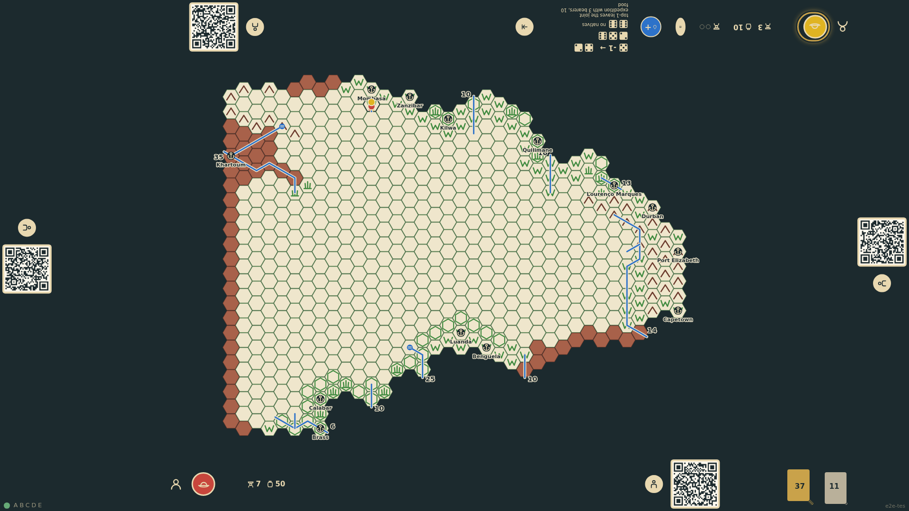

# Joint expeditions

Explorers may travel as one. In Europe a player sailing can pool the donations of companions, who sail and land with him; the party has one chart, held by its leader, and moves once a round on the turn of the member who comes last in the order, with one lost check and markers for everyone. Explorers meeting in a hex may join forces the same way, and any member may leave with an agreed share of the chart, the rest staying with the party.

_Generated by the test step helper from `029-joint-expeditions.spec.ts`. Do not edit by hand._

## 1. bottom-1 opens the sail chooser, taps top-1's token to pool his donations, and books Mombasa: both are at sea, the budget is the two hands less the fare, and the rail notes the joint expedition

**Player**

**Verifications:**

- [x] Both explorers are at sea for Mombasa; bottom-1 leads a party of two with the pooled budget; top-1 has nothing left

## 2. Round 3: both landed at Mombasa on the leader's turn; bottom-1 outfits the party's one chart and his rail marks a party of two, top-1's rail marks his leader; the party does not move on the leader's turn

**Player**

**Verifications:**

- [x] The chart sits on bottom-1 with a party mark of 2; top-1 shows the leader; no move target is offered to bottom-1

## 3. On top-1's turn the party steps into c24r12 as one: both tokens stand side by side, one lost check was rolled, and the hex carries both markers

**Player**

**Verifications:**

- [x] Both tokens are on c24r12 and shared; one lost check; markers for both

## 4. top-1 leaves the party with three bearers and ten rations chosen at the edge: each explorer now has his own chart and the party is dissolved

**Player**

**Verifications:**

- [x] top-1 has 3 bearers and 10 food, bottom-1 keeps 7 and 50; no party remains; the rail notes the parting
