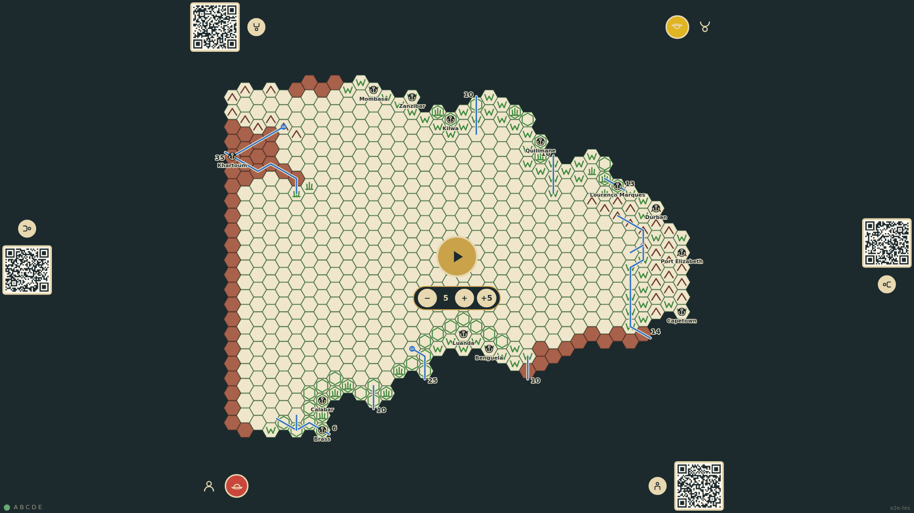
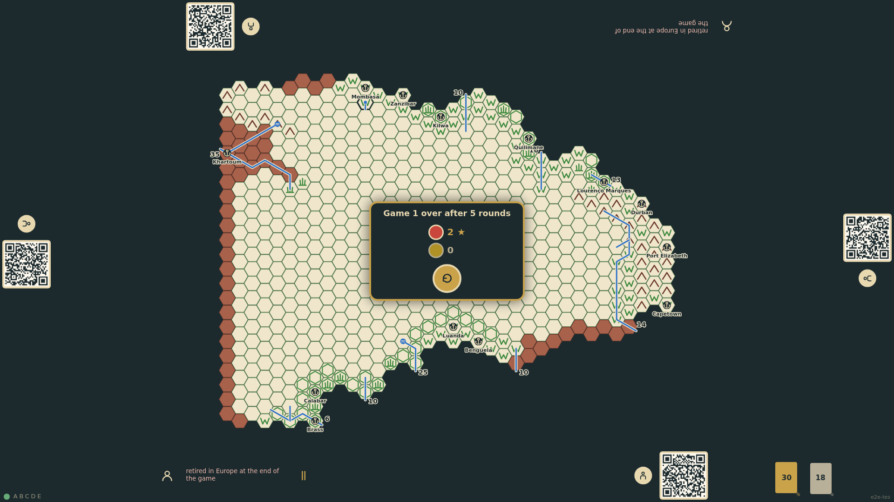
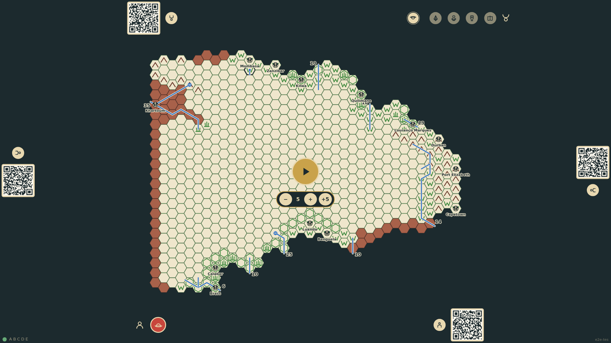

# Game end and continuation

A game runs to an agreed number of rounds, chosen beside the start control, or ends when every seat with an explorer votes for it on the retire panel. At the end every explorer in Europe publishes all he can, every explorer retires, and the standings appear in the middle of the table with the winner marked. A tap starts a new game on the same map: what was published stays known, with its tribes and the records to beat, while scores, explorers and the deck start afresh.

_Generated by the test step helper from `030-game-end-and-continuation.spec.ts`. Do not edit by hand._

## 1. Before the start the table offers a round limit beside the start control: five rounds are chosen

**Player**

**Verifications:**

- [x] The limit reads 5 and the start control says so

## 2. When the fifth round ends the game is over: bottom-1, home in Europe, publishes c24r12 and scores two; both explorers retire; the standings in the middle of the table mark bottom-1 the winner

**Player**

**Verifications:**

- [x] The standings show bottom-1 with 2 points as winner and top-1 with 0; the hex is published; both rails show the retirement

## 3. A tap continues on the same map: the standings are gone, c24r12 stays published, the scores are cleared, the seats commission new explorers and the start control is back

**Player**

**Verifications:**

- [x] No standings, no scores; the published hex remains; a new explorer is commissioned and the game can start
