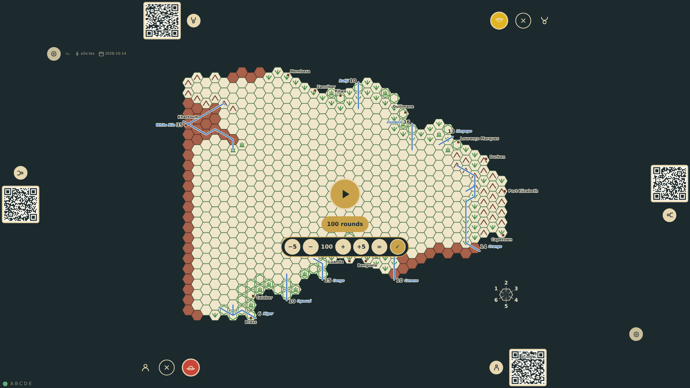
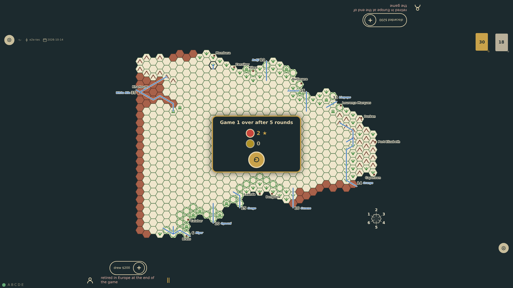
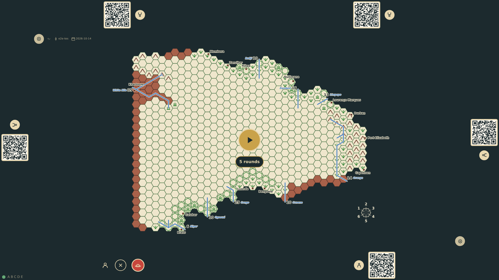

# Game end and continuation

A game runs to an agreed number of rounds, a hundred unless changed with the chooser under the start control (which offers no limit too), or ends when every seat with an explorer votes for it on the retire panel. At the end every explorer in Europe publishes all he can, every explorer retires, and the standings appear in the middle of the table with the winner marked. A tap starts a new game on the same map: what was published stays known, with its tribes and the records to beat, while scores, explorers and the deck start afresh.

_Generated by the test step helper from `030-game-end-and-continuation.spec.ts`. Do not edit by hand._

## 1. Under the start control a button reads the length of the game, a hundred rounds unless changed; a tap opens the chooser beside it: five or one round fewer or more, no limit at all, and a check to close it

**Player**

**Verifications:**

- [x] The button reads 100 rounds and the chooser is open with its six controls, the count at 100

## 2. No limit was chosen, then five rounds more: the chooser closed, the button reads 5 rounds and the start control says so

**Player**

**Verifications:**

- [x] The limit reads 5, the chooser is closed and the start control says so

## 3. When the fifth round ends the game is over: bottom-1, home in Europe, publishes c24r12 and scores two; both explorers retire; the standings in the middle of the table mark bottom-1 the winner

**Player**

**Verifications:**

- [x] The standings show bottom-1 with 2 points as winner and top-1 with 0; the hex is published; both rails show the retirement

## 4. A tap continues on the same map: the standings are gone, c24r12 stays published, the scores are cleared and every seat is free again; the bottom seat is taken afresh and commissions a new explorer, and the start control is back

**Player**

**Verifications:**

- [x] No standings, no scores; the published hex remains; the seats were cleared, one is taken again with a new explorer, and the game can start
