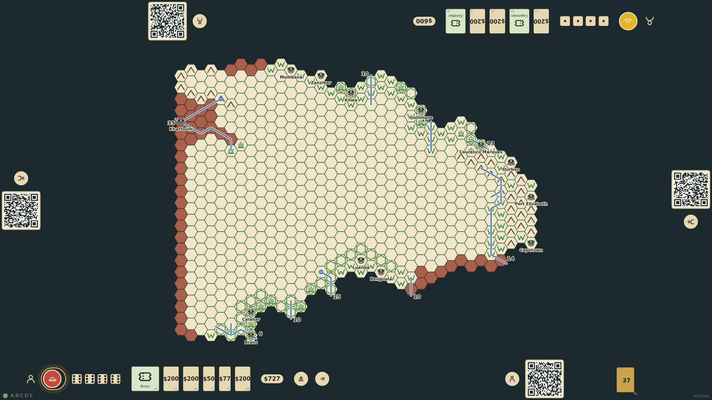
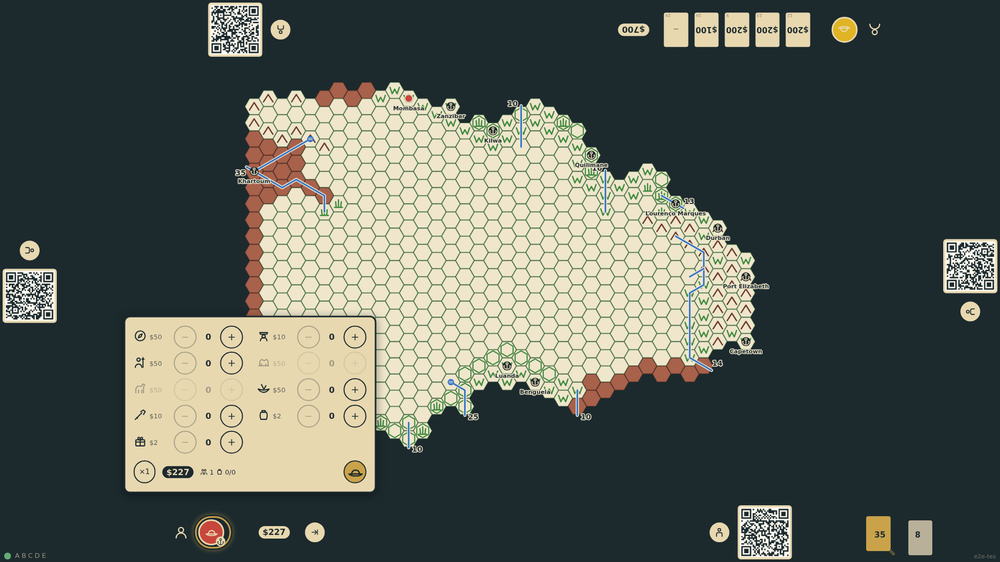
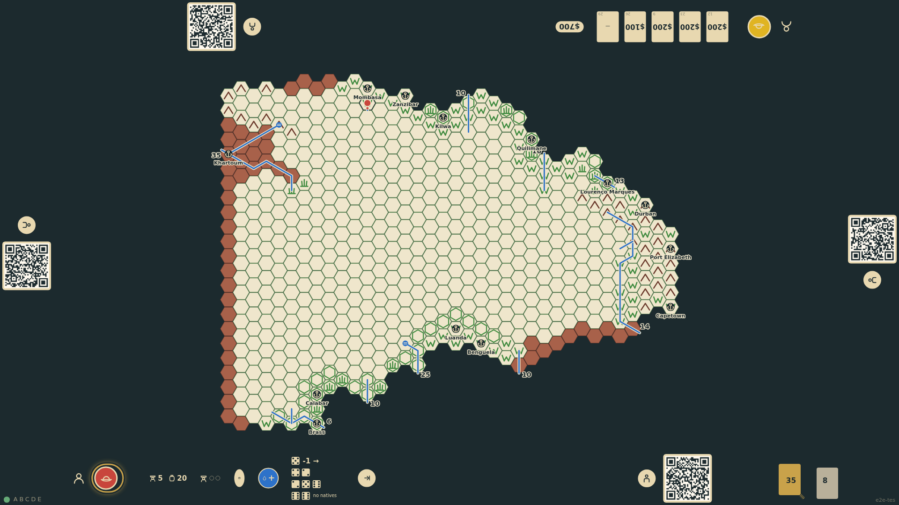
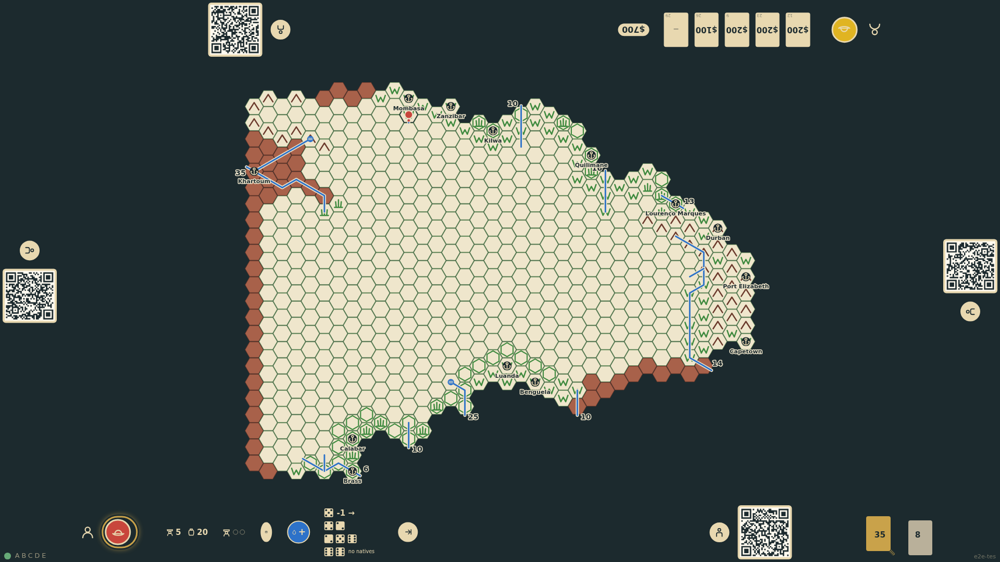
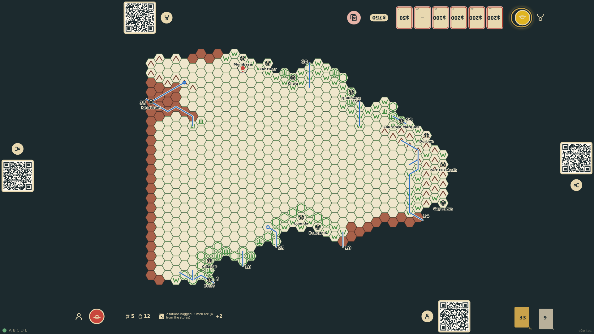

# Reload and undo

Accidental touches happen on a table. Consequential actions confirm at the player's edge, and the last action of a turn can be taken back with the undo control at the rail as long as it rolled no dice and drew no card: booking a voyage, outfitting, caching, trading. Once the dice have spoken the control is gone. The game lives in its event log, so a reload at any phase of a turn, in the middle of a discard or after a step into the unknown, reconstructs the same screen.

_Generated by the test step helper from `031-reload-and-undo.spec.ts`. Do not edit by hand._

## 1. bottom-1 books passage to Mombasa, then takes it back with the undo control: he is in Europe again with his hand, and the control is gone

**Player**

**Verifications:**

- [x] The explorer is back in Europe with six cards; nothing more to undo

## 2. Round 3: bottom-1 outfits five bearers and twenty rations, then takes it back: the chart is gone and the outfitting panel is back with the whole budget

**Player**

**Verifications:**

- [x] The chart summary is gone and the expedition chart panel is offered again

## 3. The step into c24r12 rolls the lost check and maps the hex: the dice have spoken, and the undo control is gone

**Player**

**Verifications:**

- [x] The token is on c24r12 after a lost check; no undo is offered

## 4. Reloaded in the middle of the turn: the token stands on c24r12 with the movement spent, the rolls of the turn at the rail, and the turn still bottom-1's to end

**Player**

**Verifications:**

- [x] The same screen: token on c24r12, lost check and terrain rolls shown, movement spent, end-turn offered

## 5. Round 4: top-1 is over the hand limit; the table is reloaded in the middle of the discard and comes back with the same prompt and the same hand

**Player**

**Verifications:**

- [x] After the reload the discard prompt is still up for top-1 with six cards
