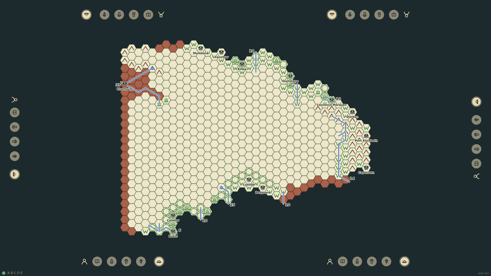
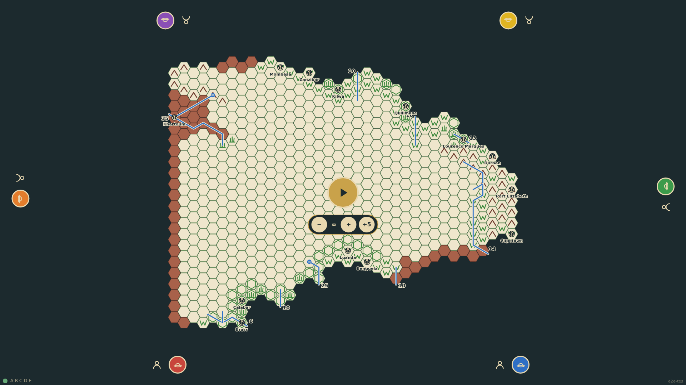
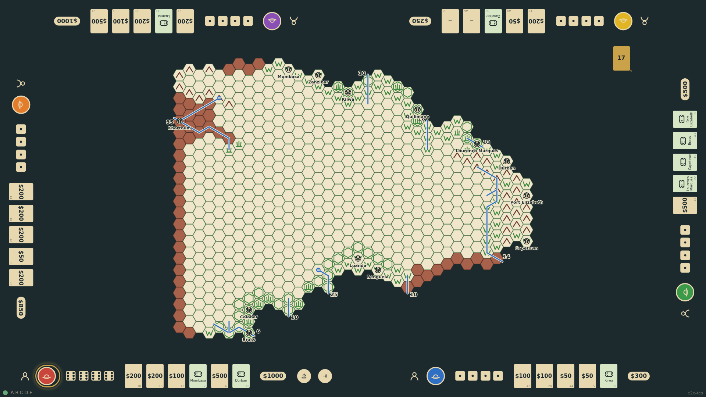
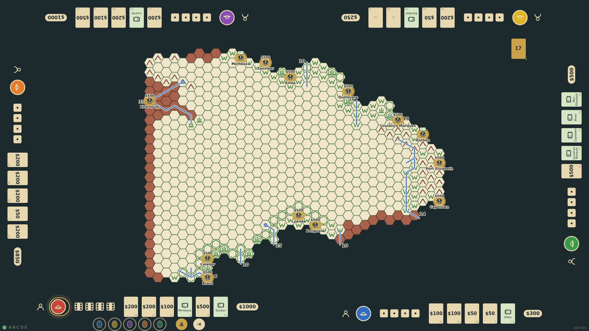
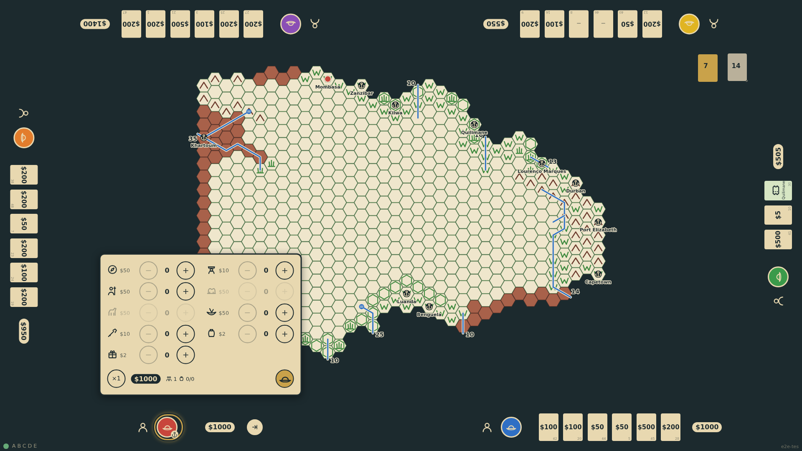
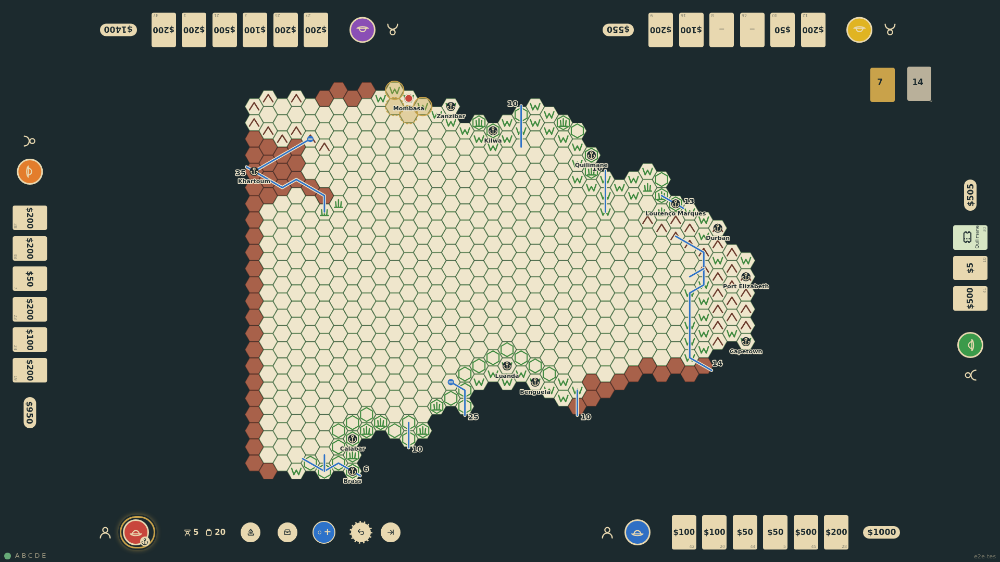
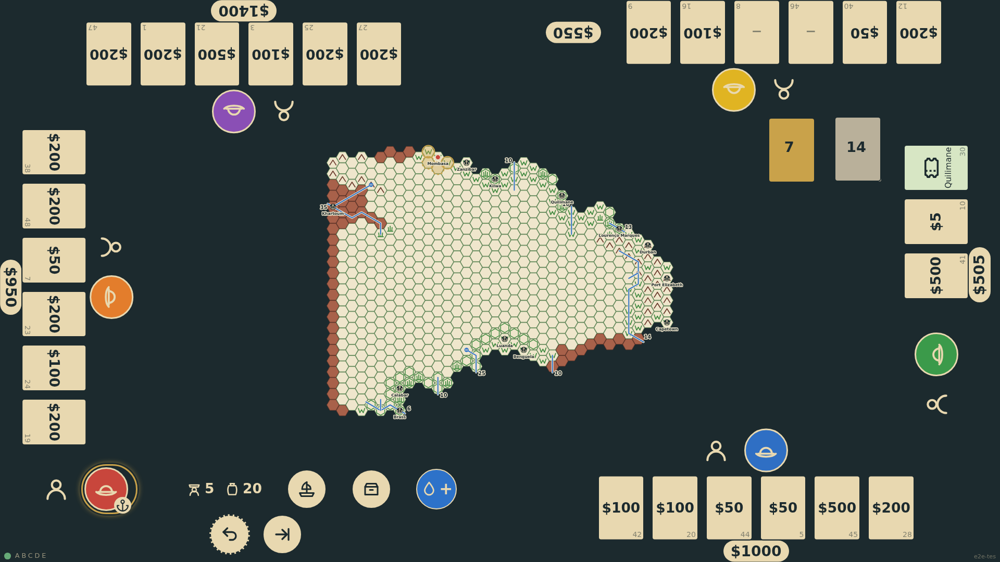

# Responsive pass at 27" and 55"

The table cannot know its physical size, so the screen diagonal is configured with ?diag= and everything a finger touches is sized from it: a touch target is 12 mm and never under 44 px, cards and rails follow the target, and text scales with it on a denser screen. This walkthrough fills all six seats and checks at every step that nothing is clipped and no control is under the target. It runs twice: at 1920×1080 as a 27" table (this gallery) and at 3840×2160 as a 55" table, where the same layout gives hexes twice the size. This run: 27" at 1920×1080.

_Generated by the test step helper from `032-responsive-27-and-55.spec.ts`. Do not edit by hand._

## 1. All six seats are taken on the 27" table: two on each long edge, one on each short edge, each rail turned to its player

**Player**

**Verifications:**

- [x] Six rails are taken and each shows the explorer setup facing its seat
- [x] The table reads the configured diagonal (27") and sizes the touch target from it: 12 mm, never under 44 px
- [x] No control on the screen is smaller than the touch target

## 2. Six explorers are commissioned; the start control and the round chooser in the middle of the table are touch-sized

**Player**

**Verifications:**

- [x] Every seat shows its explorer
- [x] The start control and the round-limit buttons are at least the touch target

## 3. The game starts: six hands of cards face their players on six rails, the dice of the roll for first player beside them, and the bottom seat holds the turn

**Player**

**Verifications:**

- [x] bottom-1 rolled four sixes and holds the turn; every rail shows a hand
- [x] A card is at least 20 mm tall at the configured diagonal
- [x] No control on the screen is smaller than the touch target

## 4. The bottom seat opens the port chooser: thirteen ports on the map offer passage, each with a tap area no smaller than the touch target whatever the hex size

**Player**

**Verifications:**

- [x] Thirteen ports are offered and Mombasa takes the ticket
- [x] Every port's tap area is at least the touch target across

## 5. Landed at Mombasa two rounds later, the bottom seat outfits on a panel at its edge that fits between its rail and the board with all six rails in place

**Player**

**Verifications:**

- [x] The outfit panel is at the bottom edge and it is bottom-1's turn in round 3
- [x] Every button on the panel is at least the touch target

## 6. Outfitted, the expedition sees its move targets: hexes the size the board allows between six rails, 24 mm across on the 55" table and under the 12 mm minimum on the 27" one, where the board already fills the space (G-107)

**Player**

**Verifications:**

- [x] Move targets surround Mombasa
- [x] A hex is at least 12 mm across, or the board already fills the height between the rails

## 7. Reconfigured for a screen of the same pixels but half the diagonal (13.5" at 1080p), the touch target grows to 78 px and cards, rails and text grow with it, still fitting with six seats

**Player**

**Verifications:**

- [x] The touch target is 78 px (12 mm at 163 ppi) and the same game is on the table
- [x] No control on the screen is smaller than the new touch target
