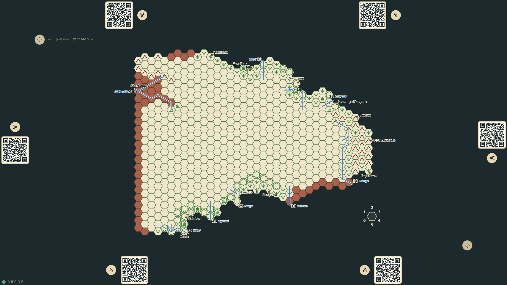

# Map legibility

The names on the map are for the players at the table, so they are placed where a reader at the south edge finds them: a port's name is placed on the map, in the sea beside its port on the side its mark takes (prompt 53), and read horizontally from there whichever way the board is turned; at the north and south edges it runs along the edge, in an unmarked margin around the land that the board keeps for the names at the coast, so Capetown's, Brass's and Mombasa's lie whole in the sea. Khartoum, inland, has its name to the east (the Nile's name has the north); Port Elizabeth's lies south of it, Calabar's south-west, down between the Niger's number and its hex. Luanda stands on the coast. Every river that reaches the sea carries its name at its mouth beside its drainage number.

_Generated by the test step helper from `033-map-legibility.spec.ts`. Do not edit by hand._

## 1. The empty table: every port named beside it in the sea, the names at the coast in the margin around the land, Luanda on the coast, and the nine rivers that reach the sea named at their mouths

**Player**

**Verifications:**

- [x] Luanda is the port of c7r19, a coastal hex (c6r19 is sea), and c8r19 is plain veldt
- [x] All thirteen ports carry a name label, upright for the south edge, placed by its own offset
- [x] Each name is placed on the map (prompt 53): Khartoum's east of it (above, with north to the left), Port Elizabeth's south (to the right), Calabar's south-west (below and to the right), Capetown's west (centred below it), Mombasa's east-south-east (above and to the right)
- [x] The land is inset from the board's edge by an unmarked margin of about a hex, and the names at the coast lie whole within the board: Capetown's, Brass's, Mombasa's, Khartoum's and the White Nile's number
- [x] Each river with a mouth is named there, beside its drainage number
