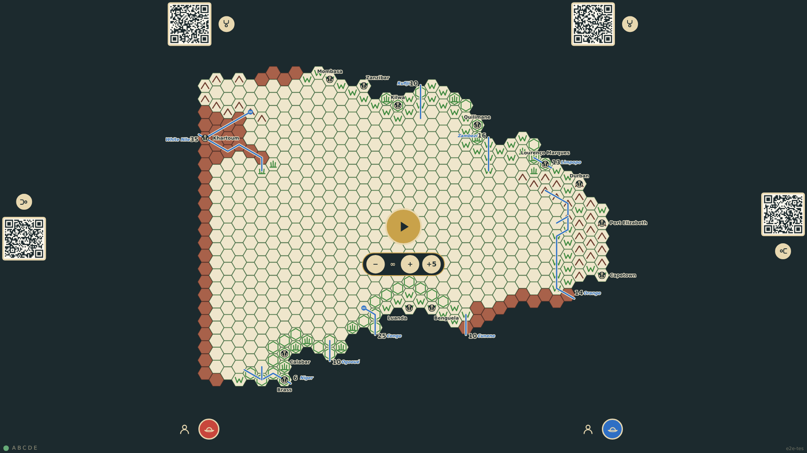
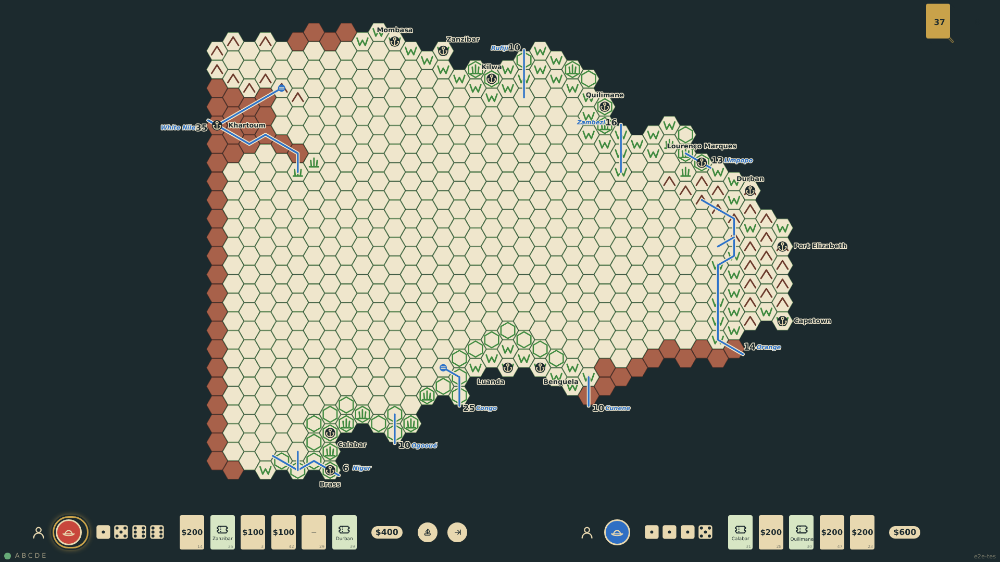
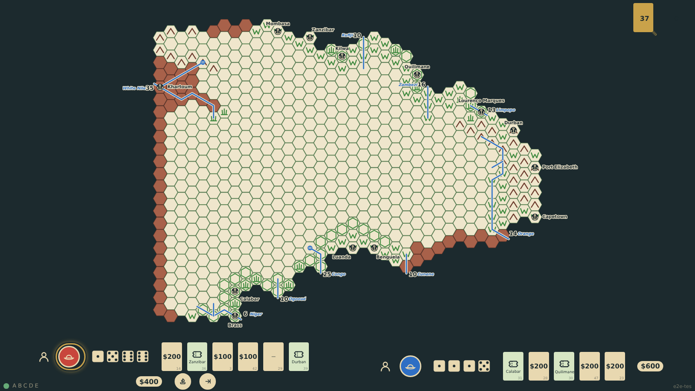

# The table fills the screen

Before the start every seat is offered. Once the game begins, a seat nobody took shows nothing: the players' rails stay where they are and the shared board grows into the edges that have no player. The layout is derived from the window, so resizing it resizes the board, the rails and the panels with it.

_Generated by the test step helper from `034-table-fills-the-screen.spec.ts`. Do not edit by hand._

## 1. Two players on the bottom edge have commissioned explorers; the four other seats are still offered, with their QR codes, and the board sits between all six rails

**Player**

**Verifications:**

- [x] Six rails show: two taken, four offering a seat

## 2. The game has started: only the two players' rails remain and the board has grown upward into the edges nobody sits at, the piles keeping its top-right corner

**Player**

**Verifications:**

- [x] Only the two bottom rails are shown
- [x] The board is taller than before the start and reaches toward the top edge

## 3. The window is resized to 1600×900: the board, rails and piles are laid out again for the new size and everything still fits

**Player**

**Verifications:**

- [x] The board fits the smaller window and the rails sit on its bottom edge
