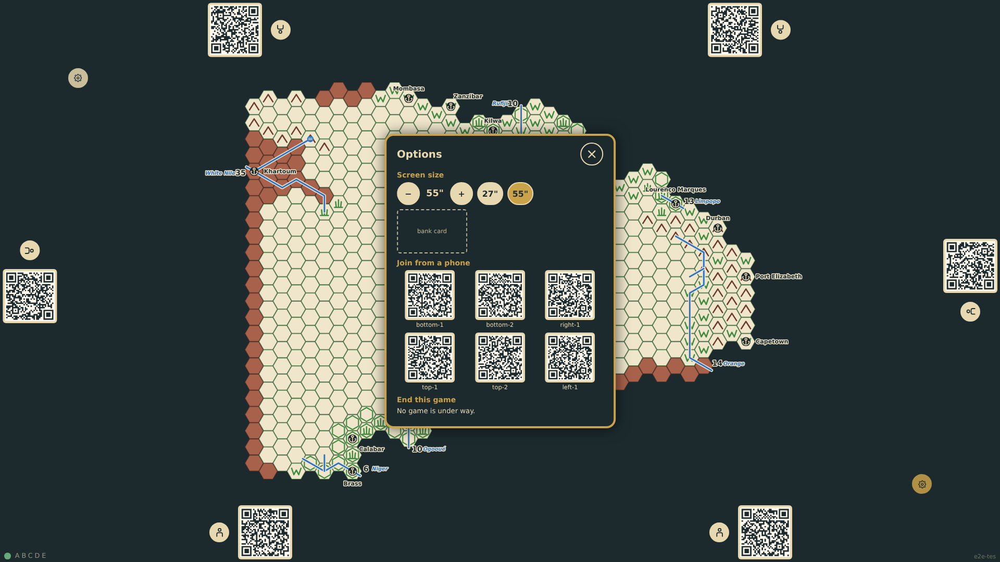
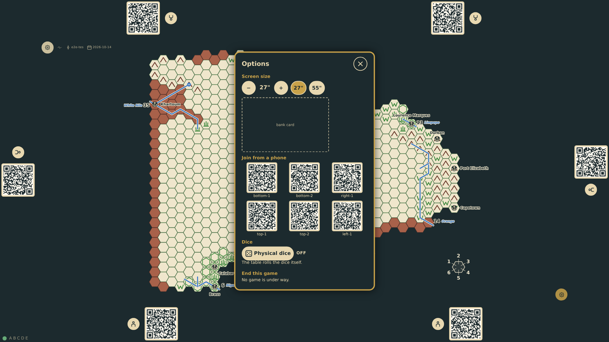
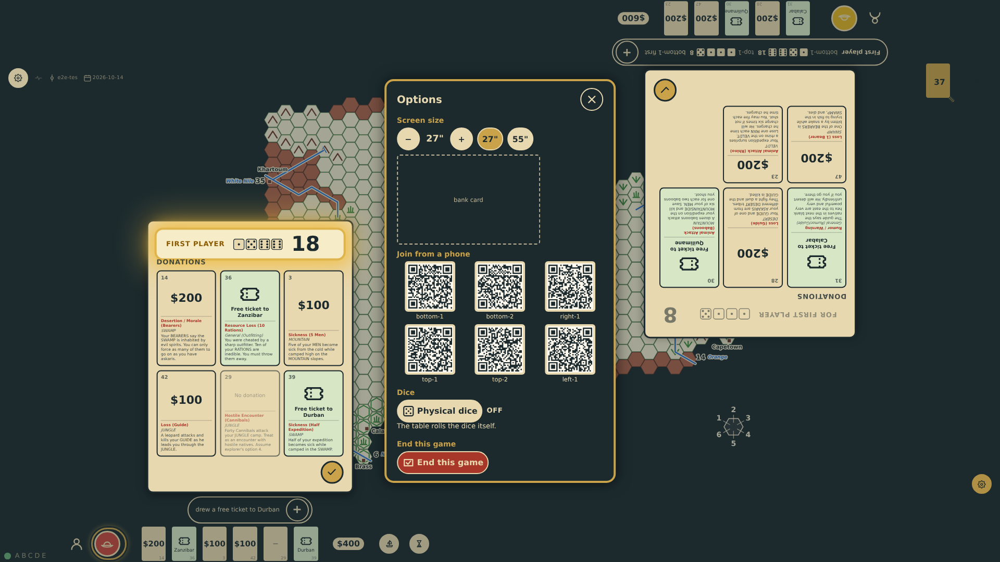
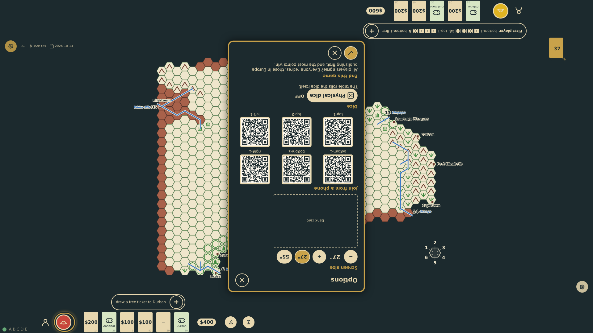
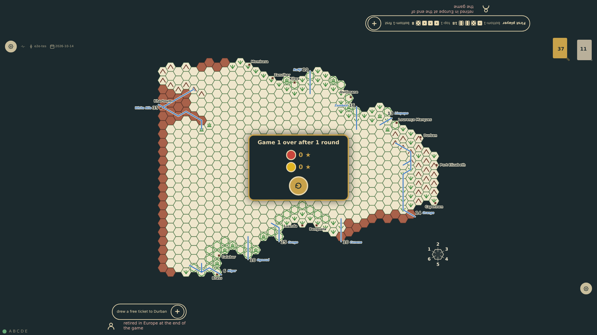

# Options

What is not part of play lives on the options screen, opened from a gear at the north-west or the south-east corner of the board so that a player at any edge can reach one; it opens turned toward the corner that opened it. It sets the screen size, with the outline of a bank card to check it against, offers every seat's QR code for joining or rejoining from a phone, and ends the game by agreement of the players at the table. The gears and the options stand above every scrim and panel (prompt 59), so the options, and ending the game, are reachable while the table is held for dice, a card or the roll for first player.

_Generated by the test step helper from `035-options.spec.ts`. Do not edit by hand._

## 1. The south-east gear opens the options facing the bottom edge: the screen size (55" by default), the outline of a bank card at that size, a QR code for every seat, and no game to end yet

**Player**

**Verifications:**

- [x] Both gears are at their corners and the panel faces the bottom edge
- [x] The diagonal reads 55 inches and the card outline is 85.6 mm wide at that size
- [x] Six QR codes link to the six seats' phone pages
- [x] There is no game to end yet

## 2. The 27" preset is chosen: the table now sizes itself for a 27" screen and the bank-card outline grows to the size a card has on it

**Player**

**Verifications:**

- [x] The table reads 27 inches and remembers it
- [x] The card outline is twice as wide as at 55 inches

## 3. The table is held while the roll for first player is read, a scrim over everything of the game; the gear in the corner is still reachable and opens the options above the scrim, with "End this game" offered, so a game can be left from any moment of play

**Player**

**Verifications:**

- [x] The scrim still holds the table, the options are open above it and offer to end the game

## 4. With a game under way, the north-west gear opens the options turned toward the top edge; "End this game" asks for confirmation

**Player**

**Verifications:**

- [x] The panel faces the top edge and offers the confirmation

## 5. Confirmed, the game ends as by agreement: everyone retires, those in Europe publishing first, and the standings appear in the middle of the table

**Player**

**Verifications:**

- [x] The game ended by consensus in round 1 and the options closed
