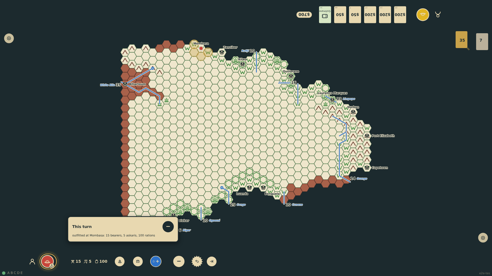
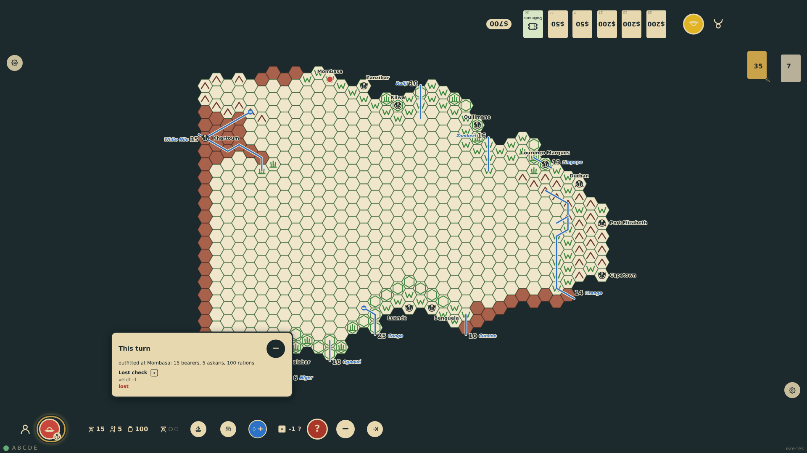
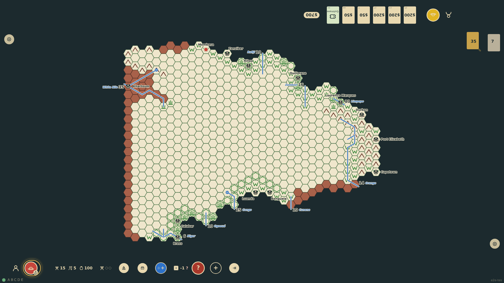

# The turn's log

The rail shows this turn's rolls as dice on one line, with a note for the latest, and the "+" is there from the turn's first action, rolled or not. The "+" at the end of that line opens the full list at the player's edge: every record of the turn in order, with its dice, the modifiers that applied and what came of it, in a short list that scrolls when the turn was eventful. The "−" that takes the place of the "+" closes it.

_Generated by the test step helper from `036-turn-log.spec.ts`. Do not edit by hand._

## 1. Nothing has rolled yet this turn, but the expedition was outfitted: the rail already ends with the "+", and the list it opens says so in a plain line (prompt 16)

**Player**

**Verifications:**

- [x] The rail shows no dice but the "+" is there, and the open list holds the one line: the outfitting
- [x] The log in the state holds that one action and no roll

## 2. The expedition tried the blank hex and was lost: the rail shows the turn's dice on one line, with a "+" at its end

**Player**

**Verifications:**

- [x] The roll log shows the lost check and ends with the "+" control

## 3. The "+" becomes a "−" and the full list of the turn opens at the player's edge: each record in order with its dice, its modifiers and its outcome

**Player**

**Verifications:**

- [x] The list at the edge holds every record of the turn, as many as the rail's log
- [x] The control now reads "−" and is pressed
- [x] The list is a short, scrollable region

## 4. The "−" closes the list and becomes a "+" again

**Player**

**Verifications:**

- [x] The list is gone and the control reads "+"
