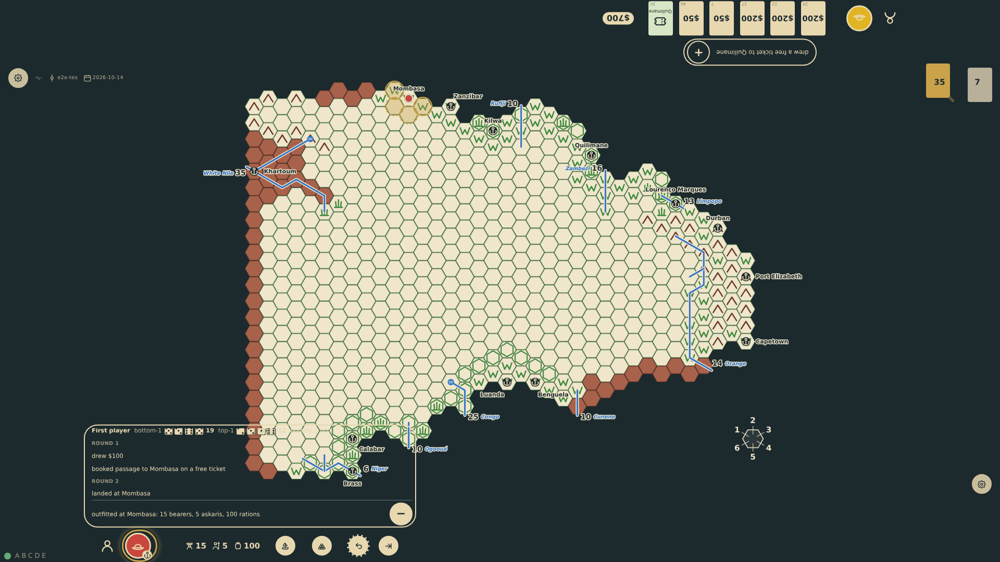
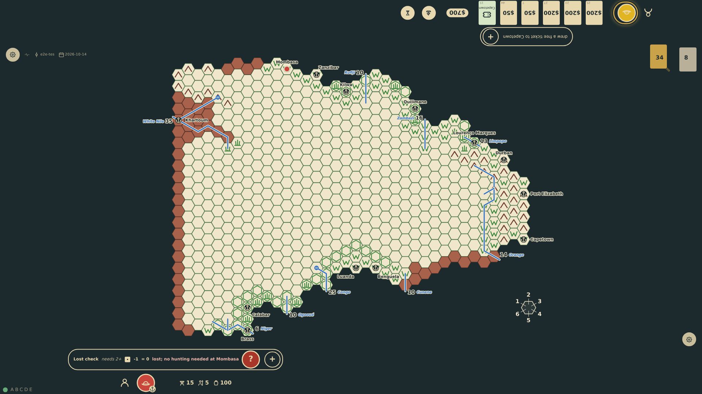
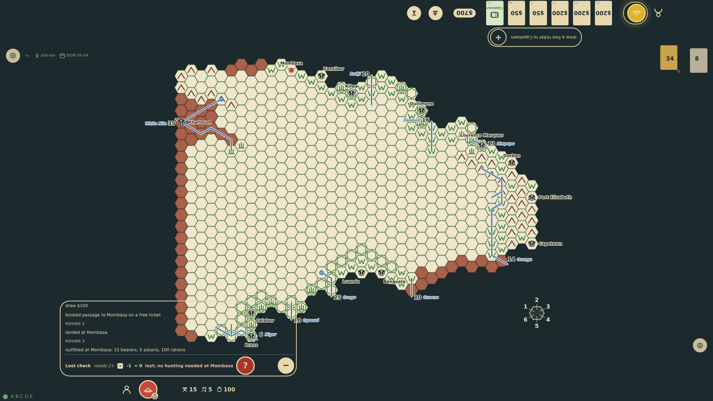
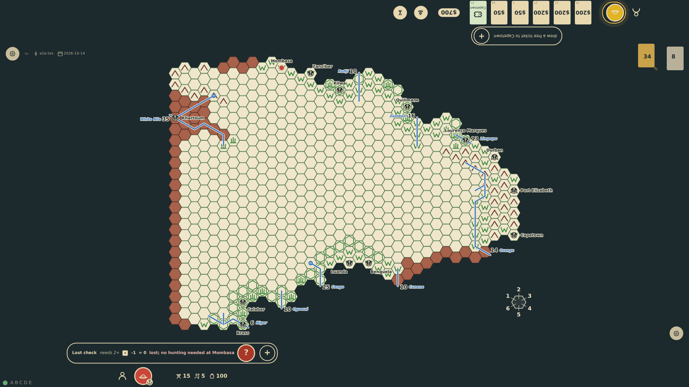

# The log

Every seat's rail is two sections: the status row at the player's edge (the name, the explorer's hat, the hand, the expedition and its controls, the camp's cairn among them) and, inward of it, the log in an outlined box. Collapsed, the box is the latest line of the log: the roll for first player, the card drawn, passage booked, the landing, the outfitting, a lost check with its dice, the meal that ends a turn in the field. The "+" at the end of that line grows the box to hold the rest of the log above it, round by round from the roll for first player, a few lines that scroll, kept at the newest; the latest line stays the box's last, and the "−" in the "+"'s place collapses the box again.

_Generated by the test step helper from `036-turn-log.spec.ts`. Do not edit by hand._

## 1. Nothing has rolled this turn, but the rail's log box already reads the log's latest line, the outfitting, with the "+" at its end, inward of the status row with the name, the hat, the expedition and the camp's cairn; the other seat's box reads its own latest line

**Player**

**Verifications:**

- [x] The rail is two sections: the status row at the edge holds the name, the explorer, the expedition and the camp control; the log box stands inward of it, collapsed
- [x] The box's line is the outfitting; the log counts the roll for first player, the Europe turn, the landing and this turn
- [x] The state holds the finished turns: the roll for first player for each seat, then each turn with its lines

## 2. The "+" becomes a "−" and the box grows inward to hold the rest of the log above the line: the roll for first player, round 1 in Europe, the landing in round 2; the outfitting stays as the box's last line, the status row where it was

**Player**

**Verifications:**

- [x] The list sits inside the box directly above the latest line, the "−" at the line's end; the status row keeps its place at the edge
- [x] The list holds every earlier line under its round, and not the rail's

## 3. The expedition tried the blank hex and was lost: the box's line is now the lost check with its dice and the lost mark, the "+" at its end

**Player**

**Verifications:**

- [x] The rail reads the lost check and ends with the "+"

## 4. Opened again, the list has grown by the outfitting under round 3 and is scrolled to its newest lines; the lost check stays the box's last line below

**Player**

**Verifications:**

- [x] The outfitting joined the list under this round; the lost check is the box's line, not the list's
- [x] The list is a few lines, a scrollable region kept at its end

## 5. The "−" collapses the box to its one line and becomes a "+" again; the box keeps the latest line

**Player**

**Verifications:**

- [x] The list is gone, the control reads "+", the lost check is still the box's line, the box collapsed inward of the status row
