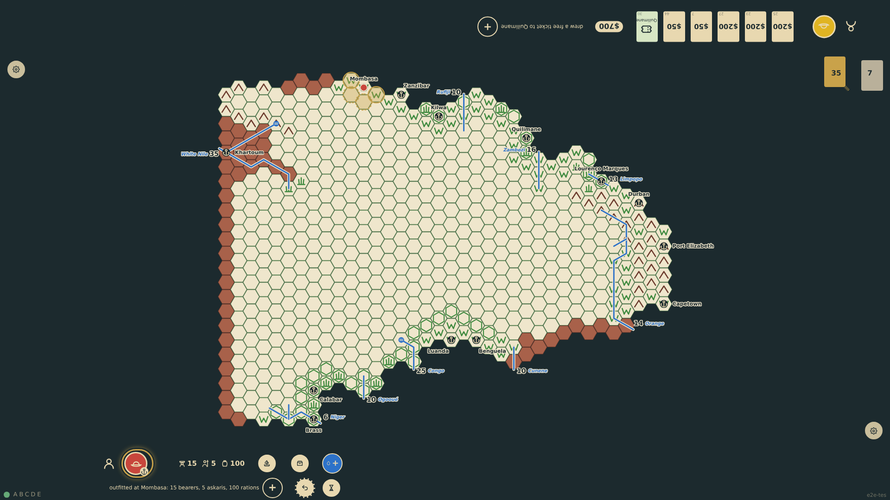
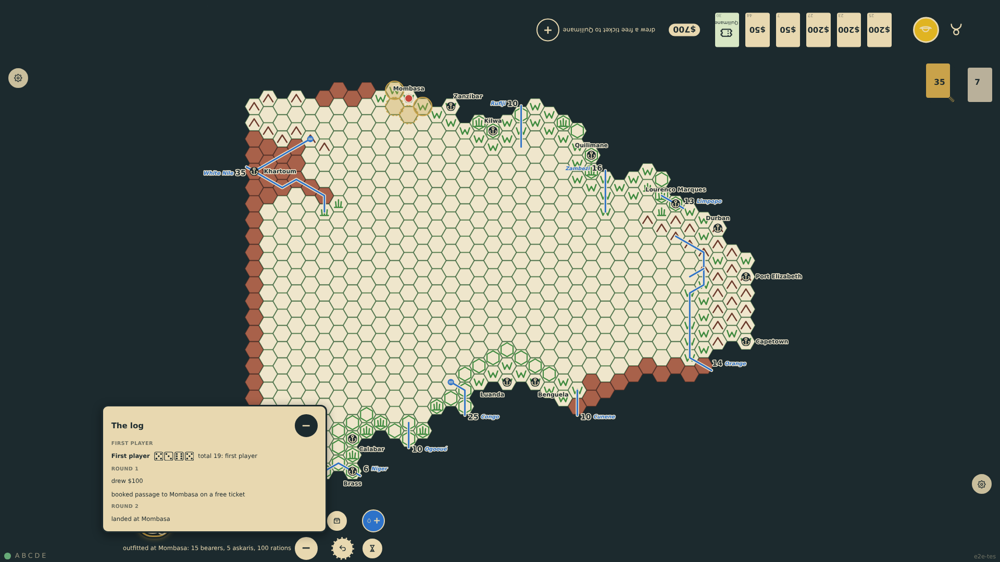
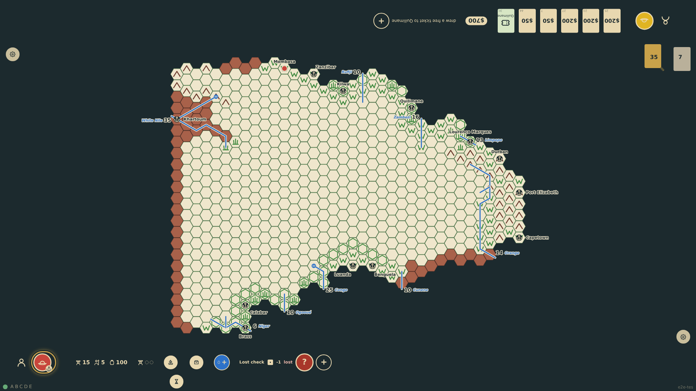

# The log

Every seat's rail carries the latest line of its log: the roll for first player, the card drawn, passage booked, the landing, the outfitting, a lost check with its dice, the meal that ends a turn in the field. The "+" at the end of that line opens the rest of the log directly above it, round by round from the roll for first player, with the list's "−" in line with the "−" that took the "+"'s place; the latest line stays on the rail as the list's last. The list is short and scrolls, kept at its newest lines.

_Generated by the test step helper from `036-turn-log.spec.ts`. Do not edit by hand._

## 1. Nothing has rolled this turn, but the rail already reads the log's latest line, the outfitting, with the "+" at its end; the other seat's rail reads its own latest line

**Player**

**Verifications:**

- [x] The rail's line is the outfitting; the log counts the roll for first player, the Europe turn, the landing and this turn
- [x] The state holds the finished turns: the roll for first player for each seat, then each turn with its lines

## 2. The "+" becomes a "−" and the rest of the log opens directly above the line: the roll for first player, round 1 in Europe, the landing in round 2; the outfitting stays on the rail as the list's last line

**Player**

**Verifications:**

- [x] The list sits directly above the rail's line with its "−" in line with the rail's
- [x] The list holds every earlier line under its round, and not the rail's

## 3. The expedition tried the blank hex and was lost: the rail's line is now the lost check with its dice and the lost mark, the "+" at its end

**Player**

**Verifications:**

- [x] The rail reads the lost check and ends with the "+"

## 4. Opened again, the list has grown by the outfitting under round 3 and is scrolled to its newest lines; the lost check stays on the rail below

**Player**

**Verifications:**

- [x] The outfitting joined the list under this round; the lost check is the rail's line, not the list's
- [x] The list is a short, scrollable region kept at its end

## 5. The "−" closes the list and becomes a "+" again; the rail keeps the latest line

**Player**

**Verifications:**

- [x] The list is gone, the control reads "+", the lost check is still on the rail
