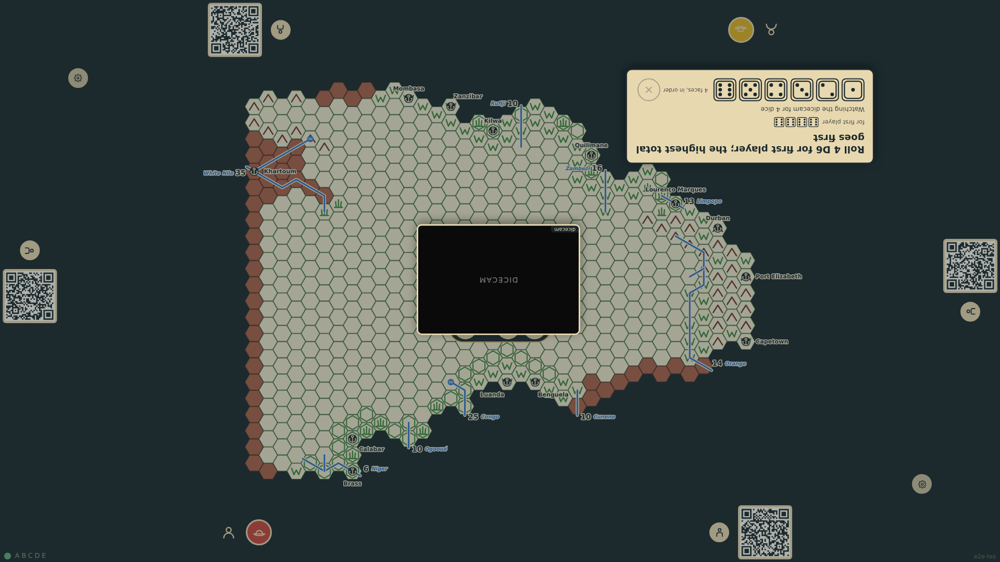
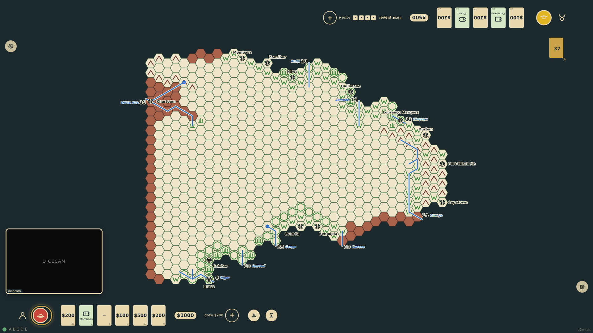
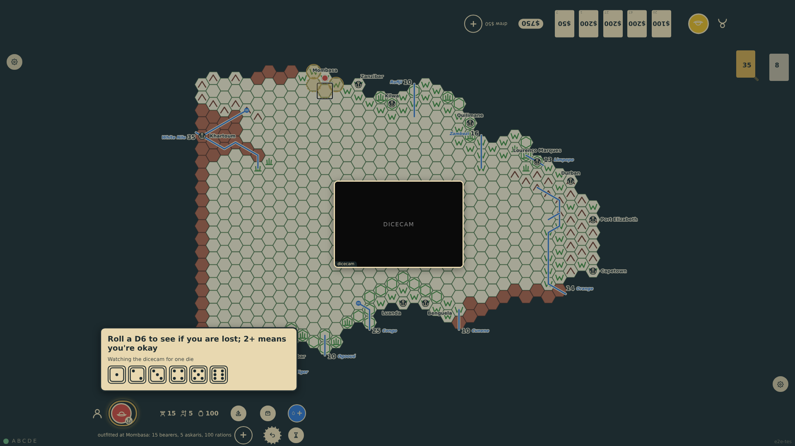
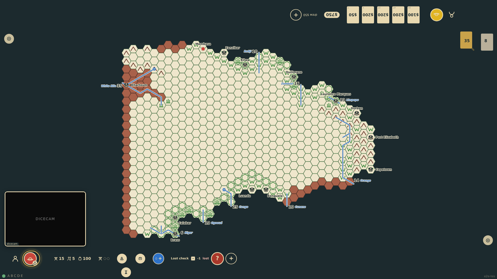
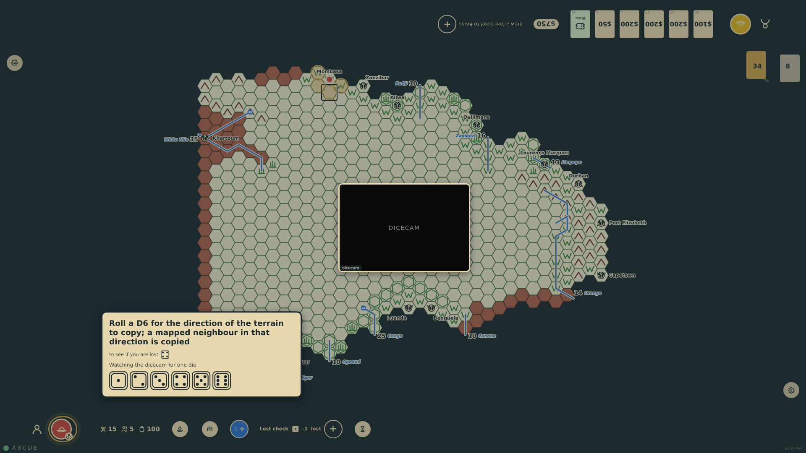
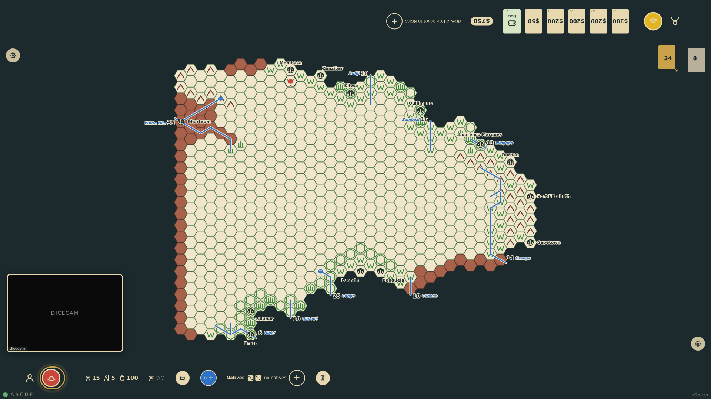

# Physical dice

The options screen turns physical dice on: from then on the table rolls nothing itself. Whenever a rule calls for dice the game stands still and the seat whose roll it is reads what to roll and why at its edge ("Roll a D6 to see if you are lost; 2+ means you're okay"), with the throws already made for the same action. The dicecam, the WebCamTool page in a frame in the corner of the board, reads the tray and two agreeing readings enter the roll; a tap on one of the six faces enters it by hand. Each roll becomes a dice/rolled event, so the log replays the same game. The roll for first player, a lost check, the terrain, a river source and the natives are rolled this way in one game.

_Generated by the test step helper from `037-physical-dice.spec.ts`. Do not edit by hand._

## 1. The options screen has a dice section: "Physical dice" is switched on, and the dicecam appears in the south-west corner of the board

**Player**

**Verifications:**

- [x] The toggle is on and the state says so; the game records it as a dice/physical event
- [x] The dicecam frame is on the table, still connecting

## 2. The game starts with the roll for first player: the table stands still and asks bottom-1, at its edge, for four dice; the dicecam is watching for them, and the six faces are there to tap instead

**Player**

**Verifications:**

- [x] The ask names the throw and what it decides; the game has not started
- [x] The dicecam is active and watching for four dice; the faces wait for four taps; the rest of the table is held

## 3. The dicecam reads four sixes twice over and the throw is in: the ask moves to top-1, who sees bottom-1's throw listed above the dicecam line

**Player**

**Verifications:**

- [x] bottom-1's four sixes are a dice/rolled event and listed for top-1; the ask is now top-1's

## 4. top-1 has no dice in front of the camera and taps the faces instead: three ones so far, shown beside the faces, a fourth will send the throw

**Player**

**Verifications:**

- [x] Three taps are counted and shown; the throw is not yet in

## 5. The fourth tap sends four ones: bottom-1 plays first, the roll for first player is in each log, and the table is free again

**Player**

**Verifications:**

- [x] Nothing is awaited, the game is in round 1 with bottom-1 first, and both throws are in the log

## 6. The first step into a blank hex: the table asks for the lost check in the rules' words, with the die it takes to find the way out of veldt

**Player**

**Verifications:**

- [x] The ask is the lost check with its threshold; the step is held until the die is rolled

## 7. The dicecam reads a one: the expedition is lost for the turn, the check is the rail's latest line with the die that was rolled

**Player**

**Verifications:**

- [x] The lost check is logged with the physical die and the expedition stayed put

## 8. Next turn the way is found on a four, and the same step goes straight on to the next roll: the direction of the terrain to copy, with the lost check listed as already rolled

**Player**

**Verifications:**

- [x] The step is still held, now at the terrain roll, and its lost check is listed above the dicecam line

## 9. A tapped two copies the veldt of Mombasa, a tapped one finds no river, and the dicecam's three and three find no natives: the hex is mapped and the expedition stands on it, every roll of the step in the log

**Player**

**Verifications:**

- [x] The hex is veldt with the expedition on it; the log holds the lost check, the terrain, the water and the natives with the dice rolled
- [x] Every throw of the game is a dice/rolled event, seven so far, and nothing was refused

## 10. After a reload the log replays the same game from the recorded throws: the same map, the same log, physical dice still on and the dicecam back in its corner

**Player**

**Verifications:**

- [x] The state is the same as before the reload and the dicecam frame is up again
