# Physical dice

The options screen turns physical dice on: from then on the table rolls nothing itself. Whenever a rule calls for dice the game stands still and the seat whose roll it is reads what to roll and why at its edge ("Roll a D6 to see if you are lost; 2+ means you're okay"), with the throws already made for the same action. The dicecam in the corner of the board shows the table's camera on a canvas, the tray and the dice as WebCamTool's engine reads them drawn over the picture; two agreeing readings enter the roll, each die judged on its own so a die tossed in beside those already lying there is the throw, and a tap on one of the six faces enters it by hand. Each roll becomes a dice/rolled event, so the log replays the same game. The roll for first player, a lost check, the terrain, a river source and the natives are rolled this way in one game. Every ask after the first shows what the dice before it decided, and once the last die of an action is in, what the dice decided stays at the seat's edge for two seconds before the table goes on (prompts 54 to 56).

_Generated by the test step helper from `037-physical-dice.spec.ts`. Do not edit by hand._

## 1. The options screen has a dice section: "Physical dice" is switched on, and the dicecam appears in the south-west corner of the board: the table's camera on a canvas, its picture of the tray with the tray's floor outlined as the engine finds it

**Player**

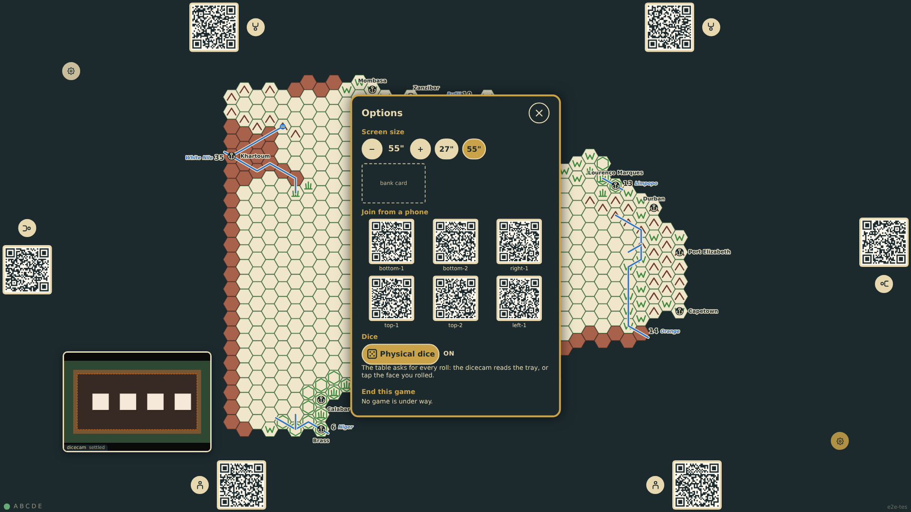

**Verifications:**

- [x] The toggle is on and the state says so; the game records it as a dice/physical event
- [x] The dicecam is active: the camera streams, the engine is up and takes the frames, the tray is settled, and the canvas shows the camera's picture

## 2. The game starts with the roll for first player: the table stands still and asks bottom-1, at its edge, for four dice; the dicecam is watching for them, and the six faces are there to tap instead

**Player**

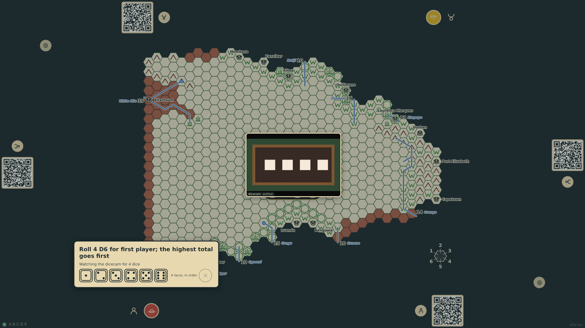

**Verifications:**

- [x] The ask names the throw and what it decides; the game has not started
- [x] The dicecam is active and watching for four dice, brought to the middle of the board; the faces wait for four taps; the rest of the table is held

## 3. The engine's first reading is of four twos lying in the tray from before the game: the table takes them for the tray as found, not for the throw, draws them on the picture and waits for a roll

**Player**

**Verifications:**

- [x] The reading is not taken: the prompt waits for a roll of four dice, none of the four counted as thrown, the dock holds the reading, and nothing is rolled

## 4. The dice are thrown and the engine reads the settled tray: four sixes, each die outlined on the picture with its value above it and its confidence along its foot, the way the Yahtzee page draws them; one reading is not enough, the table waits for a second that agrees

**Player**

**Verifications:**

- [x] The prompt says four dice are seen and their faces are being read; the dock holds two readings and the throw is not yet taken
- [x] The overlay is drawn on the canvas: the green of a die's face where the first die lies, the label's dark box above it

## 5. The dicecam reads four sixes twice over and the throw is in: bottom-1's four sixes and their total stand in front of bottom-1's own station, and the ask moves to top-1

**Player**

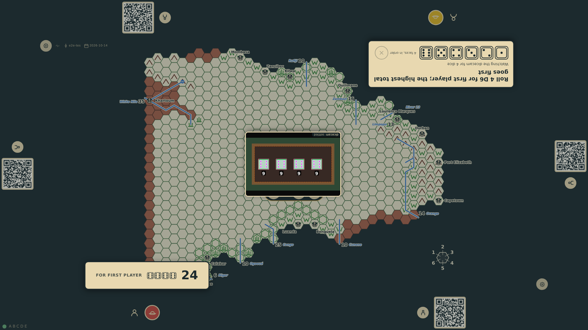

**Verifications:**

- [x] bottom-1's four sixes are a dice/rolled event, shown at bottom-1's station and not in top-1's prompt; the ask is now top-1's

## 6. top-1 has no dice in front of the camera and taps the faces instead: three ones so far, shown beside the faces, a fourth will send the throw

**Player**

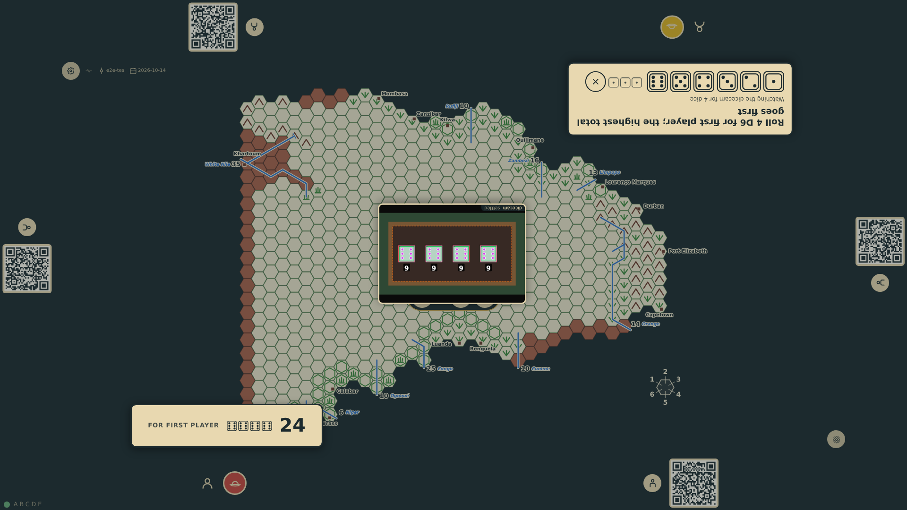

**Verifications:**

- [x] Three taps are counted and shown; the throw is not yet in

## 7. The fourth tap sends four ones and the first player is decided: each station holds its own roll, bottom-1's twenty-four glowing as first player over top-1's four, and the table stands still for a few seconds before play begins

**Player**

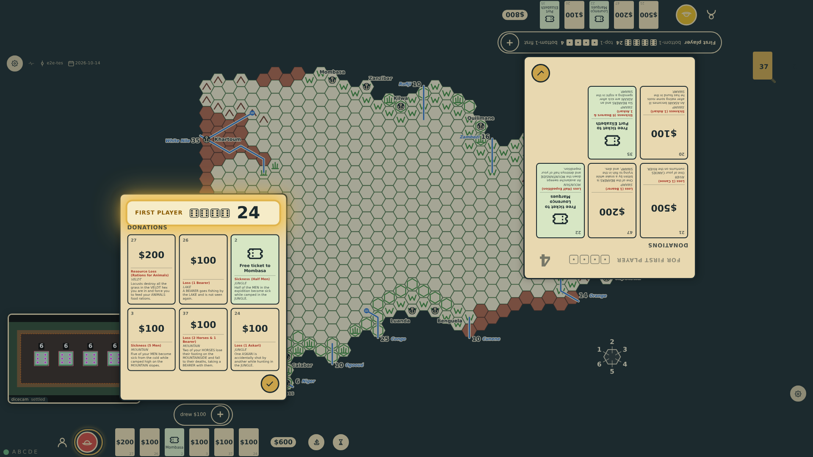

**Verifications:**

- [x] Both rolls stand at their stations, bottom-1's as the winner; the game is held at the roll

## 8. Play begins: bottom-1 plays first, the roll for first player is one line in each log with both throws and who went first, and the table is free again

**Player**

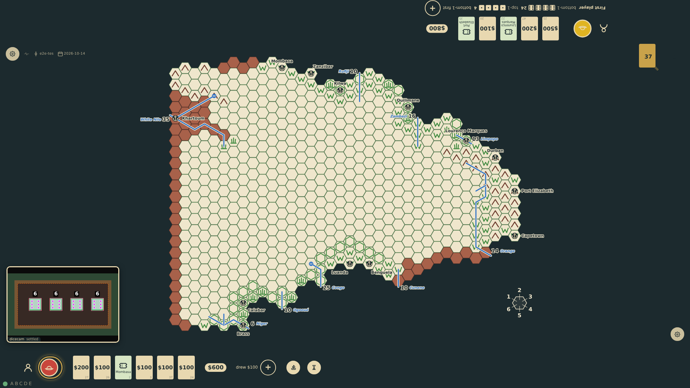

**Verifications:**

- [x] Nothing is awaited, the game is in round 1 with bottom-1 first, and the roll is one line in both logs

## 9. The first step into a blank hex: the table asks for the lost check in the rules' words, with the die it takes to find the way out of veldt

**Player**

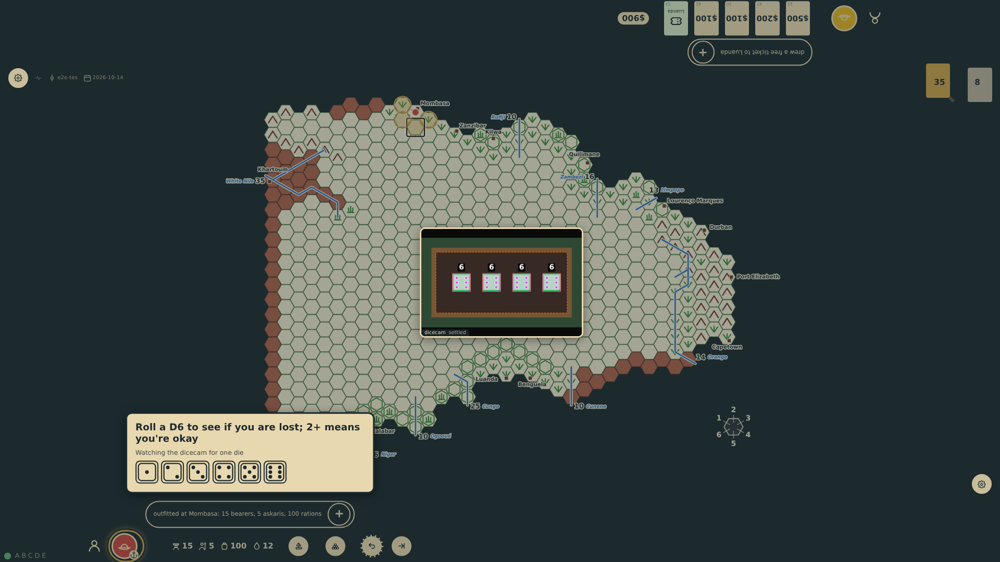

**Verifications:**

- [x] The ask is the lost check with its threshold; the step is held until the die is rolled

## 10. The dicecam reads a one: the expedition is lost and its turn ends there and then; at a port there is no hunt. The ask stays at the edge for a moment as the result (prompt 56): the check with the die, what it needed, and the notice that no hunting was needed at Mombasa; the same line is the rail's latest

**Player**

**Verifications:**

- [x] The result panel is titled by the ask and holds the one line, lost, while the turn has already passed
- [x] The lost check is logged with the physical die and the notice, the expedition stayed put, and the turn passed to top-1

## 11. Next turn the way is found on a four, and the same step goes straight on to the next roll: the direction of the terrain to copy, with the lost check listed as already rolled, its verdict on the same line, and the compass on the board to read the direction from

**Player**

**Verifications:**

- [x] The step is still held, now at the terrain roll, and its lost check is listed above the dicecam line as a log line: the die and "found the way"
- [x] The compass on the board gives the six directions as the die names them, 1 at the north-east round to 6 at the north-west

## 12. The last dice of the step are in and the hex is mapped, but the ask stays at bottom-1's edge for a moment with what every die of the step decided (prompt 56): the way found on a four, the veldt copied from direction 2, the one that is odd so no river, and the three and three that find no natives; a tap, or two seconds, and the table goes on

**Player**

**Verifications:**

- [x] The result panel is titled by the last ask and holds the four lines of the step, each explained; the dice prompt is gone

## 13. A tapped two copies the veldt of Mombasa, a tapped one finds no river, and the dicecam's three and three find no natives: the hex is mapped and the expedition stands on it, every roll of the step in the log

**Player**

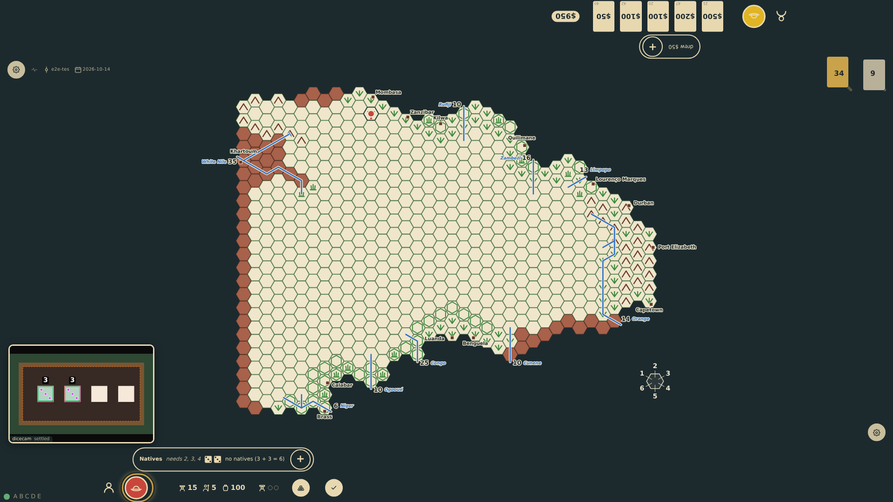

**Verifications:**

- [x] The hex is veldt with the expedition on it; the log holds the lost check, the terrain, the water and the natives with the dice rolled
- [x] Every throw of the game is a dice/rolled event, seven so far, and nothing was refused

## 14. Lost in the field, the expedition can do nothing more this turn: the table goes straight on to the hunt, the lost check listed above the dicecam line as already rolled and lost

**Player**

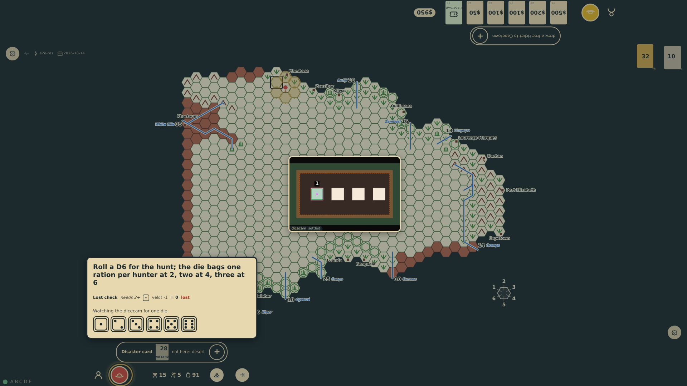

**Verifications:**

- [x] The same step is held at the hunt roll, with the lost check already rolled and its line saying lost; the token stayed where it was

## 15. The die of the lost check still lies in the tray and the engine reports it under a new name: the table remembers where the last throw lay and what it showed, and waits for a roll instead of reading it again

**Player**

**Verifications:**

- [x] The reading is ignored: the status line waits for a D6 roll, no throw is taken and the hunt is still asked

## 16. The hunt's die is in and the turn has passed, but the ask stays at bottom-1's edge for a moment with what the dice decided (prompt 54): the lost check that led to the hunt and the meal, every number explained, the five giving two rations per hunter, so the five askaris and the explorer bag twelve and the stores make up the rest; the table waits for a tap or two seconds before going on

**Player**

**Verifications:**

- [x] The result panel is titled The hunt and holds two lines, the lost check and the hunt; the hunt's line opens with the rate per hunter, then the rations bagged, the men fed and the stores drawn on; the dice prompt is gone and the turn is already top-1's

## 17. A second die tossed in beside the lost die, under the lost die's own name (the engine missed the toss), is the hunt: the one resting where it lay is left out and the five beside it is taken; the meal closes the turn and it passes to top-1; bottom-1's rail reads the hunt with what it needed, and keeps the lost mark

**Player**

**Verifications:**

- [x] The turn is top-1's; bottom-1's latest turn holds the lost check and the hunt on a five, the hunt's line saying what the die needed

## 18. The hunt's die at bottom-1's rail is tapped: a radial menu of the six faces opens round it, turned to the seat, the five the die shows marked, an X in the centre to leave it as it is; nothing has changed yet

**Player**

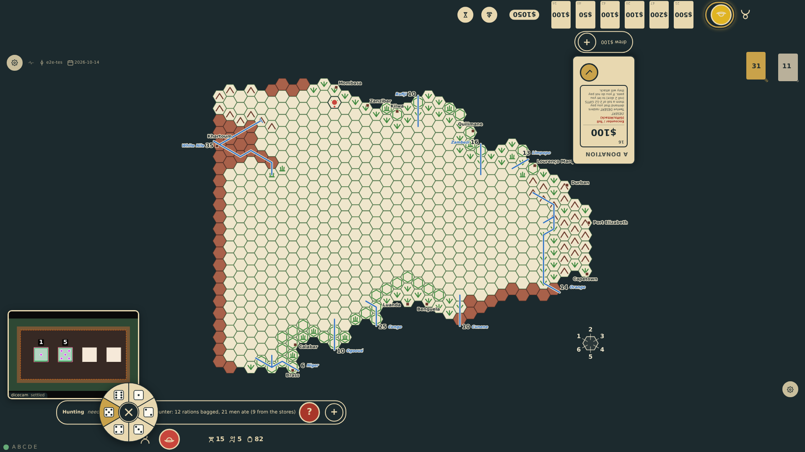

**Verifications:**

- [x] The menu stands over the rail with six faces and the centre, the five marked as the die's face; no correction has been sent

## 19. The two is chosen: the game is folded again from the recorded throws with the hunt's die a two, so the meal bags a ration a hunter instead of two and the stores hold less; the line reads the two with the mark of a die set by hand

**Player**

**Verifications:**

- [x] A dice/corrected event names the hunt's throw, its die and the two; the line's die is a two, marked; the bag and the food are smaller; nothing was refused

## 20. In the open log the lost check's die is tapped and a four chosen; the game cannot have gone that way, the hunt's die rolled after it would have answered the terrain's ask instead, so a notice at bottom-1's edge says the die stays a one and why, over the held table

**Player**

**Verifications:**

- [x] The notice gives the reason; the correction is a refused event, and the game is as it was: the lost check a one, the turn top-1's

## 21. A tap on the hunt's die in the dicecam's picture: the table finds the throw it came from by where the die lies, says over the picture that it is reading the die again, and waits for the engine's next readings of it

**Player**

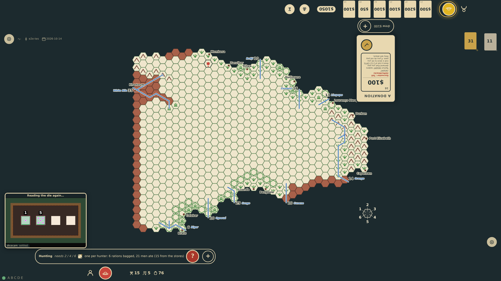

**Verifications:**

- [x] The dock says the die is being read again; nothing has changed in the game yet

## 22. Two readings agree the die is a six: the table corrects it as the menu would, the game is folded again with the hunt a six, three rations a hunter, and the dock says what it read

**Player**

**Verifications:**

- [x] A third dice/corrected names the hunt's throw and the six; the line reads the six, marked; the bag is eighteen rations and the stores hold six more than the five left them

## 23. The same die tapped again opens the six faces over the picture, the six it now shows marked, for the player to set it by hand

**Player**

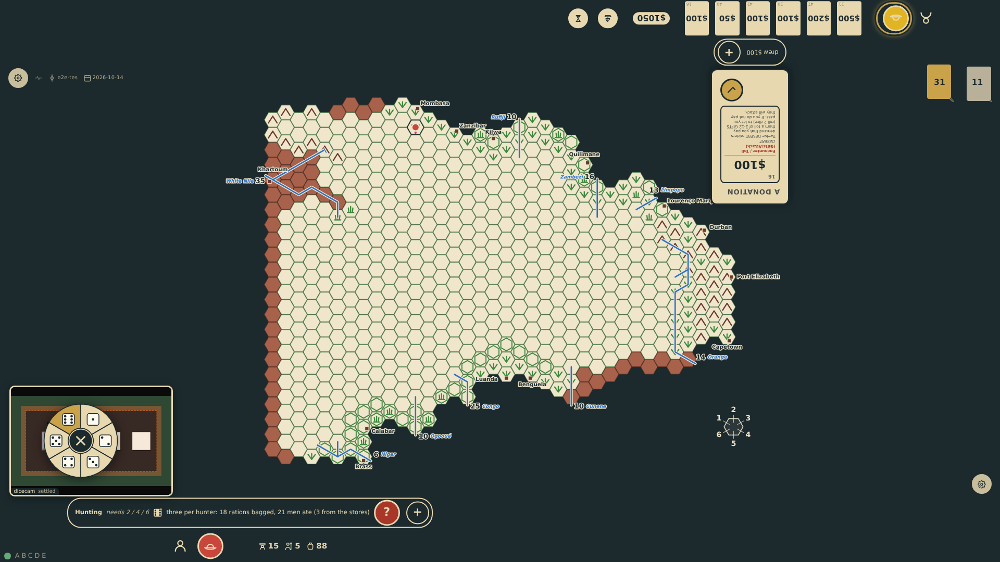

**Verifications:**

- [x] The menu stands over the dock with the six marked, and the dock's note is gone

## 24. A four is chosen: the hunt is two rations a hunter again, the stores as the five had left them, the die on the rail a four with its mark

**Player**

**Verifications:**

- [x] A fourth dice/corrected sets the die to four; the line and the stores read as after the five; nothing else was refused

## 25. After a reload the log replays the same game from the recorded throws and the corrections among them: the same map, the same log with the hunt's die a four, physical dice still on and the dicecam back in its corner, its camera and engine started again

**Player**

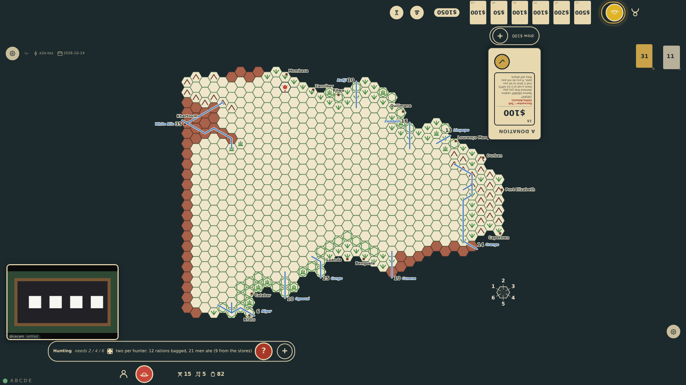

**Verifications:**

- [x] The state is the same as before the reload, the correction applied again and the refusal noted again, and the dicecam is active again
