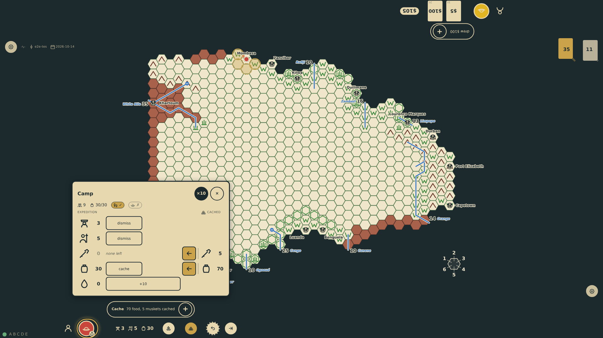
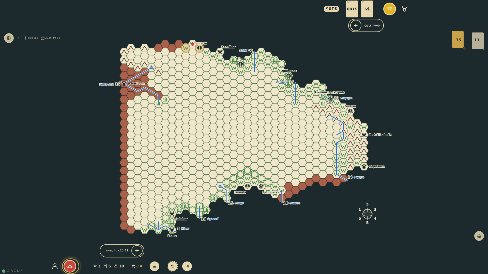

# Overloaded

An expedition carries overland what its bearers and animals can carry: ten rations a bearer, twenty a led animal, five a ridden one, a sick man twenty. With more to carry than that it cannot move overland (rules §4, prompt 43): the board offers no step and the rail marks the load. The camp is the way out on the same turn: rations and muskets cached at the port lighten the load to what three bearers carry, the steps return, and the expedition sets off.

_Generated by the test step helper from `038-overloaded.spec.ts`. Do not edit by hand._

## 1. Outfitted at Mombasa with three bearers under a hundred rations and five muskets, the expedition has 105 units to carry and bearers for 30: the board offers no step, and the rail marks the load beside the chart with a crossed foot

**Player**

**Verifications:**

- [x] No move target is offered though the turn is free; the rail's mark reads 105 units against 30 carried
- [x] A move sent all the same is refused with the reason

## 2. At the camp seventy rations and the five muskets are cached under the seat's marker: thirty units for three bearers, the foot pill ticked, the rail's mark gone, and the steps back on the board behind the panel

**Player**

**Verifications:**

- [x] The camp reads 30 units carried on foot; the rail no longer marks the load; four steps are offered

## 3. The lightened expedition steps north the same turn, the cache marker left at Mombasa; the one refused move is a diagnostic, nothing more

**Player**

**Verifications:**

- [x] The token stands on c25r11, the step logged (printed veldt: no lost check); the cache marker stays on the port hex
