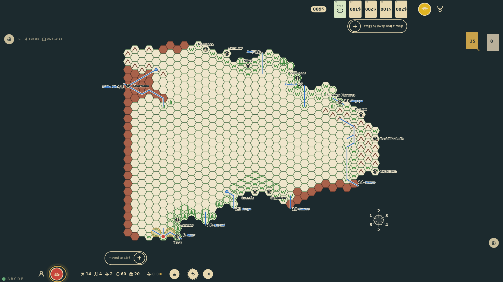
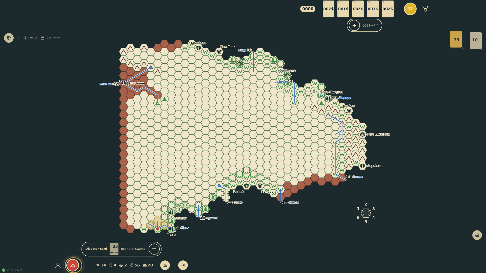
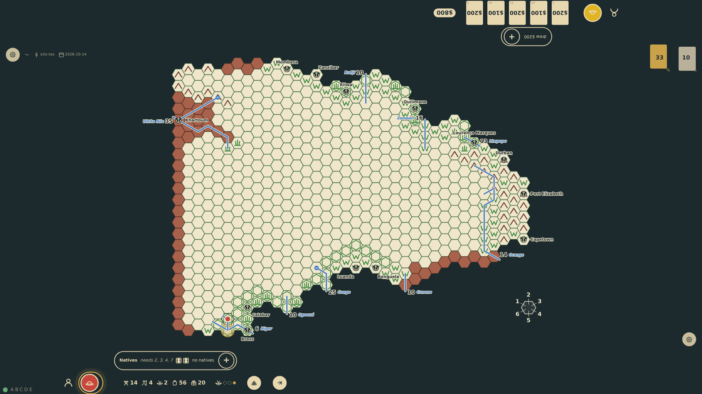

# Mixed movement

The rules give each mode its hexes a turn when all are known and when all are unknown, but not how the two mix. The table gives the mode its known hexes as movement points, a known hex costs one point and an unknown hex two, whatever the mode (RQ-19, prompt 47), so a canoe expedition with four to seven paddlers a canoe paddles three known hexes, or one unknown hex and one known. Up the Niger from Brass: two known hexes leave one point, too few for the blank hex up the Benue; next turn that hex is entered for two points and the canoes come back down to the known junction for the third.

_Generated by the test step helper from `039-mixed-movement.spec.ts`. Do not edit by hand._

## 1. Two known hexes up the Niger from Brass: the rail shows one of three canoe points left, enough for the known hex upstream at one point, not for the blank hex up the Benue, which costs two and is not offered

**Player**

**Verifications:**

- [x] The movement pips show canoe with 1 of 3 points left
- [x] The known Niger hex upstream is offered for one point; the blank Benue hex, costing two, is not
- [x] The state holds a budget of three points with an unknown hex at two, two spent, and the turn not over
- [x] A step into the blank hex sent all the same is refused for want of points

## 2. Next turn at the junction, before any step: the blank hex up the Benue is offered for two points and the known Niger hexes for one each

**Player**

**Verifications:**

- [x] The blank Benue hex costs two points by canoe and is marked unknown; the known hexes up and down the Niger cost one

## 3. The canoes enter the blank hex up the Benue: the lost check following the river upstream finds the way, the hex is mapped as jungle like its neighbour, two of the three points are spent, and the known junction hex behind is offered for the one point left

**Player**

**Verifications:**

- [x] The log shows the lost check found the way and the terrain mapped jungle
- [x] The rail shows 1 of 3 canoe points left and the known junction hex is offered for one point

## 4. The canoes come back down to the junction for the third point: an unknown hex and a known one in the same turn; the movement is spent and the turn can end with the check mark

**Player**

**Verifications:**

- [x] The token stands on the junction with every point spent and no further target; the end-turn control is a plain check mark
