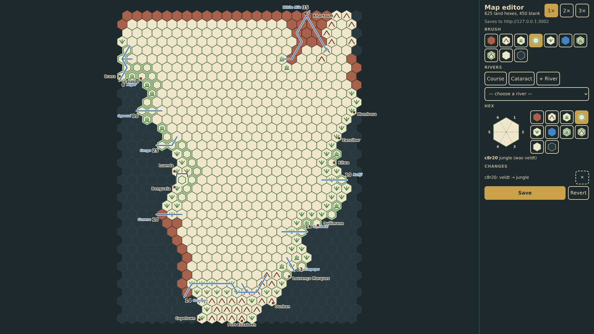
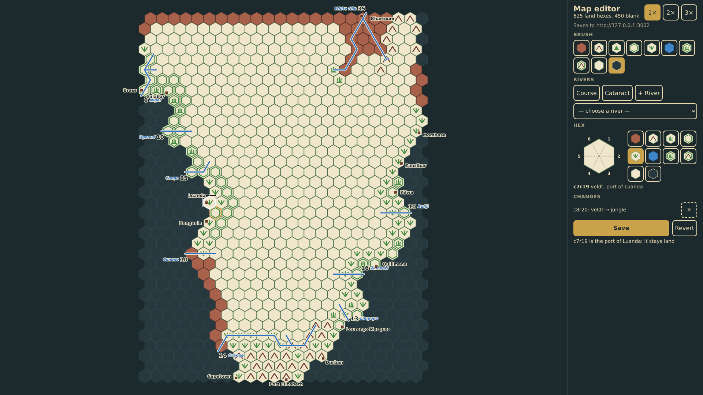
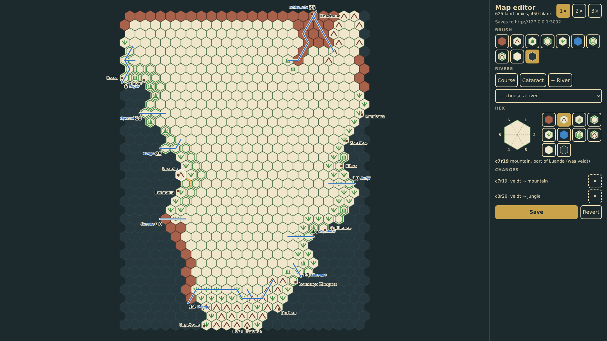
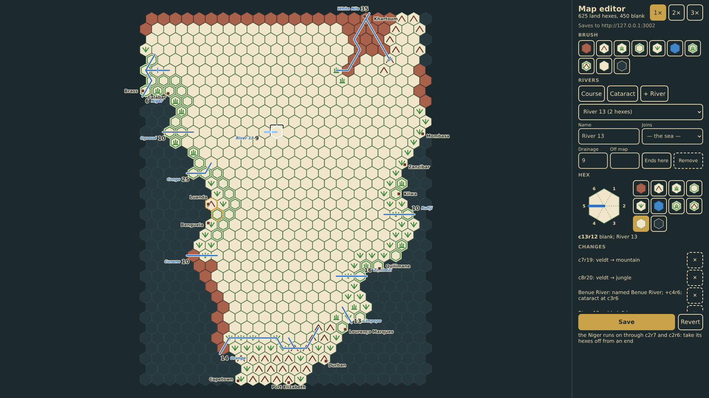
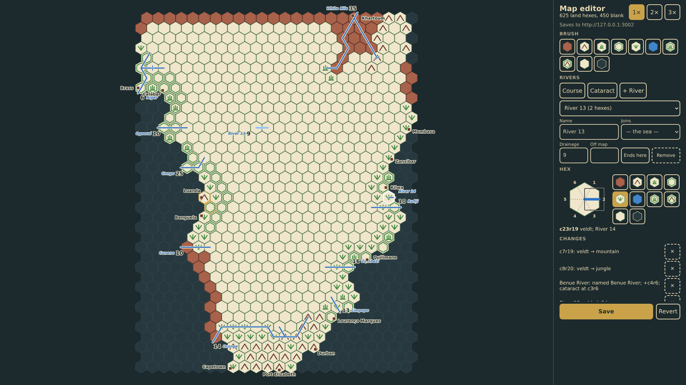
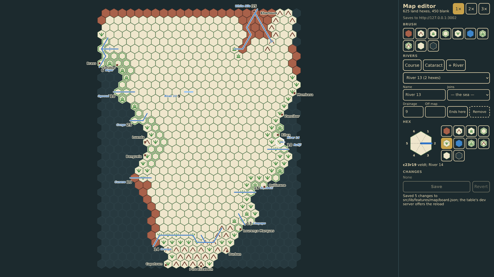

# Map editor

The board was transcribed from a photograph of the 1978 map and some hexes were misread (RQ-5). The map editor at /editor/ is a tool of its own, apart from the table: the board's window drawn north up as the table draws it, with the same symbols, rivers, ports and names (prompt 52), the sea hexes inside the window drawn too, a brush of eight terrains, blank and sea, the rivers listed with a course tool that adds a hex at either end with a tap, a cataract tool and the river's fields, a single hex editor showing the hex tapped with its terrain among the game's symbols, a tap on one changing it, and six spokes, blue where a river leaves it, each a tap to add or clear that river edge, a spoke toward the sea making the hex a river's mouth, the changes listed with a take-back each, and Save sending the whole board to the diagnostics capture server as a save command, which writes board.json in the source tree for the dev server to pick up. A port and a river hex stay land whatever the brush.

_Generated by the test step helper from `040-map-editor.spec.ts`. Do not edit by hand._

## 1. The editor shows the board's window north up, 24 hexes by 36 as the table shows it with no sea beyond the land but an unmarked margin around it for the names at the coast, the sea hexes inside it drawn dark, with the pre-printed terrain, the rivers and the ports named as the game names them; the counts read 625 land hexes and 450 blank, the brushes wait, the capture server is named, and there is nothing to save

**Player**

**Verifications:**

- [x] The window is the land's bounding box, columns 2 to 25 and rows 1 to 36 (prompt 52): no sea north of Khartoum, west of Brass or east of Mombasa; 625 hexes are land and 450 blank (RQ-5); Luanda stands on a veldt hex
- [x] An unmarked margin of about a hex lies around the land (prompt 53), and the names at the coast lie in the sea as they do on the table: Capetown's west of its hex along the bottom row, Port Elizabeth's centred below it, Mombasa's to the east, Brass's to the west
- [x] The ports, rivers and numbers are labelled as the game labels them (prompt 52): the same marks and names, Zanzibar's mark toward the sea, the Niger's 6 at its mouth, the cataract one hatch
- [x] Ten brushes are offered and none is chosen; the server is named; Save is disabled with no change to save

## 2. The jungle brush is chosen and tapped onto c8r20, a veldt hex by Luanda: the hex turns jungle with a dashed outline, the change is listed with a take-back, the hex panel says what it was, and Save is offered

**Player**

**Verifications:**

- [x] c8r20 is jungle now, outlined as changed; the hex panel reads jungle, was veldt
- [x] The change is listed as veldt → jungle with a take-back, the counts hold, and Save is enabled

## 3. The sea brush tapped onto Luanda's hex is refused: a port stays land, the message says so, and the one change stands

**Player**

**Verifications:**

- [x] Luanda's hex keeps its veldt and its port; the message names the port; the changes are still one

## 4. Luanda's hex is still the one chosen: in the hex editor its terrain, veldt, is marked among the game's terrain symbols, and a tap on the mountain symbol changes it on the map at once, the port staying

**Player**

**Verifications:**

- [x] c7r19 is mountain now with its port; the mountain symbol is marked in the hex editor and the change is listed

## 5. The Benue is chosen from the list of rivers and the course tool taken: the hexes a tap would add glow at either end of its course; a tap on c4r6 beyond its inland end adds it, the course is drawn through, and the river is renamed in its fields; the change is listed for the river

**Player**

**Verifications:**

- [x] The Benue's course now runs c2r6, c3r6, c4r6 and is drawn brighter as the chosen river; the next hexes to add glow
- [x] The change list holds the two hexes and the river: renamed and one hex longer

## 6. The cataract tool tapped on c3r6, a hex of the Benue's course, marks a cataract there, drawn on the map and added to the river's change

**Player**

**Verifications:**

- [x] A cataract stands on c3r6 and the river's change says so

## 7. A new river is added and chosen with the course tool in hand: two taps lay its course from c12r12 to c13r12, a drainage number is given, and it joins the list and the changes as added

**Player**

**Verifications:**

- [x] The thirteenth river runs c12r12, c13r12 with drainage 9, drawn with its number at the mouth; the list has thirteen rivers and the changes four

## 8. The hex editor shows c13r12 with six spokes, the one to the west blue where River 13 comes in; a tap on the east spoke leads the river on to c14r12: the spoke turns blue and the course on the map grows at once

**Player**

**Verifications:**

- [x] The hex editor shows spokes 2 and 5 as river, both River 13's; the course on the map runs c12r12, c13r12, c14r12 and the change says three hexes

## 9. The same spoke tapped again clears it: c14r12 comes off the river's end, the spoke is empty and the course on the map is two hexes again

**Player**

**Verifications:**

- [x] Only spoke 5 is river; the course is c12r12, c13r12; a spoke toward the middle of a course is refused with the reason

## 10. On a coastal hex with no river, a tap on the spoke toward the sea starts a river whose mouth is this hex, flowing out to the east: the spoke is blue, and on the map the new river reaches from the hex into the sea

**Player**

**Verifications:**

- [x] River 14 has the one hex c23r19 and its mouth to the east (2); the sea spoke is blue; the change says added, 1 hex

## 11. Save sends the board to the capture server as a save command and the answer is read: the change list empties, the jungle hex and the rivers stay as the board now is, and the message says the file was written

**Player**

**Verifications:**

- [x] The server received one save command for the board with the five changes, the hexes as painted and the rivers as drawn
- [x] Nothing is left to save: the list is empty, Save is disabled, c8r20 stays jungle without the changed outline, the rivers stay, and the message names the file
