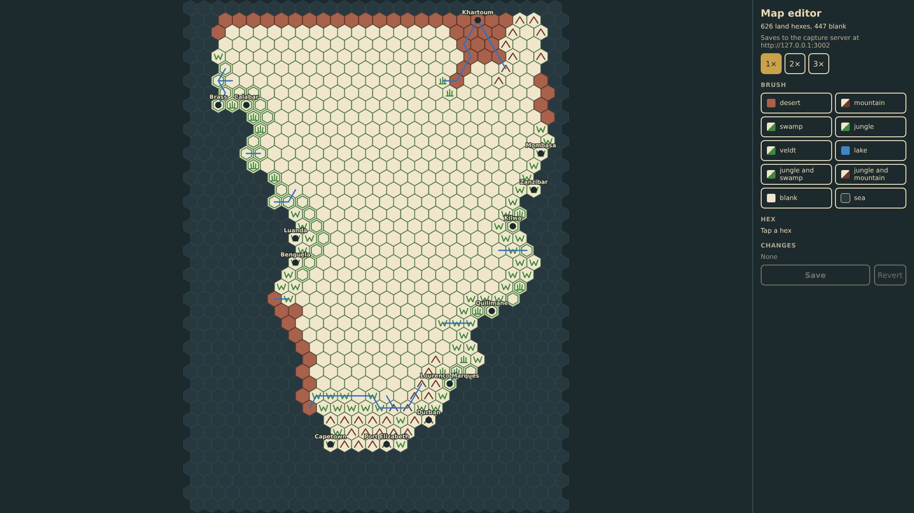
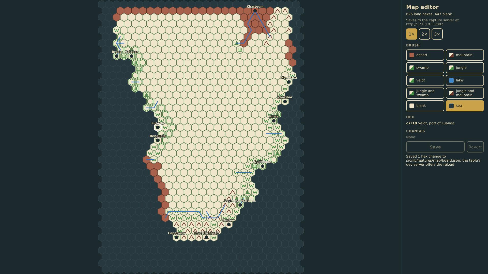

# Map editor

The board was transcribed from a photograph of the 1978 map and some hexes were misread (RQ-5). The map editor at /editor/ is a tool of its own, apart from the table: every hex of the grid drawn north up, sea and land, a brush of eight terrains, blank and sea, the changes listed with a take-back each, and Save sending the whole board to the diagnostics capture server as a save command, which writes board.json in the source tree for the dev server to pick up. A port and a river hex stay land whatever the brush.

_Generated by the test step helper from `040-map-editor.spec.ts`. Do not edit by hand._

## 1. The editor shows the whole 27×42 grid north up, sea and land, with the pre-printed terrain, the rivers and the ports; the counts read 626 land hexes and 447 blank, the brushes wait, the capture server is named, and there is nothing to save

**Player**

**Verifications:**

- [x] Every hex of the grid is drawn; 626 are land and 447 blank (RQ-5); Luanda stands on a veldt hex
- [x] Ten brushes are offered and none is chosen; the server is named; Save is disabled with no change to save

## 2. The jungle brush is chosen and tapped onto c8r20, a veldt hex by Luanda: the hex turns jungle with a dashed outline, the change is listed with a take-back, the hex panel says what it was, and Save is offered

**Player**

**Verifications:**

- [x] c8r20 is jungle now, outlined as changed; the hex panel reads jungle, was veldt
- [x] The change is listed as veldt → jungle with a take-back, the counts hold, and Save is enabled

## 3. The sea brush tapped onto Luanda's hex is refused: a port stays land, the message says so, and the one change stands

**Player**

**Verifications:**

- [x] Luanda's hex keeps its veldt and its port; the message names the port; the changes are still one

## 4. Save sends the board to the capture server as a save command and the answer is read: the change list empties, the jungle hex stays as the board now is, and the message says the file was written

**Player**

**Verifications:**

- [x] The server received one save command for the board with the one change and the hex as painted
- [x] Nothing is left to save: the list is empty, Save is disabled, c8r20 stays jungle without the changed outline, and the message names the file
